# 📘 TEMA 2 · PART COMUNA (COS SUPERIOR, A1)

## Governança de les dades a l'administració digital · Característiques de les dades · L'administració digital · Model d'administració digital a Catalunya i principals actors en el desenvolupament de l'administració digital · Règim jurídic de l'administració digital i de l'ús de mitjans electrònics

> **Data de revisió normativa:** octubre de 2026
> **Llegenda:** 🔑 Clau d'examen · ⚖️ Base normativa · 🔄 Actualitzat respecte de normativa anterior · ➕ Contingut ampliat · ⚠️ Pendent de verificació en font oficial · ✅ Text contrastat amb font oficial · ❌ Derogat o sense vigència · 📊 Esquema gràfic
>
> **Nota sobre els esquemes:** els diagrames estan escrits en **Mermaid**. Es visualitzen com a gràfics a GitHub, Obsidian, Typora, Notion, VS Code (amb l'extensió de Mermaid) i a qualsevol app que integri la llibreria `mermaid.js`. En un visor que no l'admeti, es veu el codi del diagrama; el text que l'acompanya explica el mateix contingut.
>
> **Nota sobre els textos traduïts:** els preceptes de la Llei 39/2015, la Llei 40/2015, el RD 203/2021, el RD 311/2022, el RD 4/2010, el Reglament (UE) 2022/868 i la Decisió (UE) 2022/2481 s'han contrastat amb el text oficial en castellà i es reprodueixen traduïts al català.

---

## 🗺️ Índex

1. [Marc normatiu](#1-marc-normatiu)
2. [Governança de les dades a l'administració digital](#2-governança-de-les-dades-a-ladministració-digital)
3. [Característiques de les dades](#3-característiques-de-les-dades)
4. [L'administració digital](#4-ladministració-digital)
5. [Model d'administració digital a Catalunya](#5-model-dadministració-digital-a-catalunya)
6. [Principals actors en el desenvolupament de l'administració digital](#6-principals-actors-en-el-desenvolupament-de-ladministració-digital)
7. [Règim jurídic de l'administració digital i de l'ús de mitjans electrònics](#7-règim-jurídic-de-ladministració-digital-i-de-lús-de-mitjans-electrònics)
8. [Quadre resum i autoavaluació](#8-quadre-resum-i-autoavaluació)
9. [Taula de correccions normatives](#9-taula-de-correccions-normatives)

### 📊 Mapa del tema

El mapa mostra els cinc blocs de l'enunciat del tema i els conceptes principals de cada bloc. Serveix per situar-se abans d'estudiar i per repassar al final: cada branca correspon a un apartat del document.

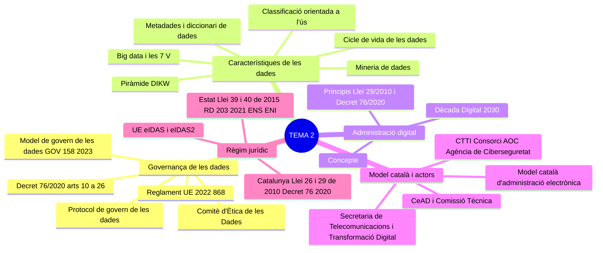

---

## 1. Marc normatiu

| Àmbit | Norma | Preceptes clau |
|---|---|---|
| **Administració digital (Generalitat)** | **Decret 76/2020, de 4 d'agost**, d'Administració digital (DOGC núm. 8195, de 6.8.2020), modificat pel **Decret 253/2025, de 25 de novembre** (DOGC núm. 9551, de 27.11.2025) | Art. **2** (àmbit) · art. **4** (principis) · arts. **5 a 9** (governança) · **títol II, capítol I** (arts. **10 a 26**, govern de les dades) · **títol III** (règim jurídic) |
| **Ús dels mitjans electrònics (sector públic de Catalunya)** | **Llei 29/2010, del 3 d'agost**, de l'ús dels mitjans electrònics al sector públic de Catalunya | Arts. **1 a 7** (objecte, àmbit, finalitats, **principis**, **model català d'administració electrònica**, Consorci AOC) · arts. **19** i **21** |
| **Règim jurídic i procediment (Catalunya)** | **Llei 26/2010, del 3 d'agost**, de règim jurídic i de procediment de les administracions públiques de Catalunya (modificada per la **Llei 9/2025, de 13 de novembre**) | Arts. **21.3-4** (canals i cita prèvia) · art. **24** (dret a l'ús dels mitjans electrònics) · **DA 16a** (signatura electrònica no avançada) |
| **Model de govern de les dades** | **Acord GOV/158/2023, de 25 de juliol** (DOGC núm. 8967, de 27.7.2023) | Annex: objectius, eixos, estratègia, organització, àmbits d'actuació |
| **Ètica de les dades** | **Acord GOV/6/2021, de 19 de gener**, pel qual es crea el Comitè d'Ètica de les Dades (DOGC núm. 8322, de 21.1.2021) | Punts **1 a 6** |
| **Òrgans col·legiats estratègics** | **Decret 228/2019, de 5 de novembre**, dels òrgans col·legiats estratègics de l'àmbit de l'administració digital, dels empleats públics i de la supervisió i governança de les entitats del sector públic institucional de l'Administració de la Generalitat (modificat pel **Decret 166/2025, de 29 de juliol**) | Arts. **1 a 8** (CeAD i Comissió Tècnica del CeAD) |
| **Organització** | **Decret 105/2025, de 27 de maig**, de reestructuració del Departament de la Presidència | Art. **1.2.5** (ens adscrits) · arts. **80, 81, 85, 91 a 95** |
| **Procediment administratiu comú (Estat, bàsica)** | **Llei 39/2015, d'1 d'octubre**, del procediment administratiu comú de les administracions públiques | Arts. **9 a 14**, **16**, **26 a 28**, **41**, **43**, **70** · **DF 7a** |
| **Règim jurídic del sector públic (Estat, bàsica)** | **Llei 40/2015, d'1 d'octubre**, de règim jurídic del sector públic | Art. **3.2** · arts. **38 a 46 bis** · arts. **155 a 158** |
| **Reglament de mitjans electrònics (Estat)** | **Reial decret 203/2021, de 30 de març**, pel qual s'aprova el Reglament d'actuació i funcionament del sector públic per mitjans electrònics (modificat pel **RD 255/2025, d'1 d'abril**) | Arts. **1 a 3** · **DF 1a** (caràcter bàsic) |
| **Seguretat (Estat)** | **Reial decret 311/2022, de 3 de maig**, pel qual es regula l'Esquema Nacional de Seguretat (**ENS**) | Arts. **1**, **5**, **12**, **40** |
| **Interoperabilitat (Estat)** | **Reial decret 4/2010, de 8 de gener**, pel qual es regula l'Esquema Nacional d'Interoperabilitat (**ENI**) | Arts. **1**, **4 a 6** |
| **Identificació electrònica i serveis de confiança (UE)** | **Reglament (UE) núm. 910/2014**, de 23 de juliol de 2014 (**eIDAS**), modificat pel **Reglament (UE) 2024/1183**, d'11 d'abril de 2024 (**eIDAS2**) | Cartera europea d'identitat digital |
| **Governança de dades (UE)** | **Reglament (UE) 2022/868**, de 30 de maig de 2022, relatiu a la governança europea de dades (*Data Governance Act*) | Arts. **1** i **2** |
| **Dècada Digital (UE)** | **Decisió (UE) 2022/2481**, de 14 de desembre de 2022, per la qual s'estableix el programa estratègic de la Dècada Digital per a 2030 | Art. **4** (metes digitals) |

> 🔄 **Canvis normatius rellevants per a aquest tema:**
> - **Decret 253/2025, de 25 de novembre**: modifica el Decret 76/2020 en matèria d'**atenció ciutadana** (arts. 37, 39, 40, 41 i 42, disposicions addicionals setena i vuitena i annexos 1 i 2) i deroga la disposició addicional sisena i la disposició transitòria cinquena del Decret 76/2020 i l'Ordre PRE/17/2023, de 3 de febrer. Entra en vigor als vint dies de la publicació al DOGC. No modifica el govern de les dades (arts. 10 a 26).
> - **Decret 166/2025, de 29 de juliol**, de la primera fase de supressió de diversos òrgans col·legiats de l'Administració de la Generalitat: ❌ **deroga els arts. 9 i 10 del Decret 228/2019** i suprimeix la **Comissió de Desplegament de l'Administració Digital (CodAD)**. Modifica també els arts. 1.1, 3.2 i 4.1 del Decret 228/2019.
> - **Llei 9/2025, de 13 de novembre**: nova redacció de l'**art. 21 de la Llei 26/2010**, que incorpora l'apartat 4: *la cita prèvia no pot ser obligatòria en cap cas*.
> - **Acord GOV/158/2023**: aprova el **Model de govern de les dades** previst a l'art. 10.3 del Decret 76/2020.
> - **Reial decret 311/2022**: ❌ deroga el **Reial decret 3/2010** (ENS anterior).
> - **Reial decret 203/2021**: ❌ deroga el **Reial decret 1671/2009**. El **RD 255/2025** modifica els arts. 27.1 i 28.1.
> - **Reglament (UE) 2024/1183 (eIDAS2)**: modifica el Reglament eIDAS i crea la **cartera europea d'identitat digital**.
> - **Decret 105/2025**: les competències d'administració digital, dades i transformació digital s'exerceixen per mitjà de la **Secretaria de Telecomunicacions i Transformació Digital** del **Departament de la Presidència**.

---

## 2. Governança de les dades a l'administració digital

### 2.1 La dada com a actiu de l'organització

La dada és l'element bàsic que dona lloc a la informació i al coneixement. És l'anomenat **capital informacional** d'una organització, que s'utilitza per prendre les decisions més adequades per seguir funcionant de manera eficaç i eficient.

Gestionar les dades és el que s'anomena **governar les dades**, i d'aquí surt el concepte de **governança de les dades**, que ha tingut dos models:

| Model | Característiques |
|---|---|
| **Estàtic o clàssic** | Les dades s'acumulen en forma de documents als arxius, amb una classificació unívoca i unilateral. |
| 🔑 **Dinàmic** (sistema actual) | Les dades guanyen valor quan, a més de conservar-les (pròpia del model estàtic), es posen a disposició de la ciutadania, cosa que n'incrementa el valor. |

En la situació anterior hi havia el **"desgovern de les dades"**: es demanava una mateixa dada moltes vegades, amb aquests efectes negatius:
- La mateixa dada tenia significats diferents.
- Les veia qui no calia i no les veia qui les necessitava.
- No se'n podia extreure coneixement.

Davant d'aquests fets, el **Decret 76/2020, de 4 d'agost, d'Administració digital**, regula el govern de les dades com un model propi que, més enllà de la gestió documental digital, permet crear **nous serveis digitals analítics i predictius** que milloren contínuament la prestació dels serveis públics.

🔑 **Govern de les dades:** conjunt de principis i mesures adoptades per una organització per assegurar la **qualitat, la disponibilitat i la seguretat** de les seves dades en tot el **cicle de vida**.
> ⚠️ Definició de l'**annex 2 (glossari) del Decret 76/2020**: no s'ha pogut contrastar amb el text oficial de l'annex.

🔑 **Beneficis del govern de les dades:**
- Només cal una **aportació única** de les dades.
- Millora les actuacions administratives.
- Impulsa la presa de decisions.
- Fa efectiu el **dret de la ciutadania a saber quines dades seves té l'Administració**.

> 💡 El Model de govern de les dades (Acord GOV/158/2023) ho expressa així: *el govern de les dades es basa en la gestió eficient de les dades per optimitzar la forma de treballar, evitar duplicitats i prioritzar la compartició de la informació en tota l'organització, cosa que facilitarà el canvi de relació amb la ciutadania vers un model més proactiu i personalitzat.*

### 2.2 El govern de les dades al Decret 76/2020

⚖️ El govern de les dades es regula al **capítol I del títol II** (Serveis digitals) del Decret 76/2020, **articles 10 a 26**, organitzat en quatre seccions.

📊 **Esquema de l'estructura del capítol I del títol II.** El diagrama mostra les quatre seccions i els articles de cadascuna: la secció 1 regula el model i el protocol; la secció 2, l'intercanvi de dades i la interoperabilitat; la secció 3, el Catàleg corporatiu de processos; i la secció 4, els actius digitals i la gestió arxivística.

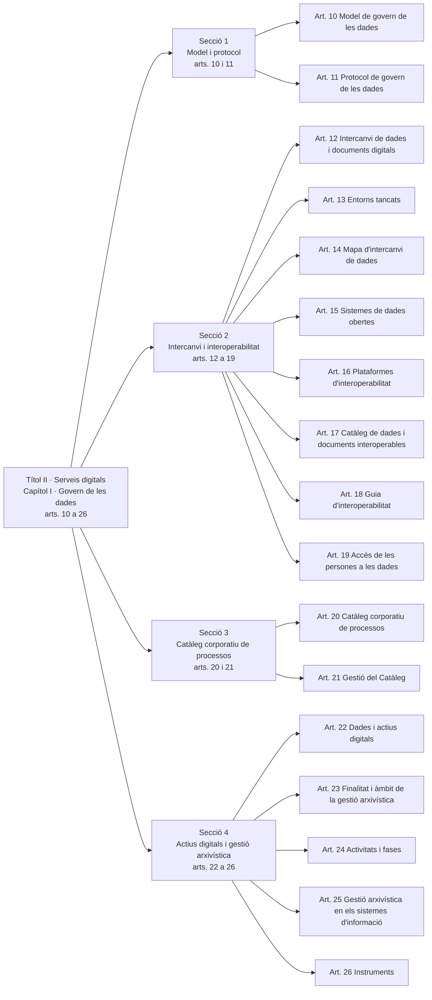

### 2.3 El model de govern de les dades (art. 10)

⚖️ **Art. 10.1:** 🔑 l'Administració de la Generalitat estableix un **model de govern de les dades**, que és l'**instrument organitzatiu** que determina els criteris i els elements que defineixen el govern de les dades a l'Administració de la Generalitat. El model es desplega mitjançant un **protocol** que recull els aspectes tècnics i organitzatius necessaris per implantar-lo.

⚖️ 🔑 **Criteris del model (art. 10.2):**

| Lletra | Criteri |
|:-:|---|
| **a** | Les dades són un **actiu digital** compartit per l'Administració de la Generalitat i el seu sector públic, i se n'ha de **maximitzar la reutilització**. |
| **b** | És un **model comú** que s'adapta a les necessitats específiques de cada cas, amb la **participació corresponsable** de totes les unitats implicades. |
| **c** | Inclou **totes les dades fonamentals** i totes les dades de les **àrees de gestió sectorials**, segons el principi de proporcionalitat. |
| **d** | Es fonamenta en **estàndards** que garanteixen l'**homogeneïtat semàntica i sintàctica** de les dades: les dades tenen el mateix significat per a totes les unitats i òrgans de l'Administració, i s'ordenen i es relacionen entre si de la mateixa manera. |
| **e** | Les dades comuniquen la informació de manera **clara i concisa** i proporcionen informació significativa per facilitar la presa de decisions. |
| **f** | Criteri de **dada única**: col·laboració entre els òrgans i sistemes que custodien una mateixa dada i identificació unívoca de la font més fiable. |
| **g** | **Seguretat de les dades**: se'n gestionen l'alta, la modificació, la consulta i la supressió de manera segura i amb **traçabilitat** (possibilitat de conèixer el procés que ha seguit la dada des de l'inici), autenticitat, integritat, confidencialitat, privacitat i disponibilitat. |

⚖️ **Aprovació (art. 10.3):** 🔑 el **Govern**, a proposta de la persona titular del departament competent, aprova el model de govern de les dades. ➡️ Aprovat per l'**Acord GOV/158/2023, de 25 de juliol** (vegeu l'apartat 2.7).

⚖️ **Art. 10.4:** el model s'estableix d'acord amb els principis i requeriments de la normativa de **protecció de dades**, **transparència i accés a la informació pública** i **estadística**, i garanteix la **interoperabilitat** i la **reutilització** de les dades.

> 💡 **Interoperabilitat:** capacitat dels sistemes d'informació, i dels procediments als quals donen suport, de compartir dades i possibilitar l'intercanvi d'informació, coneixement, documents i dades entre si. L'art. 2.d del RD 203/2021 la defineix en termes equivalents (vegeu l'apartat 7.3.3).

⚖️ **Obligacions dels subjectes de l'art. 2 respecte del model (art. 10.5):**
- a) Garantir el compliment del model.
- b) 🔑 Garantir que les persones puguin saber **quines dades seves té l'Administració**, l'ús que en fa i els tractaments corresponents.
- c) Promoure la millora de les actuacions administratives basada en l'ús de tecnologies avançades de gestió i tractament de dades.
- d) Fomentar l'ús de les dades per prestar a les persones **serveis proactius i personalitzats**.

### 2.4 El protocol de govern de les dades (art. 11)

⚖️ 🔑 El **protocol** és el document que desplega el model de govern de les dades i en recull els aspectes tècnics i organitzatius necessaris per implantar-lo.

🔑 **Contingut mínim (art. 11.1) — 9 elements:**

| Lletra | Element | En què consisteix |
|:-:|---|---|
| **a** | **Rols i responsabilitats** | De les persones i els organismes que intervenen en el model de gestió de les dades. |
| **b** | **Qualitat de les dades** | Esquema organitzatiu i tecnològic necessari perquè les dades tinguin la fiabilitat adequada als seus usos. |
| **c** | **Cicle de vida de les dades** | Organització de la seqüència de passos que fa una dada, des que es genera o es captura fins que eventualment s'arxiva o s'elimina, amb les unitats que intervenen en cada pas i les operacions que executen. |
| **d** | **Modelització i arquitectura de les dades** | Identificació i definició de les dades necessàries per a un àmbit determinat i la seva relació amb el conjunt de dades de l'Administració; requeriments perquè la infraestructura lògica i física garanteixi la disponibilitat de les dades allà on calgui (**principi de dada única**). |
| **e** | **Seguretat** | Mecanismes que garanteixen que a cada dada només hi accedeixen les persones autoritzades. |
| **f** | **Metadades** | Propietats que cal definir per a cada dada per garantir-ne la gestió correcta al llarg de tot el cicle de vida. |
| **g** | **Catàleg de dades** | Document que integra el mapa d'intercanvi de dades i el catàleg de dades i documents interoperables. |
| **h** | **Analítica de les dades** | Mecanismes de coordinació entre les unitats que impulsen actuacions de tractament massiu de dades, intel·ligència artificial o anàlisi de dades. |
| **i** | **Sistemes d'avaluació i seguiment** | Del model de govern de les dades. |

⚖️ **Aprovació (art. 11.2):** 🔑 la **persona titular del departament competent**, que ha de garantir la participació dels organismes responsables del desplegament.

> ⚠️ **Model ≠ protocol:** el **model** l'aprova el **Govern** (art. 10.3) i fixa els criteris; el **protocol** l'aprova el **conseller o consellera** competent (art. 11.2) i desplega el model en els aspectes tècnics i organitzatius.

### 2.5 Intercanvi de dades i interoperabilitat (arts. 12 a 19)

L'intercanvi de dades i documents digitals entre els subjectes de l'Administració de la Generalitat i el seu sector públic, o amb la resta d'administracions públiques, és un **element clau del model de govern de les dades**.

| Article | Contingut |
|---|---|
| ⚖️ **Art. 12. Intercanvi de dades i documents digitals** | Les dades i els documents en poder dels subjectes del Decret s'utilitzen per fer les actuacions que preveu, al servei de l'interès públic i amb respecte als drets de les persones. L'intercanvi amb altres administracions es fa mitjançant els **sistemes i plataformes establerts** amb aquesta finalitat i altres sistemes d'interconnexió de **bases de dades distribuïdes** (conjunt de bases de dades situades en diferents espais lògics i geogràfics interconnectades a través d'una xarxa informàtica), d'acord amb la normativa de **ciberseguretat** i de **protecció de dades personals**. El departament competent en fixa les condicions i garanties, i també la cooperació necessària perquè l'**òrgan estadístic de la Generalitat** accedeixi a les dades per a l'ús estadístic que preveu la normativa. |
| ⚖️ **Art. 13. Intercanvi en entorns tancats** | El departament competent fixa les condicions de l'intercanvi en **entorns tancats de comunicació**. L'intercanvi amb la resta del sector públic de Catalunya es regeix per **conveni**. 🔑 Les dades comunicades en aquests entorns es consideren **vàlides a l'efecte d'identificació i autenticació** dels emissors i receptors. (Vegeu també l'**art. 44 de la Llei 40/2015**.) |
| ⚖️ **Art. 14. Mapa d'intercanvi de dades** | 🔑 L'Administració de la Generalitat ha d'aprovar un **mapa d'intercanvi de dades** per facilitar la localització i l'accés a les dades. Contingut mínim: **l'organisme titular** de les dades i els documents, i **les condicions, els protocols i els criteris funcionals i tècnics** per accedir-hi digitalment. Ha de ser **interoperable** amb altres catàlegs de naturalesa similar d'altres administracions. |
| ⚖️ ➕ **Art. 15. Sistemes de dades obertes** | Si escau, els sistemes d'intercanvi de dades s'han d'interconnectar amb els **sistemes de dades obertes**, en les condicions que fixi l'òrgan competent en matèria de transparència i dades obertes. |
| ⚖️ **Art. 16. Plataformes d'interoperabilitat** | El departament competent, mitjançant l'**ens responsable de les solucions tecnològiques**, posa a disposició les **plataformes d'intermediació** i el suport necessari per als serveis d'interoperabilitat. Els serveis d'interoperabilitat amb altres administracions i institucions s'han de fer per mitjà d'aquestes plataformes. 🔑 Les dades que s'hi intercanvien han de tenir garantides l'**autenticitat, la confidencialitat, la integritat, la disponibilitat i la traçabilitat**. |
| ⚖️ **Art. 17. Catàleg de dades i documents interoperables** | 🔑 Relació de les dades i els documents en poder dels subjectes del Decret i d'altres administracions que es poden obtenir mitjançant plataformes segures. Serveix perquè les persones exerceixin el **dret a no aportar documents** que ja tingui qualsevol administració. Es pot consultar a la **seu electrònica** de la Generalitat. 🔑 S'integra al **Catàleg de dades i documents interoperables de Catalunya**, que gestiona el **Consorci AOC**. El gestiona i el manté el departament competent. |
| ⚖️ **Art. 18. Guia d'interoperabilitat** | 🔑 La persona titular del departament competent aprova **per ordre** la **Guia d'interoperabilitat**, que fixa el procediment per requerir dades i documents i incorporar-los al Catàleg, i les directrius corporatives en matèria d'interoperabilitat. |
| ⚖️ **Art. 19. Accés de les persones a les dades** | Els subjectes del Decret han d'obrir **per defecte** les dades que tenen, incloses les que provenen d'altres subjectes obligats, i facilitar mecanismes perquè les persones hi accedeixin, excepte les dades la publicació de les quals estigui prohibida legalment. Les persones accedeixen a les **seves dades** pels sistemes que posi a disposició cada administració, pels serveis d'interoperabilitat o per altres canals, com ara les carpetes personals o el punt d'accés general. |

> 💡 **Plataforma d'intermediació:** eina tecnològica que permet que una administració consulti les dades de les persones que té una altra administració, de manera que les persones interessades en un procediment no hagin d'aportar documentació o dades que ja van aportar a una altra administració o que ja són en poder seu.

📊 **Esquema del dret a no aportar dades.** El diagrama segueix el recorregut d'una sol·licitud: la persona no aporta un document que ja té l'Administració; l'òrgan tramitador consulta el Catàleg per saber si la dada és interoperable i la recapta per mitjà de la plataforma d'intermediació, que garanteix la seguretat de la transmissió. Si no la pot obtenir, excepcionalment la demana a la persona (art. 28.3 Llei 39/2015).

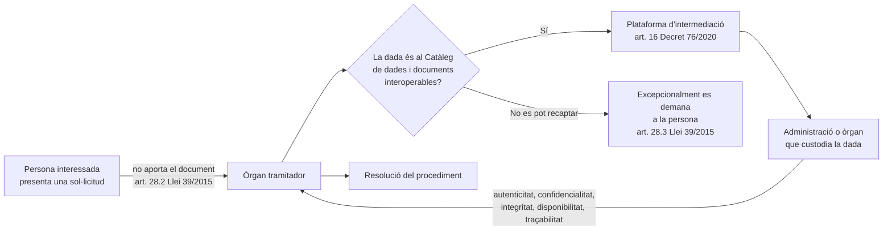

### 2.6 Catàleg corporatiu de processos i actius digitals (arts. 20 a 26)

#### a) Catàleg corporatiu de processos (arts. 20 i 21) ➕

- ⚖️ **Art. 20:** el **Catàleg corporatiu de processos** és el sistema d'informació corporatiu per gestionar, racionalitzar i normalitzar la informació sobre els **processos i serveis** dels subjectes del Decret. Inclou tant els **serveis externs** (adreçats a les persones o a altres administracions) com els **interns** (adreçats a la mateixa organització).
- ⚖️ **Art. 21:** els subjectes del Decret han d'incorporar al Catàleg tota la informació dels seus processos i serveis i mantenir-la actualitzada. El **gestiona** el departament competent.

#### b) Dades i actius digitals (art. 22) ➕

- 🔑 **Actiu digital:** la dada o informació obtinguda o generada en l'exercici de les funcions dels subjectes del Decret, que s'ha de documentar i conservar durant un temps determinat. Inclou arxius de dades, imatges, sons, text i multimèdia, i també els documents administratius: qualsevol tipus de dada o de representació d'informació.
- Els actius digitals es generen, gestionen o conserven en els **sistemes de gestió de dades i de documents**, el **web corporatiu**, la **seu electrònica** i els **comptes i perfils a les xarxes socials** dels subjectes del Decret, d'acord amb la normativa de gestió documental i arxiu.

#### c) Gestió arxivística (arts. 23 a 26) ➕

- ⚖️ **Finalitat (art. 23):** assegurar la creació, la captura i la gestió d'informació **autèntica, fiable, utilitzable i íntegra**. Abasta els documents públics digitals, les dades dels sistemes d'informació corporatius i altres actius digitals, i en garanteix la conservació durant el temps necessari per a la finalitat per a la qual es van generar o incorporar.
- ⚖️ **Activitats i fases (art. 24):** abans de les fases, es fa una **avaluació de la informació digital** (anàlisi i valoració).
- ⚖️ **Sistemes d'informació (art. 25):** han de garantir les polítiques de gestió arxivística de les dades i els actius digitals.
- ⚖️ **Instruments (art. 26):** els estableix el departament competent en **gestió documental i arxiu** i s'apliquen en els sistemes i plataformes de gestió, corporatius i no corporatius.

📊 **Esquema de les fases de la gestió arxivística (art. 24).** Abans de començar, s'avalua la informació digital. La fase activa dura des que es crea la informació fins que s'acaba el tràmit; la semiactiva, mentre els documents conserven valor provatori de drets i deures; i la inactiva o històrica separa la informació amb valor permanent, que es conserva, de la resta, que es destrueix segons la normativa.

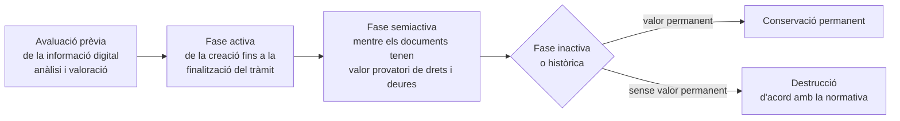

### 2.7 ➕ El Model de govern de les dades de l'Administració de la Generalitat (Acord GOV/158/2023)

⚖️ **Acord GOV/158/2023, de 25 de juliol**, pel qual s'aprova el Model de govern de les dades de l'Administració de la Generalitat de Catalunya i del seu sector públic (DOGC núm. 8967, de 27.7.2023). ✅ Text contrastat amb el DOGC.

- Aprovat pel **Govern** en compliment de l'**art. 10.3 del Decret 76/2020**.
- 🔑 És aplicable als **subjectes de l'art. 2 del Decret 76/2020**.
- *Les dades esdevenen la força de canvi de l'Administració digital.*

#### a) Objectius fonamentals (apartat 2) — 11 objectius

| Lletra | Objectiu |
|:-:|---|
| a | Establir un **model comú** que s'adapti a les necessitats específiques de cada cas, amb la participació corresponsable de totes les unitats implicades des que les dades es recullen, es processen i s'emmagatzemen fins que s'arxiven o eliminen. |
| b | Implementar la **gestió basada en dades**, a partir de l'adopció d'estàndards que garanteixen l'homogeneïtat semàntica i sintàctica de les dades i la traçabilitat dels termes de negoci. |
| c | Garantir el criteri de **dada única** a través de la col·laboració entre els òrgans i sistemes que custodien una mateixa dada i la identificació unívoca de la font més fiable, si escau, en origen. |
| d | Garantir l'**accés** a les dades seguint els estàndards de **seguretat i privacitat**. |
| e | Determinar les **responsabilitats** necessàries per a una gestió eficaç de les dades. |
| f | Determinar les condicions i garanties de l'**intercanvi de dades en entorns tancats** de comunicació, mitjançant un sistema tecnològic per al consum i l'intercanvi de dades governades. |
| g | **Maximitzar la reutilització** de les dades, com a actiu digital que són. |
| h | Definir els **principis ètics** en tot el cicle de vida de les dades, inclosos els usos d'analítica avançada, i garantir-ne el compliment; assegurar que es disposa de dades amb la qualitat, consistència, cobertura i granularitat necessàries. |
| i | Garantir que les persones tinguin accés a saber **quines dades seves** tenen l'Administració i el seu sector públic, l'ús que en fan i els tractaments corresponents. |
| j | Promoure la millora de les actuacions administratives basada en l'ús de **tecnologies avançades** de gestió i analítica de dades. |
| k | Facilitar la **presa de decisions basada en dades**. |

#### b) Quatre eixos i tres puntals

📊 **Esquema dels eixos i els puntals del model.** Els **quatre eixos** són els fonaments de les actuacions necessàries per desplegar el model. Els **tres puntals** (persones, processos i tecnologia) són la base de l'estratègia de govern de les dades.

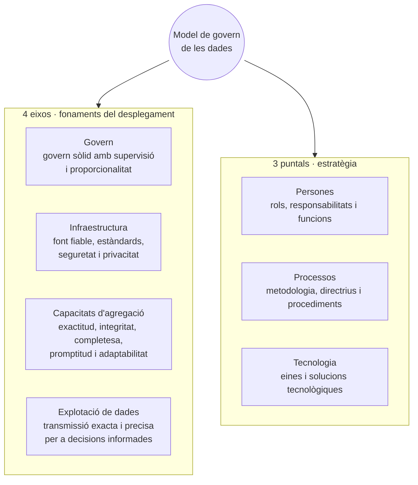

🔑 **Els quatre eixos:**
- **Govern:** promoure un govern sòlid mantenint alhora una supervisió i un principi de proporcionalitat.
- **Infraestructura:** establir una infraestructura amb una font fiable, que compleixi els estàndards i garanteixi la seguretat i la privacitat de les dades.
- **Capacitats d'agregació:** assegurar l'exactitud, la integritat, la completesa, la promptitud i l'adaptabilitat de les dades.
- **Explotació de dades:** garantir que les dades es transmeten de manera exacta i precisa, cobreixen totes les àrees significatives i faciliten una presa de decisions informada.

🔑 **Els tres puntals de l'estratègia:**
- **Persones:** estructura organitzativa basada en rols, responsabilitats i funcions.
- **Processos:** metodologia de treball amb les directrius i els procediments de gestió i aprovació per introduir, transformar i recollir les dades.
- **Tecnologia:** solucions tecnològiques per automatitzar l'assignació de rols, l'aprovació d'operacions, l'accés a la informació, la ciberseguretat, el control de la qualitat, l'intercanvi, la reutilització i els usos avançats d'analítica.

#### c) Model de relació federal centralitzat (DAMA)

🔑 El model es defineix com un **model federal centralitzat**, d'acord amb els models de govern de la dada de la metodologia **DAMA Internacional** (*Data Management Association*). Hi ha dues funcions principals:

📊 **Esquema del model federal centralitzat.** Les **funcions centrals** defineixen l'estratègia i la traslladen a solucions corporatives; les **funcions federals** són als departaments i al seu sector públic, que despleguen el govern de les dades en el seu àmbit sectorial seguint el model i les directrius centrals, i hi retornen informació, incidències i millores.

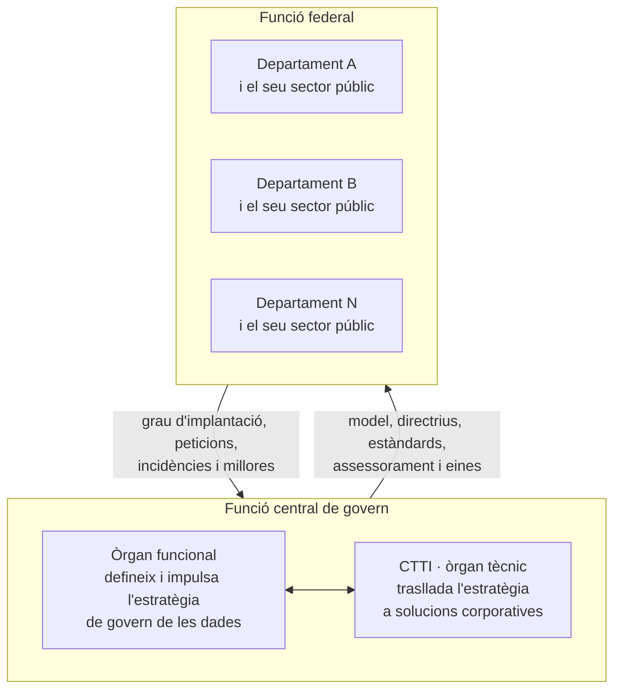

- **Funcions centrals (apartat 4.1.1):** s'atribueixen a la **Direcció General d'Administració Digital (DGAD)**, com a òrgan funcional responsable de definir i impulsar l'estratègia, i al **CTTI**, com a òrgan tècnic responsable de traslladar-la a l'àmbit tecnològic en solucions corporatives. Entre les responsabilitats de la DGAD: alinear l'estratègia amb les competències transversals (transparència, dades obertes, estadística oficial, protecció de dades, ciberseguretat, atenció ciutadana, arxiu i gestió documental i ètica de les dades); coordinar la implementació; assessorar; evitar sitges o duplicitats; definir estàndards; impulsar solucions d'**intel·ligència artificial i analítica avançada**; elevar consultes al **Comitè d'Ètica de les Dades**; promoure el canvi cultural; impulsar els comitès de govern de les dades. El CTTI alinea l'estratègia de govern de les dades amb l'estratègia tecnològica corporativa, dota els departaments de les solucions tecnològiques i defineix la normativa tècnica.
- **Funcions federals (apartat 4.1.2):** els **departaments i el seu sector públic** aporten coneixement funcional i tècnic sobre els dominis de dades que gestionen, coordinen la implementació en el seu àmbit i n'informen, gestionen els grups de treball departamentals multidisciplinaris, eleven peticions o incidències i comparteixen millores.

> ⚠️ **Nota sobre la DGAD:** l'Acord GOV/158/2023 atribueix les funcions centrals a la **Direcció General d'Administració Digital**. Aquesta direcció general **no figura a l'estructura vigent** del Departament de la Presidència (Decret 105/2025). L'Acord no s'ha modificat. Segons el Decret 105/2025, la funció de *planificar, impulsar, definir, coordinar i desenvolupar el Model de govern de les dades* correspon a la **Subdirecció General de Dades i Innovació Digital a l'Administració** (art. 92.1.i), que depèn de la **Direcció General d'Intel·ligència Artificial, Eficiència i Dades a l'Administració** (art. 91.2).

#### d) Rols i responsabilitats (apartat 4.2) — 7 rols

📊 **Esquema dels rols.** El model distingeix quatre rols dels **àmbits funcionals** i tres dels **àmbits tecnològics**.

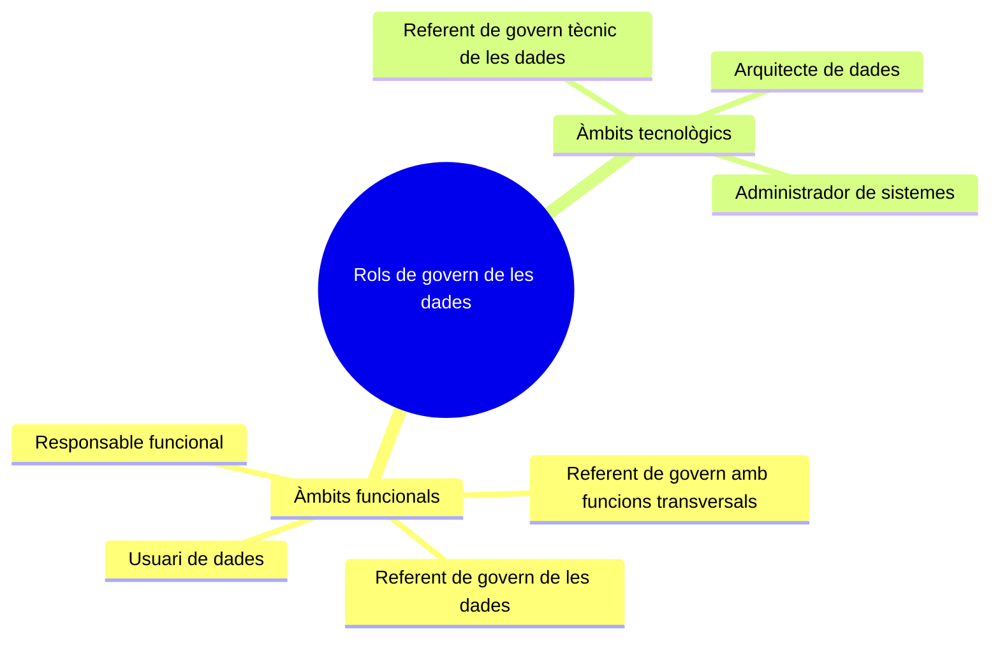

| Àmbit | Rol | 🔑 Responsabilitat |
|---|---|---|
| Funcional | **Referent de govern de les dades** | Coneix els processos, les dades i els principis del govern; té una **visió transversal** del departament i del sector públic; vetlla perquè es compleixin les directrius i els estàndards en tot l'àmbit departamental; és el **nexe amb els òrgans de les funcions centrals**. |
| Funcional | **Referent de govern amb funcions transversals** | Coneix els processos, les dades i els principis de govern d'un **àmbit transversal** del qual és competent; garanteix el compliment de la seva normativa específica i es coordina amb els referents departamentals. |
| Funcional | **Responsable funcional** | Perfil **operatiu** amb coneixement profund del seu àmbit de negoci; s'assegura que les dades del seu domini es defineixen i es gestionen correctament. |
| Funcional | **Usuari de dades** | Consumidors i gestors de dades (consum per a l'activitat operativa, anàlisi, models analítics, informes i quadres de comandament); eleva propostes organitzatives i funcionals. |
| Tecnològic | **Referent de govern tècnic de les dades** | Executa i coordina accions de govern des de la perspectiva **tècnica**; transmet les directrius de la funció central a les **àrees TIC** i a l'inrevés. |
| Tecnològic | **Arquitecte de dades** | Assegura que les dades es defineixen correctament a la infraestructura tecnològica: **mapa complet** de com i on són les dades i com s'interrelacionen. |
| Tecnològic | **Administrador de sistemes** | Administra i controla els **sistemes d'origen** de la informació i hi implementa les directrius i els controls de qualitat, seguretat i privacitat. |

#### e) Model operatiu (apartat 4.3)

📊 **Esquema dels nivells de responsabilitat.** El model operatiu té tres nivells. L'**estratègic** alinea l'estratègia amb les direccions dels departaments per mitjà dels òrgans col·legiats d'administració digital. El **tàctic** coordina les unitats i fa el seguiment en els comitès de govern de les dades. L'**executiu** operativitza les iniciatives amb equips funcionals i tecnològics i grups de treball.

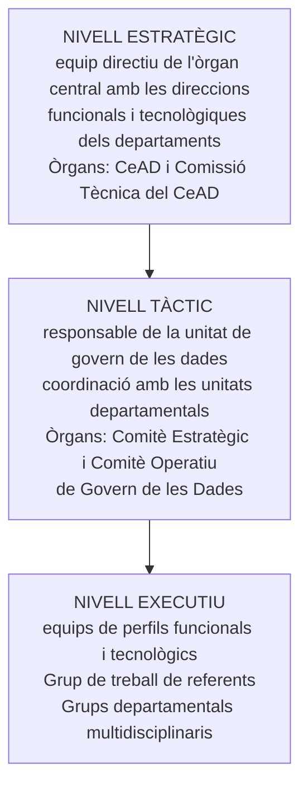

- **Comitès de govern de les dades (4.3.1):**
  - 🔑 **Comitè Estratègic de Govern de les Dades:** impulsa l'estratègia mitjançant el desplegament, la coordinació i la supervisió de les línies d'acció del model, vetlla pel compliment dels principis, les directrius i els estàndards, i resol les qüestions més rellevants.
  - 🔑 **Comitè Operatiu de Govern de les Dades:** impulsa i coordina la implementació **operativa** del model (planifica, prioritza i fa el seguiment periòdic de les iniciatives), dona suport al Comitè Estratègic i pot crear grups de treball.
  - Tots dos els formen, com a mínim, representants de l'equip directiu de la DGAD i del CTTI. El protocol de govern de les dades n'ha de fixar la resta de membres.
- **Grups de treball (4.3.2):**
  - **Grup de treball de referents del govern de les dades** de l'Administració de la Generalitat: referents designats per cada departament i, si escau, per les entitats del sector públic, i altres referents d'àmbit transversal.
  - **Grups de treball departamentals multidisciplinaris:** executen i gestionen les activitats de la funció federal seguint les directrius de les funcions centrals.

#### f) Àmbits d'actuació (apartat 5) — 9 àmbits

🔑 El model es basa en una **adaptació de la metodologia internacional DAMA**, alineada amb les directrius europees sobre governança de les dades.

📊 **Esquema dels nou àmbits d'actuació.**

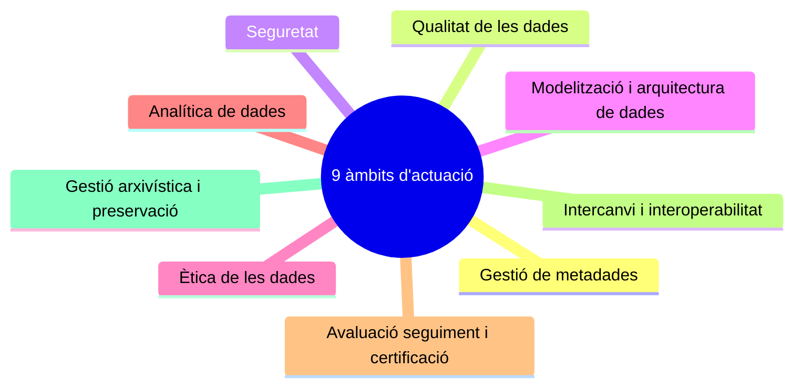

| # | Àmbit | Contingut |
|:-:|---|---|
| 5.1 | **Gestió de metadades** | Les **metadades** són dades que descriuen altres dades i ofereixen informació addicional sobre l'estructura, el format o la semàntica de les dades. Activitats d'identificació, definició, emmagatzematge, integració i ús de metadades. |
| 5.2 | **Qualitat de les dades** | Que les dades siguin **precises, completes, coherents, actualitzades i rellevants**. Processos per identificar, mesurar i millorar la qualitat. |
| 5.3 | **Seguretat** | Regulació de l'accés, l'ús i la protecció de les dades: control d'accessos i autenticació, encriptació, gestió de vulnerabilitats i continuïtat del servei, per garantir la **integritat, la disponibilitat i la confidencialitat**. |
| 5.4 | **Modelització i arquitectura de dades** | Estàndards de gestió de **dades mestres, de referència i transaccionals** i de modelatge; com s'han de fer la integració i la interoperabilitat; esquemes comuns per a tots els sistemes. |
| 5.5 | **Ètica de les dades** | Alinea el model amb els principis ètics; objectiu: que l'ús de les dades produeixi **beneficis sense perjudicis** per a la ciutadania. Òrgan d'assessorament: el **Comitè d'Ètica de les Dades**. |
| 5.6 | **Analítica de dades** | Nous serveis digitals **analítics i predictius**; analítica, tractament massiu de dades i **intel·ligència artificial**. |
| 5.7 | **Avaluació, seguiment i certificació** | Instrument d'avaluació, seguiment i verificació del compliment dels principis i objectius del model. |
| 5.8 | **Intercanvi i interoperabilitat** | Estructura que permeti la interoperabilitat dels sistemes d'informació i dels procediments per compartir dades i intercanviar informació, coneixement, documents i dades. |
| 5.9 | **Gestió arxivística i preservació de les dades** | Gestió arxivística de les dades i conservació durant el temps necessari per a la finalitat per a la qual s'han generat o incorporat. |

#### g) Operativització del model (apartat 6)

📊 **Esquema de la cadena d'instruments.** El Decret 76/2020 preveu el model (art. 10) i el protocol (art. 11). El protocol es concreta en **polítiques**, que s'acompanyen de **guies metodològiques** (documents operatius de cada àmbit, amb fluxogrames i instruments tècnics), i tot es gestiona amb **eines tecnològiques**. El model és **dinàmic**: es revisa periòdicament segons el grau de maduresa.

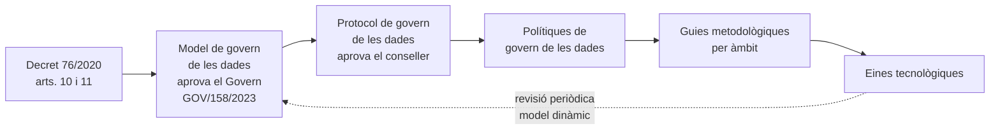

### 2.8 ➕ El Comitè d'Ètica de les Dades (Acord GOV/6/2021)

⚖️ **Acord GOV/6/2021, de 19 de gener**, pel qual es crea el Comitè d'Ètica de les Dades (DOGC núm. 8322, de 21.1.2021). ✅ Text contrastat amb el DOGC.

- 🔑 **Naturalesa:** òrgan de caràcter **consultiu i transversal** al servei de l'Administració de la Generalitat i del seu sector públic institucional. És fonamentalment un **òrgan de deliberació** amb funció consultiva i assessora, amb un punt de vista **multidisciplinari**.
- **Objecte:** garantir un **espai de reflexió ètica** en el desplegament del model de dades de l'Administració que faciliti la presa de decisions, generi coneixement i orientacions, desplegui usos avançats de les dades i generi bones pràctiques.
- 🔑 **Ús avançat de les dades:** *l'aplicació, a les actuacions i polítiques públiques de l'Administració de la Generalitat i el seu sector públic, de les tècniques i els serveis d'adquisició, transformació i anàlisi habilitades per a la disponibilitat massiva de dades.*
- **Integració:** s'integra en la **Xarxa de Comitès d'Ètica de Catalunya** i assessora el **Consell Estratègic d'Administració Digital**.

🔑 **Funcions (punt 2):**
- a) **Assessorar** l'Administració de la Generalitat i el seu sector públic institucional en l'ètica dels usos avançats de les dades.
- b) Formular **recomanacions**, establir **protocols** d'actuació i generar materials de suport, també sobre la comunicació d'aquests usos a la ciutadania.
- c) **Informar** sobre les qüestions ètiques pròpies dels usos avançats de les dades.
- d) Donar suport als comitès de la **Xarxa de Comitès d'Ètica de Catalunya**.
- e) Fomentar la **sensibilització, la difusió i la formació**.
- f) Donar suport al **Consell Estratègic d'Administració Digital**.

**Composició (punt 3):**

| Membre | Designació |
|---|---|
| **Presidència** | Titular de la Direcció General d'Administració Digital |
| **3 vocals externs** | Nomenats per la persona titular del departament competent: **2 professionals de reconegut prestigi** en ètica o usos avançats de les dades i **1 persona en representació d'entitats o moviments cívics** |
| **Vocals de l'Administració de la Generalitat** | **1 persona experta per departament** (ús de les dades o protecció de dades) · **1 persona de l'àmbit jurídic** experta en administració digital · **1 persona experta en democràcia, transparència i dades obertes** |
| **4 vocals d'ens** | **Idescat** · **Agència de Ciberseguretat de Catalunya** · **CTTI** · **Consorci AOC** |
| **Secretaria** | Una persona funcionària de la Direcció General d'Administració Digital, amb veu però sense vot |

**Funcionament (punts 4 a 6):**
- Fixa les seves normes de funcionament intern.
- Es reuneix de manera ordinària **almenys tres vegades l'any**.
- Deure de **secret**.
- La participació **no genera dret a dietes ni indemnitzacions**.
- Pot constituir **grups de treball**, amb persones externes.
- 🔑 Elabora un **informe anual d'activitats** per al conseller o consellera competent.
- 🔑 **Queden excloses** de l'àmbit de treball del Comitè les **dades en matèria de salut**.

> ⚠️ **Nota sobre la composició:** l'Acord GOV/6/2021 atribueix la presidència i la secretaria del Comitè a la **Direcció General d'Administració Digital** del **Departament de Polítiques Digitals i Administració Pública**. Cap dels dos òrgans no figura a l'estructura vigent (Decret 105/2025). L'Acord no s'ha modificat. Segons el Decret 105/2025, la **Subdirecció General de Dades i Innovació Digital a l'Administració** té la funció de *vetllar per un ús ètic de les dades d'acord amb les recomanacions i les propostes del Comitè d'Ètica de les Dades* (art. 92.1.k).

### 2.9 ➕ El Reglament (UE) 2022/868, de governança europea de dades

⚖️ **Reglament (UE) 2022/868 del Parlament Europeu i del Consell, de 30 de maig de 2022**, relatiu a la governança europea de dades (*Data Governance Act*). Va entrar en vigor el **23 de juny de 2022** i és aplicable des del **24 de setembre de 2023**.

🔑 **Objecte (art. 1.1).** El Reglament estableix:
- a) les **condicions per a la reutilització**, dins de la Unió, de determinades categories de dades que són en poder d'**organismes del sector públic**;
- b) un marc de notificació i supervisió per a la prestació de **serveis d'intermediació de dades**;
- c) un marc per a la **inscripció voluntària en un registre** de les entitats que recullen i tracten dades cedides amb **finalitats altruistes**, i
- d) un marc per a la creació d'un **Comitè Europeu d'Innovació en matèria de Dades**.

- ⚖️ **Art. 1.2:** el Reglament **no obliga** els organismes del sector públic a permetre la reutilització de dades ni els eximeix de les seves obligacions de confidencialitat.
- ⚖️ **Art. 1.3:** 🔑 en cas de conflicte amb el dret de la Unió en matèria de **protecció de dades personals**, **preval aquest dret**. El Reglament no crea una base jurídica per al tractament de dades personals.

🔑 **Definicions principals (art. 2):**

| Núm. | Terme | Definició |
|:-:|---|---|
| 1 | **Dades** | Tota representació digital d'actes, fets o informació, i també la seva recopilació, fins i tot com a enregistrament sonor, visual o audiovisual. |
| 2 | **Reutilització** | La utilització, per persones físiques o jurídiques, de dades en poder d'organismes del sector públic, amb finalitats comercials o no comercials diferents del propòsit inicial de la missió de servei públic per a la qual es van produir, excepte l'intercanvi de dades entre organismes del sector públic amb l'única finalitat de fer les seves activitats de servei públic. |
| 10 | **Intercanvi de dades** | La facilitació de dades per un interessat o titular de dades a un usuari de dades, directament o per mitjà d'un intermediari, per fer-ne un ús en comú o individual. |
| 11 | **Servei d'intermediació de dades** | Tot servei que té per objecte establir relacions comercials per a l'intercanvi de dades entre un nombre indeterminat d'interessats i titulars de dades, d'una banda, i usuaris de dades, de l'altra. En queden exclosos, com a mínim, els serveis d'intercanvi de dades que ofereixen els organismes del sector públic sense la intenció d'establir relacions comercials. |
| 16 | **Cessió altruista de dades** | Tot intercanvi voluntari de dades basat en el consentiment dels interessats (dades personals) o en el permís dels titulars (dades no personals), sense ànim d'obtenir una gratificació superior a la compensació dels costos, amb objectius d'interès general (assistència sanitària, lluita contra el canvi climàtic, mobilitat, estadístiques oficials, millora dels serveis públics, elaboració de polítiques públiques o recerca científica d'interès general). |
| 17 | **Organisme del sector públic** | Les autoritats estatals, regionals o locals, els organismes de dret públic o les associacions constituïdes per una o més d'aquestes autoritats o organismes. |
| 20 | **Entorn de tractament segur** | L'entorn físic o virtual i els mitjans organitzatius per garantir el compliment del dret de la Unió i del dret nacional, i que permeten a l'entitat que el proporciona determinar i supervisar totes les accions de tractament. |

---

## 3. Característiques de les dades

### 3.1 Dades massives i les 7 V

Les administracions públiques tenen una quantitat ingent de dades informàtiques. És el que s'anomena **big data** o **dades massives**: 🔑 *un conjunt de dades que, pel seu volum, la seva naturalesa diversa i la velocitat a què han de ser processades, ultrapassen la capacitat dels sistemes informàtics habituals.*

🔑 Les característiques més importants de les dades massives són les anomenades **"7 V del big data"**.

📊 **Esquema de les 7 V.** Cada branca és una de les set característiques. Les tres primeres (volum, velocitat i varietat) descriuen la natura de les dades; la veracitat, la viabilitat i la visualització en condicionen l'ús; i el valor és el resultat final, que només s'obté quan les dades es converteixen en informació, coneixement i decisió.

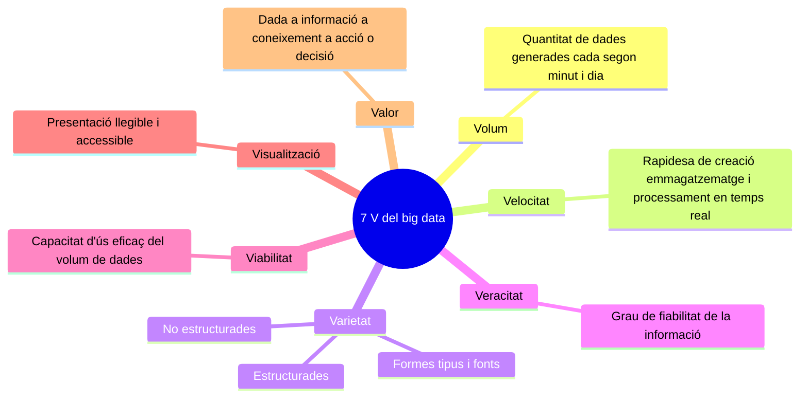

| V | Característica | Explicació |
|:-:|---|---|
| 1 | **Volum** | Quantitat de dades que es generen cada segon, minut i dia en el nostre entorn i que les organitzacions emmagatzemen per processar-les i transformar-les en coneixement vàlid per a les administracions. |
| 2 | **Velocitat** | Rapidesa amb què les dades es creen, s'emmagatzemen i es processen en temps real. En determinats processos, l'estudi en temps real és necessari perquè les dades siguin útils i les conclusions, efectives. |
| 3 | **Varietat** | Formes, tipus i fonts en què es registren les dades: **estructurades**, fàcils de gestionar (p. ex., bases de dades), i **no estructurades** (documents de text, correus electrònics, dades de sensors, àudios, vídeos o imatges), que requereixen una eina específica. |
| 4 | **Veracitat** | Grau de fiabilitat de la informació rebuda. Cal invertir temps per obtenir dades de qualitat, aplicant solucions i mètodes que eliminin dades imprevisibles que puguin emmascarar la tendència de les dades. |
| 5 | **Viabilitat** | Capacitat de les organitzacions de fer un ús eficaç del gran volum de dades que gestionen per conèixer millor l'àmbit on operen i la ciutadania, i per dissenyar estratègies o plans. |
| 6 | **Visualització** | Manera com es presenten les dades. Un cop processades (en taules i fulls de càlcul), cal representar-les visualment perquè siguin llegibles i accessibles i permetin trobar patrons i claus ocultes. |
| 7 | 🔑 **Valor** | La dada per si sola no té valor, ni tampoc el simple fet de recopilar-ne una gran quantitat. El valor s'obté quan les dades es transformen en **informació**; aquesta es converteix en **coneixement**, que dona lloc a una **acció o decisió**. |

En conclusió, el big data és una combinació d'aquestes set característiques que permet a les organitzacions obtenir un avantatge competitiu.

### 3.2 Classificació de les dades orientada al seu ús

En l'àmbit del big data, les classificacions més utilitzades són segons l'**estructura** i segons l'**origen** de les dades.

📊 **Esquema de la classificació de les dades.** La branca de l'estructura distingeix dades estructurades, no estructurades i multiestructurades o híbrides, cadascuna amb els seus subtipus. La branca de l'origen agrupa les dades segons d'on provenen.

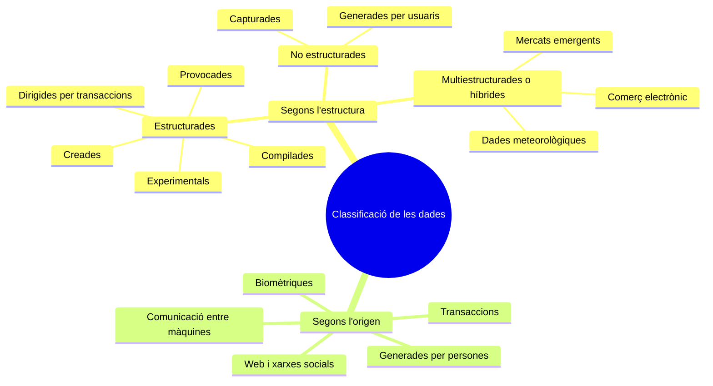

#### a) Segons l'estructura de les dades

**1. Dades estructurades**

| Tipus | Descripció | Exemples |
|---|---|---|
| **Creades** | Dades generades pels nostres sistemes d'una manera predefinida. | Registres en taules, fitxers XML associats a un esquema. |
| **Provocades** | Dades creades de manera indirecta a partir d'una acció prèvia. | Valoracions de restaurants, pel·lícules o empreses. |
| **Dirigides per transaccions** | Dades que resulten de finalitzar correctament una acció prèvia. | Factures generades automàticament en fer una compra, rebut d'un caixer automàtic en retirar efectiu. |
| **Compilades** | Resums de dades d'empresa o de serveis públics d'interès grupal. | Cens electoral, vehicles matriculats, habitatges públics. |
| **Experimentals** | Dades generades com a part de proves o simulacions per validar si hi ha una oportunitat de negoci. | — |

**2. Dades no estructurades**

| Tipus | Descripció | Exemples |
|---|---|---|
| **Capturades** | Dades creades a partir del comportament d'un usuari. | Informació biomètrica de polseres de moviment, aplicacions de seguiment d'activitats (carrera, ciclisme, natació, posició GPS). |
| **Generades per usuaris** | Dades que especifica un usuari. | Publicacions a les xarxes socials, vídeos reproduïts, cerques a internet. |

🔑 En entorns de big data, per treballar amb aquests tipus de dades s'utilitzen:
- **Data warehouse** (magatzem de dades): emmagatzema les **dades estructurades** per analitzar-les i obtenir-ne informes.
- **Data lake** (llac de dades): emmagatzema **dades no estructurades** i en manté el **format original** fins que es decideix com s'utilitzaran.

**3. Dades multiestructurades o híbrides:** dades de mercats emergents, comerç electrònic, dades meteorològiques.

#### b) Segons l'origen de les dades

| Origen | Exemples |
|---|---|
| **Web i xarxes socials** | Informació sobre clics a enllaços i elements, cerques a internet, fonts de dades de les xarxes socials, contingut web (pàgines, imatges, enllaços). |
| **Comunicació entre màquines** | Lectures RFID, senyals GPS, altres sensors (parquímetres, màquines expenedores, caixers). |
| **Transaccions** | Registres de comunicacions (trucades, missatgeria, VoIP) i registres de facturació (pagaments amb targeta, pagament en línia). |
| **Biomètriques** | Reconeixement facial, informació genètica (ADN). |
| **Generades per persones** | Enregistraments a operadors d'atenció al client, correu electrònic, registres mèdics electrònics. |

### 3.3 Relació entre dades: la piràmide DIKW

Una **dada** és una representació simbòlica (numèrica, alfabètica, algorísmica, espacial, etc.) d'un atribut o variable quantitativa o qualitativa. És la **part mínima de la informació**, però per si soles les dades no tenen informació rellevant.

Mitjançant els sistemes informàtics es poden agrupar les dades (per mitjà de les **metadades**) i obtenir **informació**. Aquesta informació, treballada per les persones i també per algoritmes informàtics, genera **coneixement**, l'element bàsic de la nostra societat, que per això s'anomena **societat del coneixement**. Tenir coneixement sobre un producte o un servei permet adaptar-se ràpidament en una societat globalitzada i canviant, i això porta a la **saviesa**.

🔑 És el que reflecteix la **piràmide DIKW** o piràmide del coneixement, que relaciona quatre components: **D**ata (dades), **I**nformation (informació), **K**nowledge (coneixement) i **W**isdom (saviesa).

📊 **Piràmide DIKW.** Es llegeix de baix a dalt. A la base hi ha moltes dades sense context; cada nivell superior n'afegeix: la informació dona context a les dades (què, qui, quan, on), el coneixement les interpreta (com), i la saviesa permet decidir i actuar (per què, què cal fer). Com més amunt, menys volum i més valor.

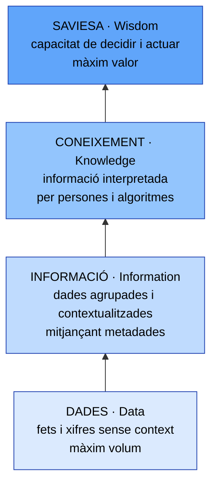

### 3.4 Metadades i diccionari de dades

#### a) Metadades

🔑 Les **metadades** són *"dades sobre les dades"*: subministren informació sobre les característiques de les dades (el contingut, la qualitat, les condicions, la història, la disponibilitat i altres característiques), i ajuden a localitzar i gestionar la informació.

> ⚖️ El **Model de govern de les dades** (Acord GOV/158/2023, apartat 5.1) les defineix com *dades que descriuen altres dades i a través de les quals s'ofereix informació addicional sobre, entre d'altres, l'estructura, el format o la semàntica de les dades, per optimitzar-ne la comprensió i l'ús*. La **Llei 39/2015** exigeix que els documents electrònics administratius incorporin les **metadades mínimes exigides** (art. 26.2.d) i que les còpies electròniques incloguin les metadades que n'acreditin la condició de còpia (art. 27.3).

Les metadades s'han convertit en una font d'informació de gran valor per a les organitzacions que tenen moltes dades, com les administracions públiques, perquè faciliten la comprensió de les dades i són una peça clau per millorar l'eficiència en la gestió de la informació.

A la Generalitat de Catalunya, l'**esquema de metadades** és la peça clau per a la gestió electrònica dels documents administratius, ja que possibilita una política comuna de gestió documental per a tota la Generalitat. És un instrument que permet capturar de manera normalitzada la informació bàsica per identificar i gestionar la documentació que produeix un organisme, i defineix, entre altres aspectes, quines dades s'han de conservar. Les seves funcions són:
- Facilitar la recuperació i la consulta àgil de la documentació.
- Ajudar a fer la disposició de forma automatitzada.
- Facilitar l'aplicació d'estratègies de preservació de la documentació de conservació permanent o a llarg termini.
- Assegurar l'eliminació correcta de la documentació i l'actualització automàtica del registre de destrucció.
- Facilitar la definició de l'accés.
- Garantir la interoperabilitat entre sistemes.

🔑 Aquest esquema no es pot aplicar sense un **perfil d'aplicació de metadades**. A la Generalitat és el **Perfil d'aplicació de metadades d'ARESTA**, que defineix **tres nivells d'aplicació**:

| Nivell | Unitat |
|---|---|
| 1 | **Document** (unitat documental simple) |
| 2 | **Expedient** (unitat documental composta) |
| 3 | **Sèrie documental** |

El perfil defineix també les normes de descripció dels elements i les regles d'ús, i:
- Inclou informació detallada sobre la captura de les metadades (fonts d'on extreure les dades, valors per defecte, moment en què s'informen, etc.).
- Inclou comentaris, observacions i exemples que ajuden a implementar-lo.
- Està consensuat entre els òrgans d'impuls transversal (gestió documental i arxiu, organització, tecnologies de la informació i la comunicació).

Els organismes de l'Administració de la Generalitat, respecte dels seus sistemes d'informació propis, han de valorar l'impacte de la integració amb ARESTA, identificant els plans de treball i els evolutius adients per alinear-se amb el perfil d'aplicació de metadades d'ARESTA i garantir el compliment del **Protocol de documents electrònics i arxiu**.

#### b) Diccionari de dades

🔑 El **diccionari de dades** conté la informació que el sistema de gestió de bases de dades necessita per fer les seves funcions i donar suport a la seva implementació particular (que varia considerablement d'un producte a un altre).

Elements d'un diccionari de dades:
- Descripcions detallades de taules i camps.
- Informació d'indexació.
- Restriccions d'integritat referencial.
- Definicions de l'esquema de base de dades.
- Procediments emmagatzemats i disparadors.
- Informació de control d'accés (noms d'usuari, rols i privilegis).
- Paràmetres d'ubicació de l'emmagatzematge.
- Estadístiques d'ús de la base de dades.

### 3.5 Dades específiques de negoci i dades de tramitació

L'**anàlisi de dades** (*data analytics*, DA) és la ciència que examina dades en brut per treure'n conclusions sobre la informació.

**Tipus d'anàlisi de dades:**

| Tipus | Descripció |
|---|---|
| **Anàlisi diària** | Es basa en informes ja definits i es fa setmanalment o mensualment (p. ex., l'anàlisi de les campanyes en mitjans de pagament). |
| **Anàlisi *ad hoc*** | Es fa quan sorgeix una situació inesperada o quan s'ha detectat alguna cosa en l'anàlisi estàndard. |
| **Anàlisi de big data** | Procés d'examinar una gran quantitat de dades per descobrir **patrons ocults, correlacions desconegudes i informació útil**. Normalment la fan institucions oficials que gestionen moltes dades o empreses grans. Les fonts poden incloure registres del servidor web i dades de seguiment de clics a internet, informes d'activitats socials, mitjans de comunicació, telèfons mòbils, registres detallats de trucades i informació captada per sensors. |

**Diversitat de fonts i tipus de dades.** Amb tantes fonts, tipus de dades i estructures complexes, la dificultat d'integrar les dades augmenta.
- **Fonts:** dades d'internet i mòbils; dades de l'internet de les coses; dades sectorials recopilades per empreses especialitzades; dades experimentals.
- **Tipus:** **no estructurades** (documents, vídeos, àudios, etc.); **semiestructurades** (programari, fulls de càlcul, informes); **estructurades**.

🔑 Només el **20%** de la informació és estructurada, i això pot provocar molts errors si no s'emprèn un projecte de qualitat de dades.

> ➕ ⚖️ El **Model de govern de les dades** (Acord GOV/158/2023, apartat 5.4) distingeix, a l'àmbit de modelització i arquitectura, entre **dades mestres**, **dades de referència** i **dades transaccionals**, i preveu estàndards de gestió per a cadascuna. El **Decret 105/2025** atribueix a la Subdirecció General de Dades i Innovació Digital a l'Administració la funció de *coordinar la gestió de les dades de referència i les dades mestres corporatives* (art. 92.1.j).

### 3.6 El cicle de vida de les dades

🔑 El **cicle de vida de les dades** descriu els diferents estadis de la gestió de les dades.

📊 **Cicle de vida de les dades.** El diagrama mostra les sis fases en forma de cicle: les dades es creen o es recopilen, es processen, s'analitzen, es conserven, s'hi dona accés i es reutilitzen. La reutilització genera noves dades i el cicle torna a començar, perquè les dades continuen vives després del projecte que les va originar.

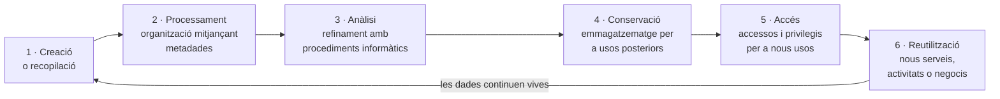

| Fase | Contingut |
|---|---|
| **1. Creació o recopilació** | Agrupació de les dades que té una organització. |
| **2. Processament** | Un cop agrupades, s'organitzen en diferents grups mitjançant les **metadades**. |
| **3. Anàlisi** | Un cop organitzades, es **refinen** amb procediments informàtics per potenciar els aspectes que es volen destacar. |
| **4. Conservació** | Un cop refinades, s'emmagatzemen per a possibles usos posteriors. |
| **5. Accés** | Sobre les dades emmagatzemades es poden donar diferents accessos o privilegis perquè altres persones hi accedeixin i en defineixin nous usos. |
| **6. Reutilització** | Les dades, amb aquests nous usos, donen lloc a nous serveis, activitats o negocis. |

🔑 El cicle de vida de les dades **va més enllà del cicle de vida d'un projecte**: les dades recopilades continuen vives i a disposició per ser reutilitzades, pel mateix investigador que les va generar en un projecte anterior o per altres investigadors. El cicle ha de garantir el manteniment de l'**autenticitat, la fiabilitat, la integritat i la utilització** del contingut digital.

La gestió del cicle de vida de les dades s'ha convertit en una eina fonamental per aconseguir més productivitat en la relació amb les persones usuàries, ja que permet entendre els processos i desenvolupar metodologies i plans de gestió en les organitzacions.

> ⚖️ **El cicle de vida a la normativa de la Generalitat:**
> - El **protocol de govern de les dades** ha d'incloure el cicle de vida: *la seqüència de passos que fa una dada, des que es genera o es captura fins que eventualment s'arxiva o s'elimina* (art. 11.1.c Decret 76/2020).
> - El **Model de govern de les dades** el recull com la participació corresponsable de totes les unitats *des que les dades es recullen, es processen i s'emmagatzemen fins que s'arxiven o eliminen* (Acord GOV/158/2023, apartats 2.a i 3).
> - La **gestió arxivística** n'estableix les fases: activa, semiactiva i inactiva o històrica (art. 24 Decret 76/2020; vegeu l'apartat 2.6).
> - La **Llei 40/2015** obliga a assegurar la conservació a llarg termini dels documents electrònics *d'acord amb les especificacions sobre el cicle de vida dels serveis i sistemes utilitzats* (art. 46.3).

📊 **Comparació del cicle de vida de gestió i el cicle de vida normatiu.** Un bloc mostra el cicle de vida de gestió de les dades; l'altre, la seqüència que fixen el Decret 76/2020 i l'Acord GOV/158/2023, que acaba amb l'arxiu o l'eliminació. Totes dues visions són compatibles: la normativa posa l'accent en la responsabilitat de les unitats en cada pas i en el final de la vida de la dada.

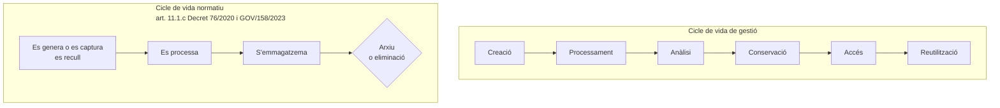

### 3.7 Les dades massives a l'Administració

Les grans organitzacions, com la Generalitat de Catalunya, tenen moltíssimes dades que es poden tractar per veure els problemes de manera més completa i facilitar-ne la solució, i per aconseguir nous serveis o prestacions més adaptats a la ciutadania. Aquesta recerca de **patrons i prediccions** per facilitar la presa de decisions és el que fa la **mineria de dades** (apartat 3.8).

🔑 No es pot obviar la normativa de **protecció de dades personals**, que pretén evitar abusos en l'ús de les dades personals.

En aquest sentit, l'aleshores **Departament de Polítiques Digitals i Administració Pública** i el **Centre d'Excel·lència en Big Data de Barcelona (Big Data CoE)** van elaborar l'informe ***Bones pràctiques per compartir dades personals en la nova economia de les dades***, que aporta pautes per a un tractament adequat de les dades personals i la seva **anonimització** en entorns tecnològicament complexos com el big data. En destaquen aquests aspectes:
- Vol facilitar el desenvolupament de la nova economia de les dades per aprofitar-ne al màxim les oportunitats en els àmbits empresarial, d'innovació i social, i donar eines a empreses i organitzacions per aplicar el Reglament general de protecció de dades sense posar en risc aquest potencial.
- Recopila procediments, mesures tècniques i bibliografia per complir la normativa de dades i proposa recomanacions per a totes les organitzacions que tracten grans volums de dades: respecte als principis de **lleialtat i transparència**, de **responsabilitat** sobre el tractament, de **recerca i innovació responsable** i de perseguir un **interès legítim**.
- Aconsella fer una **avaluació d'impacte en la protecció de dades** que demostri que el tractament no suposa un risc per a la privacitat, i incideix en el compromís amb els procediments i les bones pràctiques de recollida de dades personals i d'informació al públic i als interessats.
- Cal garantir drets dels interessats com el **dret a l'oblit** i el de **portabilitat** de les dades personals, i aconsella comptar amb un **delegat de protecció de dades**, especialment davant de grans volums de dades.

**Exemple d'aplicació.** La pandèmia de la COVID-19 va posar de manifest la necessitat de detectar amb antelació els brots epidèmics per millorar-ne la contenció i la mitigació. Es va impulsar així el primer projecte d'ús d'anàlisi de big data i intel·ligència artificial per a la prevenció d'epidèmies, per ajudar a preveure, detectar i mitigar-ne la propagació a partir de l'anàlisi de dades de les xarxes de telefonia mòbil, el cens, dades epidemiològiques i dades ambientals i meteorològiques. Era una iniciativa publicoprivada que sumava la Generalitat de Catalunya (per mitjà dels aleshores Departament de Polítiques Digitals i Administració Pública i Departament de Salut), institucions mèdiques i de salut (Hospital Germans Trias i Pujol i Fundació Lluita contra la Sida), centres d'innovació i recerca tecnològica i grups de recerca (CIDAI, Eurecat, Barcelona Supercomputing Center, Universitat Rovira i Virgili i Universitat de Girona) i Mobile World Capital Barcelona, amb la col·laboració de la iniciativa GSMA AI for Impact. El projecte preveia:
1. El **creuament de les dades de forma agregada i anonimitzada** (sense traçabilitat ni identificació de les persones) i l'anàlisi i l'extensió de models matemàtics per comparar i predir patrons d'epidèmies, a partir de la grip i la COVID-19.
2. Un primer **model epidemiològic** millorat amb tècniques d'**aprenentatge automàtic** (*machine learning*).
3. Una eina que integrés automàticament les diferents fonts de dades per monitorar l'evolució d'una epidèmia i un sistema de suport a les decisions obert per a les comunitats científica i sanitària.

### 3.8 La mineria de dades (*data mining*)

🔑 La **mineria de dades** és un conjunt de tècniques (anàlisi estadística i algoritmes) encaminades a l'extracció de coneixement processable que és ocult a les bases de dades i que dona lloc a informació **vàlida, nova, potencialment útil i entenedora**.

📊 **Fases d'un procés de mineria de dades.** El procés avança des de la fixació d'objectius fins a l'avaluació del model. Si el model no supera l'avaluació, es torna enrere: al principi o, si un expert ho considera oportú, a qualsevol fase anterior. Aquesta retroalimentació es repeteix fins que el model és vàlid i es pot explotar.

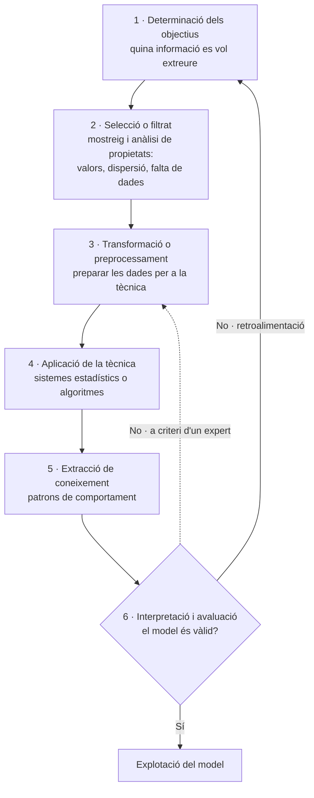

| Fase | Contingut |
|---|---|
| **1. Determinació dels objectius** | Quin tipus d'informació es vol extreure de la base de dades. |
| **2. Selecció o filtrat del conjunt de dades** | Mostreig de les dades disponibles i anàlisi de les seves propietats (valors, dispersió, falta de dades). |
| **3. Transformació o preprocessament** | A partir de la primera fase, es modifiquen les dades per preparar-les per a la tècnica de mineria que millor s'hi adapti. |
| **4. Aplicació de la tècnica de mineria de dades** | Generalment sistemes estadístics o algoritmes de cerca (seqüència d'instruccions per dur a terme processos i donar resposta a necessitats o decisions). |
| **5. Extracció de coneixement** | S'obtenen patrons de comportament derivats dels valors de les dades o de les relacions entre elles. |
| **6. Interpretació i avaluació** | S'obté un model teòric i se'n comprova la validesa. Si no supera l'avaluació, el procés es pot repetir des del principi o, si un expert ho considera oportú, des de qualsevol pas anterior, tantes vegades com calgui. Un cop validat, el model està a punt per a la seva **explotació**. |

🔑 **Diferència amb el big data:** el **big data** fa referència a les **dades**; la **mineria de dades** fa referència a la **tècnica** per obtenir els objectius que busca l'organització.

> 💡 **Dataisme:** filosofia o ideologia emergent que confia més en les macrodades i els algoritmes computacionals que en el coneixement i la saviesa humans.

---

## 4. L'administració digital

### 4.1 Concepte

⚖️ Segons el **preàmbul del Decret 76/2020**, en l'àmbit europeu s'ha fet una aposta decidida per implementar no només l'administració electrònica, sinó l'**administració digital**, un concepte emergent que comporta:
- la **digitalització dels processos i serveis**, i
- 🔑 la **generació de valor públic** mitjançant l'ús de les tecnologies de la informació i la comunicació (TIC).

Les noves tecnologies s'uneixen als instruments propis de l'administració electrònica per construir **administracions públiques obertes i eficients** que presten **serveis personalitzats i accessibles** a les persones. Aquesta nova dimensió suposa **repensar el funcionament i l'organització** de les administracions públiques i la **innovació** necessària per oferir nous serveis personalitzats i proactius.

⚖️ El **preàmbul del Decret 228/2019** ho concreta: 🔑 *la transformació digital no comporta només substituir documents en paper per documents en suport electrònic, sinó una anàlisi i una transformació profundes de l'organització encaminades a convertir els processos en dades, amb la finalitat de millorar l'activitat i la qualitat dels serveis públics.* Perquè l'Administració sigui realment digital cal que els serveis públics siguin, **per defecte, proactius, personalitzats, desmaterialitzats i digitals**, i que desapareguin les **barreres temporals** (els horaris) i **espacials**.

⚖️ El **preàmbul de l'Acord GOV/158/2023** situa aquesta transformació en una **estratègia de dades** que vol fer de l'Administració de la Generalitat *un referent d'administració del segle xxi* en el disseny de nous **serveis públics digitals, proactius i personalitzats**. Aquesta estratègia impulsa un canvi en la manera de treballar dels empleats públics, *amb més flexibilitat, motivació i conciliació*, i una administració **inclusiva, innovadora, oberta, digital i eficient**, amb l'objectiu d'aportar serveis públics de màxima qualitat.

📊 **De l'administració electrònica a l'administració digital.** L'esquema resumeix el salt que descriuen els preàmbuls dels decrets 76/2020 i 228/2019: l'administració electrònica incorpora mitjans electrònics als procediments; l'administració digital, a més, transforma l'organització, converteix els processos en dades i genera valor públic amb serveis proactius i personalitzats.

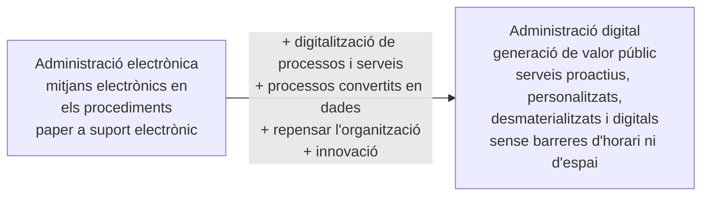

### 4.2 🔄 Marc estratègic

#### a) Unió Europea: el programa de la Dècada Digital per a 2030

⚖️ **Decisió (UE) 2022/2481 del Parlament Europeu i del Consell, de 14 de desembre de 2022**, per la qual s'estableix el programa estratègic de la Dècada Digital per a 2030. ✅ Art. 4 contrastat amb el text oficial.

🔑 **Metes digitals de la Unió per a 2030 (art. 4.1):**

| Àmbit | Metes |
|---|---|
| **1. Capacitats digitals** | a) Com a mínim el **80%** de les persones d'entre 16 i 74 anys amb, almenys, **capacitats digitals bàsiques** · b) Com a mínim **20 milions d'especialistes en TIC** ocupats a la Unió, facilitant l'accés de les dones i augmentant el nombre de titulats en TIC |
| **2. Infraestructures digitals** | a) Tots els usuaris finals en ubicació fixa coberts per una **xarxa de gigabit** i totes les zones poblades per xarxes sense fil d'alta velocitat amb un rendiment com a mínim equivalent al **5G** · b) La producció a la Unió de **semiconductors** de vanguardia, com a mínim el **20%** de la producció mundial en valor · c) Com a mínim **10.000 nodes de proximitat** d'alta seguretat i climàticament neutres · d) El primer **ordinador amb acceleració quàntica**, a tot tardar el 2025 |
| **3. Transformació digital de les empreses** | a) Com a mínim el **75%** de les empreses amb serveis de **computació en núvol**, **macrodades** o **intel·ligència artificial** · b) Més del **90%** de les pimes amb un nivell bàsic d'intensitat digital · c) Com a mínim **duplicar el nombre d'unicorns** |
| 🔑 **4. Digitalització dels serveis públics** | a) **100%** dels **serveis públics essencials accessibles en línia** i, quan escaigui, possibilitat d'interactuar en línia amb les administracions · b) **100%** de la ciutadania amb accés al seu **historial mèdic electrònic** · c) **100%** de la ciutadania amb accés a un **mitjà d'identificació electrònica (eID) segur** i reconegut a tota la Unió, que li permeti el control absolut de les transaccions relatives a la seva identitat i de les dades personals que comparteix |

> ⚠️ L'**art. 4.2** obliga la Comissió a **revisar** les metes digitals i les definicions **a tot tardar el 30 de juny de 2026**, i a presentar, si ho considera necessari, una proposta legislativa de modificació. No s'ha verificat el resultat d'aquesta revisió. Les metes transcrites són les del text vigent de la Decisió.

📊 **Les quatre metes de la Dècada Digital.** L'esquema agrupa les metes per àmbit. Per a aquest tema, la branca rellevant és la de digitalització dels serveis públics: serveis essencials en línia, historial mèdic electrònic i identificació electrònica, que es connecta amb la cartera europea d'identitat digital de l'eIDAS2 (apartat 7.2).

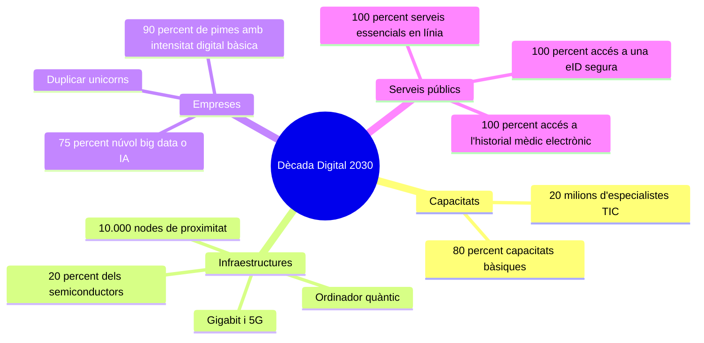

#### b) Catalunya

- 🔄 **Pla de Govern 2024-2027** (legislatura 2024-2027): la **Prioritat 4, "Bon govern, seguretat i millors serveis públics"**, inclou la **transformació digital** entre els seus àmbits, amb l'objectiu d'*una administració àgil, eficient i segura*. Planteja garantir l'**accés universal a les eines digitals** i desenvolupar polítiques que protegeixin els drets individuals en l'àmbit digital.
- 🔄 **Pla de reforma de l'Administració i de millora dels serveis públics**, aprovat pel Govern el **8 d'octubre de 2024**. Té dos eixos:
  - Una **estratègia de transformació**, amb una comissió d'experts que treballa sobre **12 àmbits prioritaris** i una comissió interdepartamental que n'implementa les propostes. 🔑 L'**àmbit prioritari 3** és *la digitalització integral de l'Administració*; el 4, garantir l'atenció presencial a la ciutadania; i el 5, la traçabilitat de tràmits i serveis.
  - Un **pla de xoc** de **17 accions** d'aplicació immediata, entre les quals: eliminar la **cita prèvia obligatòria**, simplificar l'ecosistema de webs i aplicacions mòbils de la Generalitat, dissenyar un nou espai web de serveis digitals, estendre la figura de l'**agent digital** als punts d'autoservei, posar en marxa una **oficina mòbil** i crear un sistema de valoració dels serveis digitals públics.

> ⚖️ La supressió de la cita prèvia obligatòria té ara rang de llei: **art. 21.4 de la Llei 26/2010**, redactat per la **Llei 9/2025** (vegeu l'apartat 7.4.1).

### 4.3 Principis generals de l'administració digital

#### a) Principis de la Llei 29/2010 (art. 4)

⚖️ ✅ 🔑 L'**art. 4 de la Llei 29/2010, del 3 d'agost**, de l'ús dels mitjans electrònics al sector públic de Catalunya, recull **10 principis** que han d'informar la incorporació dels mitjans electrònics a les actuacions del sector públic de Catalunya:

| # | Principi | Contingut |
|:-:|---|---|
| 1 | **Proximitat** | Les entitats del sector públic han de facilitar que l'ús dels mitjans electrònics per part dels ciutadans les faci més properes i adaptades a les seves necessitats, reduint costos i càrregues. |
| 2 | **Transparència i participació** | Han de garantir l'accés a l'estat de les tramitacions administratives i a la informació dels seus arxius, d'acord amb l'ordenament jurídic, i també el retiment de comptes i l'establiment de mecanismes de participació activa en les decisions públiques. |
| 3 | **Accessibilitat** | Han de garantir que l'ús dels mitjans electrònics no ocasioni discriminacions per raó del mitjà utilitzat o per raó de les discapacitats o les dificultats especials dels destinataris. *(Compte amb la bretxa digital.)* |
| 4 | **Qualitat** | Han d'adoptar les mesures necessàries perquè la difusió de la informació pública i la tramitació dels procediments per mitjans electrònics satisfacin les necessitats dels destinataris i facilitin l'assoliment de les finalitats de l'art. 3. |
| 5 | **Simplificació, eficàcia, eficiència i economia** | Han de redissenyar els serveis, els tràmits i els procediments; reduir les càrregues, els costos, els terminis i el temps dels procediments, i assolir més eficàcia, eficiència i economia. |
| 6 | **Seguretat** | Han de garantir que l'ús dels mitjans electrònics assegura la identitat, la integritat, la conservació i, si escau, la confidencialitat de la informació i les transaccions. |
| 7 | **Neutralitat tecnològica** | Han de permetre l'ús dels mitjans electrònics independentment de les opcions tecnològiques dels destinataris i han de promoure l'ús d'**estàndards oberts**. |
| 8 | **Cooperació i col·laboració** | Han de treballar en comú, compartir estratègies, generar solucions organitzatives i tecnològiques comunes i garantir la **interoperabilitat** dels seus sistemes d'informació. |
| 9 | **Proporcionalitat** | Han d'actuar amb proporcionalitat en l'exigència de garanties i mesures de seguretat i en la petició d'informació i dades als ciutadans. |
| 10 | **Legalitat** | Manteniment de la integritat de les garanties jurídiques dels ciutadans davant les administracions públiques, d'acord amb el règim jurídic i el procediment de les administracions públiques. |

#### b) Principis del Decret 76/2020 (art. 4)

⚖️ 🔑 L'actuació dels subjectes de l'art. 2 del Decret 76/2020, en l'àmbit de l'administració digital, s'ha d'inspirar en els principis de l'**art. 4 de la Llei 29/2010** i, a més, en aquests **12 principis**:

| Lletra | Principi | Contingut |
|:-:|---|---|
| a | **Compromís per exercir el lideratge** | — |
| b | **Coordinació** | Amb els subjectes de l'art. 2 i la resta d'administracions públiques catalanes per construir les seves polítiques sobre aquestes prioritats i principis. |
| c | 🔑 **Proactivitat i personalització** | En la prestació de serveis públics digitals, per situar l'**experiència de les persones al centre del disseny** de serveis. |
| d | **Eficàcia i eficiència en la gestió dels recursos públics** | Per posar en pràctica les polítiques d'administració digital i generar resultats positius, utilitzar els recursos de manera responsable i evitar tant com sigui possible traslladar les càrregues del present al futur. |
| e | **Inclusivitat** | Perquè totes les persones, individualment o col·lectivament, puguin ser partícips del benestar generat per la societat digital. |
| f | **Participació i proximitat** | Per facilitar l'accés i la trobada amb les persones i fomentar la participació individual i col·lectiva en la presa de decisions i en la gestió. |
| g | **Transparència** | Per exposar, de manera clara i intel·ligible, les dades i informacions rellevants per conèixer, entendre, controlar i avaluar la seva acció. |
| h | **Innovació i adaptació contínua** | Dels serveis públics, aprofitant el potencial de la tecnologia en cada moment. |
| i | **Qualitat** | En la prestació dels serveis digitals. |
| j | **Confiança en l'Administració digital** | Mitjançant el desenvolupament d'un **model de ciberseguretat**, especialment en relació amb la protecció de dades de caràcter personal. |
| k | 🔑 **Continuïtat digital** | Capacitat de l'Administració de dissenyar, crear i preservar la informació durant tot el temps que sigui necessària per a les finalitats per a les quals es va crear, i fer-la accessible a les persones interessades al llarg del temps. |
| l | **Legalitat** | Manteniment de la integritat de les garanties jurídiques de la ciutadania davant les administracions públiques. |

📊 **Comparació dels principis.** Una branca recull els 10 principis de la Llei 29/2010; l'altra, els 12 del Decret 76/2020, que s'hi **afegeixen** (no els substitueixen). Hi ha principis que apareixen a totes dues normes (proximitat i participació, transparència, qualitat, eficàcia i eficiència, legalitat) i principis propis del Decret, centrats en la persona i en la continuïtat de la informació: lideratge, proactivitat i personalització, inclusivitat, innovació, confiança i continuïtat digital.

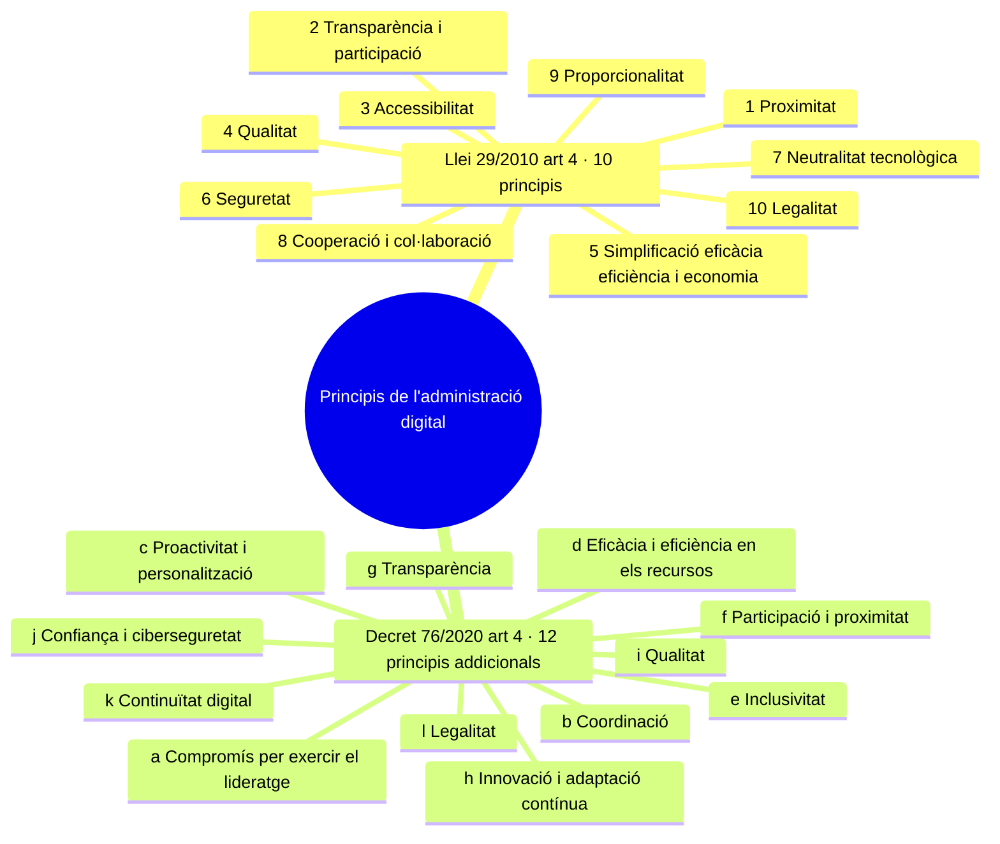

> 💡 El **RD 203/2021** (art. 2) fixa, per a tot el sector públic, sis principis de les actuacions i relacions electròniques: neutralitat tecnològica i adaptabilitat, accessibilitat, facilitat d'ús, interoperabilitat, proporcionalitat, i personalització i proactivitat (vegeu l'apartat 7.3.3).

### 4.4 Objecte, finalitats i àmbit d'aplicació del Decret 76/2020

⚖️ **Objecte (art. 1):** establir els instruments organitzatius per a l'ús de les solucions TIC corporatives per normalitzar i dissenyar els serveis i les plataformes digitals, i establir el **règim jurídic de l'administració digital** de l'Administració de la Generalitat i definir-ne l'**estructura organitzativa**. L'**annex 2** conté un glossari de termes tècnics.

⚖️ **Finalitats (art. 3):**
- a) Ordenar el desplegament de l'administració digital per maximitzar l'eficiència en les relacions internes i externes.
- b) 🔑 Establir el **govern de les dades** com a **element estructural** de l'administració digital.
- c) Establir les normes de procediment administratiu de l'administració digital derivades de les especificitats organitzatives de la Generalitat.

⚖️ 🔑 **Àmbit d'aplicació (art. 2):**

| Apartat | Subjectes | Títols aplicables |
|---|---|---|
| **2.1** | a) Els **departaments** de l'Administració de la Generalitat · b) els **organismes públics i entitats de dret públic** vinculats o dependents · c) els **consorcis adscrits** | **Tot el Decret** |
| **2.2** | a) Les **fundacions** amb presència o participació majoritària de l'Administració de la Generalitat o de les entitats de l'apartat 1 · b) les **associacions i societats** constituïdes exclusivament per l'Administració de la Generalitat · c) els **concessionaris de serveis públics** i les **corporacions de dret públic** en l'exercici de potestats administratives, quan ho disposi el títol concessional o ho aprovin els seus òrgans de govern | Només els **títols I** (Preliminar) i **II** (Serveis digitals) |

🔑 A l'efecte del Decret, s'entén per **Administració de la Generalitat** els subjectes de l'apartat 1 (art. 2.3). Als subjectes de l'apartat 2 **no se'ls aplica** el títol III (règim jurídic de l'administració digital) ni el títol IV (relacions dels empleats públics amb l'Administració de la Generalitat).

---

## 5. Model d'administració digital a Catalunya

### 5.1 El model català d'administració electrònica (Llei 29/2010)

El model català d'administració electrònica cerca millorar la **transparència, l'eficàcia i la qualitat** del sector públic per mitjà de l'ús dels mitjans electrònics en les relacions entre les entitats del sector públic i les persones. Es basa en la **corresponsabilitat** entre les administracions públiques catalanes i tots els actors implicats per definir les estratègies d'avenç en l'ús dels mitjans electrònics.

La Llei 29/2010 **reforça la cooperació interadministrativa** per trobar solucions comunes als problemes i reptes de l'extensió dels mitjans electrònics, amb una **estructura comuna d'interoperabilitat** entre les aplicacions i els sistemes d'informació de les diverses administracions i la **reutilització** de les aplicacions creades per les administracions públiques catalanes.

⚖️ ✅ **Objecte de la Llei 29/2010 (art. 1):** regular a) l'ús dels mitjans electrònics en les actuacions del sector públic de Catalunya; b) l'ús dels mitjans electrònics en les relacions entre les entitats del sector públic i els ciutadans; c) la definició dels instruments per desenvolupar i fomentar la relació per mitjans electrònics entre les entitats del sector públic, i entre aquestes i els ciutadans; d) 🔑 la **concreció del model català d'administració electrònica**.

⚖️ ✅ 🔑 **El model català d'administració electrònica (art. 5).** Les entitats del sector públic de Catalunya han d'impulsar un model basat en:
- a) La **incorporació dels mitjans electrònics** a la seva activitat ordinària per millorar l'accessibilitat, la transparència, l'eficàcia, l'eficiència i la qualitat dels serveis i la gestió interna.
- b) La **cooperació i col·laboració institucionals** en la creació i posada a disposició d'**infraestructures i serveis comuns** que garanteixin la interoperabilitat i que facin més eficaç i econòmic l'oferiment de serveis.
- c) La definició i el desenvolupament **comú** de polítiques i iniciatives organitzatives i tecnològiques que maximitzin l'eficiència i la **reutilització** dels serveis i les aplicacions.

⚖️ ✅ **Desenvolupament del model (art. 6).** Correspon a l'Administració de la Generalitat, als ens locals i a la resta d'entitats del sector públic de Catalunya.

| Les administracions públiques catalanes (art. 6.2) | L'Administració de la Generalitat (art. 6.3) |
|---|---|
| a) Definir estratègies per avançar en l'ús dels mitjans electrònics | a) Dissenyar i desenvolupar aplicacions **interoperables** i **reutilitzables** per altres administracions |
| b) Dissenyar, implementar i desenvolupar aplicacions, procediments i instruments per a les relacions electròniques, la interoperabilitat i la reutilització | b) Fomentar l'ús dels mitjans electrònics en els **ens locals** |
| c) Impulsar l'ús dels mitjans electrònics en les relacions amb els ciutadans | c) Cooperar en l'exercici de les competències dels ens locals en aquesta matèria |
| d) Usar els mitjans electrònics en les relacions amb altres entitats del sector públic de Catalunya | d) Usar els mitjans electrònics en les relacions amb altres entitats del sector públic de Catalunya |
| e) Garantir un nivell de **ciberseguretat** adequat | e) 🔑 Aprovar el **Marc d'interoperabilitat de Catalunya** |
| | f) Promoure una **xarxa de comunicacions electròniques** de les administracions públiques catalanes |
| | g) Garantir una seguretat de la informació adequada i determinar i aplicar el nivell adequat de ciberseguretat del model |

> 💡 Les lletres 2.e i 3.g les va afegir la **Llei 15/2017, del 25 de juliol**. El Tribunal Constitucional va **desestimar** el recurs d'inconstitucionalitat contra aquests apartats (**STC 142/2018, de 20 de desembre**).

⚖️ La cooperació entre la Generalitat i els ens locals es fa **per mitjà del Consorci AOC** (art. 7; vegeu l'apartat 6.4).

### 5.2 El model d'administració digital de la Generalitat (Decret 76/2020, arts. 5 a 9)

⚖️ El **capítol II del títol I** del Decret 76/2020 regula la **governança** de l'administració digital.

| Article | Contingut |
|---|---|
| **Art. 5. Consell Estratègic d'Administració Digital** | 🔑 Li correspon el **lideratge estratègic, l'impuls i la coordinació** de les polítiques públiques transversals en matèria d'administració digital. Les funcions i la composició són les de la seva norma de creació (Decret 228/2019), que garanteix la **representació de tots els departaments**. 🔑 Aprova la **proposta de model d'administració digital** i l'eleva al **Govern** perquè l'aprovi. |
| **Art. 6. Implementació de l'administració digital** | Els subjectes de l'art. 2 garanteixen l'execució de les polítiques digitals del Govern. Correspon al **Govern**, a proposta del departament competent, establir un **model organitzatiu** que prevegi la planificació, el seguiment i l'avaluació dels resultats, la participació en la definició dels sistemes d'informació corporatius transversals i els recursos necessaris. 🔑 El model organitzatiu coordina **sis àmbits**: organitzatiu, jurídic, gestió de les dades, gestió documental i arxiu, protecció de dades personals i tecnologia de la informació. |
| **Art. 7. Participació de les persones** | Els subjectes de l'art. 2 faciliten i garanteixen la participació de les persones en **tot el cicle de disseny, desenvolupament, implantació i avaluació** de qualsevol servei públic, seguint els principis del govern obert. El departament competent en participació ciutadana coordina i dona suport als instruments de participació. |
| **Art. 8. Administració digital i empleats públics** | 1) Les plantilles han de disposar dels **perfils professionals** necessaris. 2) Les competències professionals transversals derivades de l'administració digital s'han d'incorporar als **processos de selecció i provisió**. 3) 🔑 Els departaments competents en polítiques digitals i en administració pública han d'aprovar un **pla de capacitació** dels empleats públics, amb mecanismes de revisió, actualització, seguiment i avaluació. 4) Els empleats públics participen en el **disseny dels serveis digitals**. |
| **Art. 9. Planificació del desplegament i avaluació** | Vegeu el quadre següent. |

⚖️ 🔑 **Planificació i avaluació (art. 9):**
1. Els subjectes de l'art. 2 han d'elaborar un **pla anual de desplegament de l'administració digital**, d'acord amb l'estratègia definida en el model d'administració digital.
2. El departament competent en polítiques digitals determina el **contingut mínim** del pla i els **indicadors comuns** de la planificació anual en relació amb les actuacions en l'àmbit de les **persones, els processos, les dades i la tecnologia**, i també la identificació de necessitats transversals.
3. Els departaments comuniquen la seva planificació i la del seu sector públic al departament competent en polítiques digitals.
4. S'ha d'informar dels serveis digitals no inclosos en la planificació anual.
5. El departament competent en polítiques digitals **informa** sobre el pla si no s'adequa als criteris corporatius, tècnics i organitzatius.
6. Els subjectes de l'art. 2 elaboren un **informe anual** que avalua l'impacte dels serveis digitals i proposa millores.
7. 🔑 Les planificacions i els informes s'eleven al **Consell Estratègic d'Administració Digital** perquè elabori un **pla anual de desenvolupament de l'administració digital**.

📊 **Els quatre eixos de la transformació digital (art. 9.2).** La planificació anual s'articula al voltant de quatre àmbits d'actuació. Les **persones** (ciutadania i empleats públics), els **processos** (tràmits i serveis redissenyats), les **dades** (governades com a actiu) i la **tecnologia** (solucions corporatives) són els eixos sobre els quals es fixen els indicadors comuns.

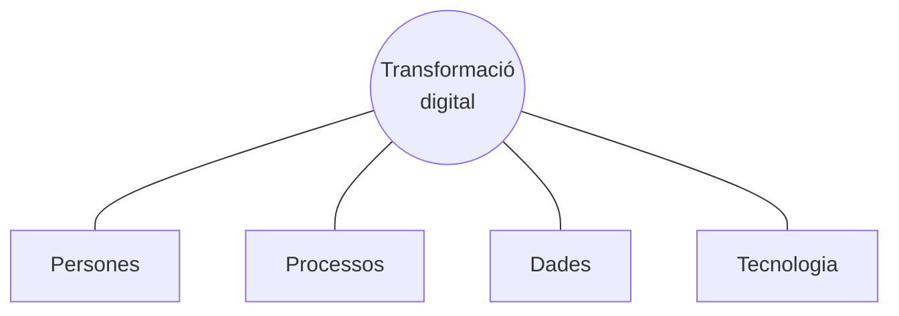

📊 **Cicle de planificació i avaluació (art. 9 Decret 76/2020 i art. 5.2.c Decret 228/2019).** Cada subjecte fa el seu pla anual de desplegament i l'informe anual d'avaluació; els departaments els comuniquen al departament competent, que els pot informar; tot s'eleva al CeAD, que aprova la proposta de pla anual de desenvolupament de l'administració digital i l'eleva al Govern. L'avaluació alimenta la planificació de l'any següent.

```mermaid
flowchart LR
    S["Subjectes de l'art. 2<br/>pla anual de desplegament<br/>+ informe anual d'avaluació"] --> DP["Departament competent<br/>contingut mínim i indicadors<br/>informe si no s'adequa"]
    DP --> CE["CeAD<br/>proposta de Pla anual de<br/>desenvolupament de<br/>l'administració digital"]
    CE --> G["Govern<br/>aprovació"]
    G -.->|"nou exercici"| S
```

### 5.3 Els òrgans col·legiats estratègics (Decret 228/2019)

⚖️ **Decret 228/2019, de 5 de novembre**, dels òrgans col·legiats estratègics de l'àmbit de l'administració digital, dels empleats públics i de la supervisió i governança de les entitats del sector públic institucional de l'Administració de la Generalitat. ✅ Text consolidat contrastat.

- 🔑 **Crea** el **Consell Estratègic d'Administració Digital (CeAD)**, del qual depèn la **Comissió Tècnica del CeAD** (art. 1.1, redacció del Decret 166/2025). Tots dos són **òrgans col·legiats transversals** de l'Administració de la Generalitat i el seu sector públic institucional (art. 4.1). El Consell pot crear altres comissions (art. 4.2).
- Regula també la **Comissió del Sector Públic Institucional** i la **Comissió de Retribucions i Despeses de Personal**.
- **Àmbit d'actuació (art. 2.1):** l'Administració de la Generalitat, les entitats autònomes i entitats de dret públic vinculades o dependents, els consorcis i les fundacions adscrits i les societats mercantils constituïdes exclusivament per l'Administració de la Generalitat.
- **Adscripció (art. 2.3):** al **departament competent en matèria d'administració i funció pública**.
- ❌ El **Decret 166/2025, de 29 de juliol**, **deroga els arts. 9 i 10** i suprimeix la **Comissió de Desplegament de l'Administració Digital (CodAD)**.
- El Decret 228/2019 va derogar el **Decret 309/2011** (Consell per a l'Impuls i l'Ordenació de la Reforma de l'Administració i Comissió per a l'Impuls dels Mitjans Electrònics a l'Administració) i l'**Ordre EMO/145/2012** (Consell Assessor de les Tecnologies de la Informació i la Comunicació).

📊 **Estructura dels òrgans col·legiats d'administració digital.** Es llegeix de baix a dalt, en el sentit en què circulen les propostes fins al Govern. El CeAD és l'òrgan estratègic. En depèn la Comissió Tècnica, que prepara les propostes i fa la coordinació tàctica i operativa. El Comitè d'Ètica de les Dades dona suport al CeAD en els aspectes ètics. La CodAD, que depenia del CeAD, ha estat suprimida.

```mermaid
flowchart BT
    G["Govern"]
    CE["Consell Estratègic d'Administració Digital · CeAD<br/>lideratge estratègic, impuls i coordinació<br/>es reuneix com a mínim 3 cops l'any"]
    CT["Comissió Tècnica del CeAD<br/>propostes, aspectes no estratègics,<br/>coordinació tàctica i operativa<br/>com a mínim trimestral"]
    CO["Comissió de Desplegament de<br/>l'Administració Digital · CodAD<br/>SUPRIMIDA · Decret 166/2025"]
    CED["Comitè d'Ètica de les Dades<br/>GOV/6/2021 · suport en ètica"]
    CT -->|"prepara les propostes"| CE
    CO -.-x CE
    CED -.->|"suport"| CE
    CE -->|"eleva propostes"| G
    style CO fill:#fee2e2,stroke:#b91c1c,color:#7f1d1d,stroke-dasharray: 5 5
```

#### a) El Consell Estratègic d'Administració Digital (CeAD)

⚖️ 🔑 **Objecte (art. 5.1):** el **lideratge estratègic, l'impuls i la coordinació** de les polítiques públiques transversals per al desplegament de l'administració digital dins del marc del **Pacte nacional per a la societat digital**.

⚖️ 🔑 **Funcions (art. 5.2):**
- a) Aprovar la proposta del **model d'administració digital** i elevar-la al **Govern** per mitjà del departament d'adscripció.
- b) Aprovar i impulsar mesures de **canvi cultural** per a una administració digital i uns serveis públics electrònics àgils, eficients, ètics, transparents, de qualitat i segurs.
- c) Aprovar la proposta del **Pla anual de desenvolupament de l'administració digital** i els protocols d'actuació corresponents, i elevar-los al Govern. 🔑 El Pla inclou el **Pla anual de desenvolupament de solucions corporatives**, amb el **Catàleg de solucions corporatives**, i el **Pla anual de transformació digital** de cada departament i de les entitats de l'art. 2.1.b.
- d) En **ciberseguretat**: proposar al Govern i fer el seguiment de l'estratègia i els plans de ciberseguretat, vetllar per polítiques i programes de seguretat, establir els **llindars de risc acceptables** i supervisar el nivell de ciberseguretat.
- e) Fer el **seguiment i la supervisió estratègica** de la planificació aprovada.
- f) **Coordinar** les actuacions de transformació digital i unificar criteris i metodologies.

⚖️ **Composició (art. 6):**

| Càrrec | Titular |
|---|---|
| **Presidència** | Persona titular del **departament competent en matèria d'administració i funció pública** |
| **Vicepresidència** | Persona titular de la **secretaria competent en matèria d'administració i funció pública** |
| **Membres** | Les persones titulars de les **secretaries generals** de tots els departaments |
| **Secretaria** (amb veu, sense vot) | Persona titular de la **direcció general competent en matèria de desenvolupament de l'administració digital** |
| **Assistència en temes de ciberseguretat** (amb veu, sense vot) | Direcció del **CTTI** i direcció de l'organisme responsable de **ciberseguretat** |

> 💡 Segons el **Decret 105/2025**, la **Secretaria d'Administració i Funció Pública** s'integra al **Departament de la Presidència** (art. 64).

**Funcionament (art. 3):** el CeAD es reuneix **com a mínim tres vegades l'any** i sempre que el convoqui el president; es pot reunir a instància de la majoria dels membres; els acords s'adopten per **majoria simple** dels assistents; l'assistència **no genera dret econòmic**; els acords amb efectes davant de tercers es publiquen al **Portal de la Transparència**.

#### b) La Comissió Tècnica del CeAD

⚖️ 🔑 **Objecte (art. 7.1):** preparar les propostes que s'han d'elevar al CeAD, decidir sobre els **aspectes no estratègics** de la implantació de l'administració digital, exercir la **coordinació tàctica i operativa** i qualsevol altra funció que li delegui el CeAD.

⚖️ **Funcions (art. 7.2):**

| Àmbit | Funcions |
|---|---|
| **Solucions corporatives** | a) Identificar, prioritzar i programar **noves solucions corporatives** i fer-ne el seguiment · b) Identificar, prioritzar i programar les **millores evolutives** · c) Elaborar la proposta del **Pla anual de desenvolupament de les solucions corporatives** i elevar-la al CeAD |
| **Transformació digital** | a) Seguiment i propostes d'actualització del **model d'administració digital** · b) Proposar el desenvolupament organitzatiu, jurídic i tecnològic · c) Elaborar la proposta del **Pla anual de transformació digital** · d) 🔑 **Informar preceptivament** les solucions sectorials dels departaments per **evitar duplicitats** amb les corporatives · e) Seguiment operatiu · f) Mesures de **cultura organitzativa** · g) Impulsar i coordinar el **grup de treball multidisciplinari per a l'avenç de la gestió documental en l'entorn electrònic (GTM)** |
| **Ciberseguretat** | a) Donar suport al CeAD en l'estratègia i els plans de ciberseguretat (directrius, llindars de risc acceptable) · b) Seguiment de la política de ciberseguretat |

- **Coordinació (art. 7.3):** es pot relacionar amb les direccions de serveis departamentals per mitjà de la **Comissió Interdepartamental d'Administració i Personal**.
- Pot crear **subcomissions o grups de treball** sectorials (art. 7.4).
- Es reuneix **com a mínim trimestralment** (art. 3.2).

> ⚠️ **Nota sobre la composició (art. 8):** la Comissió Tècnica la presideix la persona titular de la **Direcció General d'Administració Digital del Departament de Polítiques Digitals i Administració Pública**, i la secretaria correspon a l'**Oficina d'Innovació i Administració Digital** del mateix departament. La relació de 17 membres de l'art. 8.1 conserva les denominacions d'òrgans i departaments de 2019, com ara la Direcció General de Transparència i Dades Obertes o el Centre de Seguretat de la Informació de Catalunya. Aquests òrgans no figuren a l'estructura vigent (Decret 105/2025). L'art. 8 no s'ha modificat.

---

## 6. Principals actors en el desenvolupament de l'administració digital

### 6.1 🔄 Organització: el Departament de la Presidència (Decret 105/2025)

⚖️ ✅ El **Decret 105/2025, de 27 de maig**, de reestructuració del Departament de la Presidència, situa les competències d'administració digital, dades, intel·ligència artificial i infraestructures digitals a la **Secretaria de Telecomunicacions i Transformació Digital**, que té **rang orgànic de secretaria general** (art. 80.1).

📊 **Organigrama de l'administració digital a la Generalitat.** El diagrama mostra les unitats que depenen de la Secretaria de Telecomunicacions i Transformació Digital (tres direccions generals i les seves subdireccions i àrees) i els ens que hi estan adscrits. A la dreta, l'EAPC, adscrita per mitjà de la Secretaria d'Administració i Funció Pública.

```mermaid
flowchart TB
    PRE["Departament de la Presidència"]
    PRE --> STTD["Secretaria de Telecomunicacions<br/>i Transformació Digital<br/>art. 80 · rang de secretaria general"]
    PRE --> SAFP["Secretaria d'Administració<br/>i Funció Pública · art. 64"]
    SAFP -.->|"adscripció · art. 1.2.4"| EAPC["Escola d'Administració<br/>Pública de Catalunya"]
    STTD --> DGSD["DG de Serveis Digitals<br/>i Experiència Ciutadana · art. 81"]
    STTD --> DGIA["DG d'Intel·ligència Artificial,<br/>Eficiència i Dades<br/>a l'Administració · art. 91"]
    STTD --> DGID["DG d'Infraestructures<br/>Digitals · art. 95"]
    DGSD --> SGAC["SG d'Atenció Ciutadana"]
    DGSD --> SGAD["SG d'Administració Digital<br/>art. 85"]
    DGSD --> AAM["Àrea d'Analítica i Millora<br/>de l'Experiència Ciutadana"]
    DGSD --> AAJ["Àrea d'Assessorament i de Suport<br/>Jurídic a l'Administració Digital"]
    DGIA --> SGDI["SG de Dades i Innovació Digital<br/>a l'Administració · art. 92"]
    SGDI --> AD["Àrea de Dades · art. 93"]
    SGDI --> AII["Àrea d'Innovació i<br/>Intel·ligència Artificial · art. 94"]
    DGID --> SGIC["SG d'Infraestructures Digitals<br/>i de Comunicacions Electròniques"]
    DGID --> ACJ["Àrea de Coordinació Jurídica<br/>d'Infraestructures Digitals"]
    STTD -.->|"adscripció · art. 1.2.5"| ENS["CTTI · Agència de Ciberseguretat de Catalunya<br/>Consorci AOC · Fundació i2CAT"]
```

### 6.2 La Secretaria de Telecomunicacions i Transformació Digital (art. 80)

⚖️ 🔑 Funcions de l'art. 80.1 relacionades amb aquest tema:

| Lletra | Funció |
|:-:|---|
| **k** | 🔑 **Definir i dirigir l'estratègia de transformació digital** de l'Administració de la Generalitat i del seu sector públic, tant en el funcionament intern com en la relació amb la ciutadania i les entitats jurídiques. |
| **l** | Definir i desenvolupar les polítiques d'innovació i transformació digital, amb la inclusió de tecnologies disruptives com la intel·ligència artificial. |
| **m** | Definir, dirigir i impulsar l'**estratègia d'intel·ligència artificial** i proposar al Govern els instruments per impulsar-la i supervisar-la en els serveis públics. |
| **n** | Definir l'estratègia de **redisseny** per a la simplificació, agilitat, homogeneïtzació i millora dels processos administratius. |
| **o** | Supervisar i coordinar el desenvolupament de la **interoperabilitat** de serveis digitals i de l'administració digital. |
| **p** | 🔑 **Definir i impulsar el model de gestió basat en dades i la seva governança**, impulsar-ne l'obertura i garantir-ne la fiabilitat, accessibilitat, interoperabilitat i reutilització, considerant la privacitat i l'ètica de les dades. |
| **q** | Impulsar l'**Espai comú de dades obertes a Catalunya**, els seus serveis i la seva governança. |
| **r** | Assegurar la coordinació transversal de les polítiques de **protecció de dades**. |
| **s** | Dissenyar i impulsar polítiques per millorar l'**experiència de la ciutadania** en la relació amb la Generalitat. |
| **t** | Dissenyar i impulsar l'estratègia del model d'experiència i d'**atenció ciutadana omnicanal**, homogeni, integrat, accessible, proactiu i personalitzat, i de **comunicació clara**. |
| **v** | Definir i dirigir l'estratègia dels serveis digitals d'**identificació, autenticació i signatura electrònica** de les persones i dels empleats públics. |
| **w** | Dissenyar, conjuntament amb l'**Agència de Ciberseguretat de Catalunya**, les polítiques de **ciberseguretat** de la Generalitat i el seu sector públic, i aprovar-ne els plans. |

Les lletres **a** a **j** corresponen a l'àmbit de les **infraestructures digitals i les comunicacions electròniques** (desplegament d'infraestructures, compliment de la normativa, inspecció i sanció, relacions amb els operadors, suport als ens locals i promoció del sector).

### 6.3 La Direcció General de Serveis Digitals i Experiència Ciutadana (art. 81)

⚖️ Funcions principals (art. 81.1):
- a) 🔑 Dirigir l'estratègia de prestació de **serveis digitals proactius i personalitzats** orientats a la ciutadania i les entitats jurídiques.
- b) 🔑 Impulsar la **interoperabilitat** de serveis digitals i l'intercanvi d'informació, inclosa la subscripció de **convenis i acords de cessió de dades** amb altres administracions i ens del sector públic.
- d) Definir i desplegar mesures de **redisseny** per a la simplificació dels processos administratius.
- f) Liderar i coordinar les polítiques i actuacions corporatives d'**administració digital**.
- g) Proposar, planificar i liderar el desenvolupament dels **sistemes d'informació corporatius**, amb el **CTTI** i el **Consorci AOC** (vessant tecnològic).
- i) Potenciar la **participació ciutadana** en el redisseny de tràmits i serveis digitals.
- k) Dirigir i impulsar l'estratègia dels serveis digitals d'**identificació, autenticació i signatura electrònica**.
- l) i m) Definir i impulsar l'estratègia del **model d'atenció ciutadana** i de l'**atenció omnicanal**.
- n) Exercir les funcions de **unitat responsable d'accessibilitat** dels webs i les aplicacions mòbils.
- p) Impulsar la normativa per al foment de la **tramitació digital**, inclosa la intel·ligència artificial.
- q) **Autoritzar l'obertura o el redisseny** de serveis d'informació i interacció amb la ciutadania en tots els canals (webs, xarxes socials, bots, aplicacions mòbils, telèfons).
- r) Definir l'estratègia de **comunicació clara**.

**Unitats que en depenen (art. 81.2):** Subdirecció General d'Atenció Ciutadana · 🔄 **Subdirecció General d'Administració Digital** · Àrea d'Analítica i Millora de l'Experiència Ciutadana · Àrea d'Assessorament i de Suport Jurídic a l'Administració Digital.

⚖️ La **Subdirecció General d'Administració Digital** (art. 85) té, entre altres, aquestes funcions: elaborar i fer el seguiment dels instruments de **planificació estratègica** i del **pla anual d'acció** de l'administració digital (a); impulsar els sistemes de **intercanvi i interoperabilitat** i la subscripció de convenis de cessió de dades (c); impulsar els sistemes corporatius de **tramitació electrònica** (g); assegurar la coordinació interdepartamental en **interoperabilitat** (j); impulsar i coordinar la **seu electrònica** (m); establir criteris d'**accessibilitat** (o); coordinar l'estratègia dels serveis d'**identificació i signatura electrònica dels empleats públics** (r).

> 🔄 La DA 2a del Decret 105/2025 canvia la denominació de la **Subdirecció General d'Innovació i Administració Digital**, que passa a ser **Subdirecció General d'Administració Digital**.

### 6.4 La Direcció General d'Intel·ligència Artificial, Eficiència i Dades a l'Administració (arts. 91 a 94)

⚖️ 🔑 Òrgan clau del **govern de les dades**. Funcions principals (art. 91.1):
- a) Definir i implementar polítiques d'**innovació** i incorporar-hi l'**ús avançat de les dades**, la **intel·ligència artificial** i altres tecnologies disruptives.
- c) Elaborar i coordinar l'**estratègia d'implantació, adopció i ús de les dades i la intel·ligència artificial**, considerant els aspectes ètics, de seguretat, de ciberseguretat, de transparència, de protecció de dades, de privadesa i de sostenibilitat, i especialment la supervisió en matèria de drets fonamentals.
- d) Impulsar el desplegament del **govern i l'ús de les dades**, habilitant casos d'analítica i models d'IA per a la presa de decisions.
- e) Impulsar i coordinar l'estratègia d'**obertura de dades públiques** i l'**Espai comú de dades obertes a Catalunya**.
- f) 🔑 Impulsar i coordinar l'**estratègia de govern de les dades**, mitjançant eines, protocols, estàndards i metodologia per gestionar el **cicle de vida de les dades**, dels seus registres, dels documents que les contenen i dels casos d'aplicació que en fan ús.
- g) Liderar i coordinar el **Pla de transformació digital de la Generalitat**.
- k) Establir criteris de coordinació interdepartamental en **protecció de dades**.
- n) Impulsar els serveis per a la gestió i la **transparència dels sistemes d'intel·ligència artificial**.

⚖️ **Subdirecció General de Dades i Innovació Digital a l'Administració (art. 92)** — funcions destacades:
- f) Adoptar les mesures per facilitar el **govern de les dades en tot el seu cicle de vida**.
- g) Impulsar les **plataformes i sistemes de dades**, amb el **CTTI** i el **Consorci AOC** (vessant tecnològic).
- h) Vetllar pel desenvolupament de l'**Espai comú de dades obertes a Catalunya**.
- i) 🔑 **Planificar, impulsar, definir, coordinar i desenvolupar el Model de govern de les dades** en tot el seu cicle de vida.
- j) 🔑 Coordinar la gestió de les **dades de referència** i les **dades mestres corporatives**.
- k) 🔑 Vetllar per un **ús ètic de les dades** d'acord amb les recomanacions del **Comitè d'Ètica de les Dades**.
- l) Formació, difusió i **comunitats de pràctica** per consolidar el Model de govern de les dades.
- n) Impulsar el desenvolupament d'**espais de dades**.
- p) Coordinar els rols interdepartamentals en **protecció de dades**.

⚖️ **Àrea de Dades (art. 93)** — àrea funcional: fomentar els **productes de dades**; **inventariar els conjunts de dades** de la Generalitat; coordinar els plans d'intercanvi i obertura de dades; coordinar eines, protocols i estàndards per a la gestió del cicle de vida de les dades d'acord amb el Model de govern de les dades; 🔑 **gestionar el servei de dades obertes de Catalunya** i el seu repositori; federar els repositoris de dades obertes; coordinar l'obertura de dades públiques i la **reutilització**; **donar suport a la implementació del Model de govern de les dades** als departaments.

⚖️ **Àrea d'Innovació i Intel·ligència Artificial (art. 94)** — àrea funcional: desplegar l'estratègia d'innovació i d'IA en els serveis públics; assegurar un **ús coherent, sostenible i responsable de la IA**; identificar solucions innovadores; fer el seguiment dels projectes; estudis, estadístiques, formació i difusió.

> 🔄 La DA 1a del Decret 105/2025 **suprimeix**, entre d'altres, l'**Àrea de Govern de les Dades**, la **Subdirecció General de Dades Obertes i Col·laboració** i l'**Àrea de Dades Obertes**.

### 6.5 La Direcció General d'Infraestructures Digitals (art. 95)

⚖️ Impulsa les polítiques de desplegament de les **infraestructures digitals i les comunicacions electròniques** per fer arribar la connectivitat i l'accés als serveis digitals a la ciutadania, les empreses i les institucions; lidera els programes de desplegament; exerceix les competències d'**inspecció i sanció** (excloses les de radiodifusió); i dona suport als ens locals. En depenen la **Subdirecció General d'Infraestructures Digitals i de Comunicacions Electròniques** i l'**Àrea de Coordinació Jurídica d'Infraestructures Digitals**.

### 6.6 Els ens adscrits

⚖️ ✅ Resten adscrits al Departament de la Presidència **mitjançant la Secretaria de Telecomunicacions i Transformació Digital** (art. 1.2.5 Decret 105/2025):

| Ens | Paper en l'administració digital (segons la normativa citada) |
|---|---|
| 🔑 **Centre de Telecomunicacions i Tecnologies de la Informació (CTTI)** | **Òrgan tècnic** de les funcions centrals del Model de govern de les dades: trasllada l'estratègia a l'àmbit tecnològic i habilita **solucions corporatives** (GOV/158/2023, 4.1.1). Encarregat de la gestió dels serveis i sistemes informàtics de l'Administració de la Generalitat (GOV/158/2023, apartat 3). Col·labora en el vessant tecnològic dels sistemes d'informació i plataformes de dades (arts. 81.1.g i 92.1.g Decret 105/2025). La direcció del CTTI pot assistir al CeAD quan es tracten qüestions de ciberseguretat. |
| 🔑 **Agència de Ciberseguretat de Catalunya** | Dissenya, conjuntament amb la Secretaria, les **polítiques de ciberseguretat** (art. 80.1.w Decret 105/2025). Planifica, gestiona i controla la ciberseguretat en la prestació dels serveis d'identificació electrònica i d'identitat i confiança digitals (art. 7.5 Llei 29/2010). |
| 🔑 **Consorci Administració Oberta de Catalunya (Consorci AOC)** | Instrument de **cooperació entre la Generalitat i els ens locals** en l'ús dels mitjans electrònics (art. 7 Llei 29/2010). **Gestiona el Catàleg de dades i documents interoperables de Catalunya** (art. 21.3 Llei 29/2010 i art. 17 Decret 76/2020). |
| **Fundació Privada i2CAT, Internet i Innovació Digital a Catalunya** | Ens adscrit a la Secretaria. |

⚖️ ✅ 🔑 **El Consorci AOC a la Llei 29/2010 (art. 7):**
- **Art. 7.2.** La Generalitat i els ens locals cooperen i col·laboren, de manera ordinària i voluntària, per mitjà del Consorci AOC, en: a) l'impuls i el desenvolupament de l'ús dels mitjans electrònics; b) la coordinació de les seves estratègies i actuacions; c) la definició i l'execució d'estratègies comunes en aquests àmbits: 1r) la creació i prestació de **serveis comuns** d'administració electrònica; 2n) la **reutilització** de les aplicacions i els serveis; 3r) l'extensió dels mitjans electrònics per garantir la **identitat** i acreditar la **voluntat**; 4t) la promoció de la **interoperabilitat**; 5è) la garantia de la confidencialitat, la integritat, la identitat i el no-rebuig en les comunicacions electròniques.
- **Art. 7.3.** Funcions del Consorci AOC: a) desenvolupar aplicacions, eines i serveis electrònics i promoure'n l'ús, d'acord amb el **Pla de desenvolupament de l'ús dels mitjans electrònics del sector públic de Catalunya** (art. 26); b) elaborar **criteris i recomanacions d'interoperabilitat**; c) i d) desenvolupar i executar mesures de **cooperació** i de **foment** de la Generalitat amb els ens locals; e) les altres que se li atribueixin.
- **Art. 7.4.** L'**Agència Catalana de Certificació** presta serveis de **signatura electrònica** al sector públic de Catalunya per garantir la confidencialitat, la integritat, la identitat i el no-rebuig en les comunicacions electròniques.
- **Art. 7.5.** L'**Agència de Ciberseguretat de Catalunya** s'encarrega de planificar, gestionar i controlar la ciberseguretat dels serveis d'identificació electrònica i d'identitat i confiança digitals. *(Afegit per la Llei 15/2017; recurs d'inconstitucionalitat desestimat per la STC 142/2018.)*

### 6.7 Altres actors i instàncies

📊 **Mapa d'actors.** L'esquema agrupa els actors que intervenen en el desenvolupament de l'administració digital segons la seva funció: òrgans de direcció, òrgans col·legiats, ens instrumentals, estructures del Model de govern de les dades i la resta de departaments.

```mermaid
mindmap
  root((Actors de l'administració digital))
    Direcció
      Govern
      Departament de la Presidència
      Secretaria de Telecomunicacions i Transformació Digital
      Tres direccions generals
    Òrgans col·legiats
      Consell Estratègic d'Administració Digital
      Comissió Tècnica del CeAD
      Comitè d'Ètica de les Dades
    Ens instrumentals
      CTTI
      Agència de Ciberseguretat de Catalunya
      Consorci AOC
      Fundació i2CAT
      EAPC
    Model de govern de les dades
      Comitè Estratègic de Govern de les Dades
      Comitè Operatiu de Govern de les Dades
      Referents de govern de les dades
      Grups de treball multidisciplinaris
    Departaments
      Funció federal
      Pla anual de transformació digital
```

- **Govern:** aprova el model d'administració digital (art. 5.3 Decret 76/2020), el model organitzatiu (art. 6.2), el model de govern de les dades (art. 10.3) i el Pla anual de desenvolupament de l'administració digital (art. 5.2.c Decret 228/2019).
- **Departaments i el seu sector públic:** elaboren el pla anual de desplegament i l'informe anual d'avaluació (art. 9 Decret 76/2020), exerceixen la **funció federal** del govern de les dades i designen els **referents de govern de les dades** (GOV/158/2023); les persones titulars de les **secretaries generals** són membres del CeAD.
- **Institut d'Estadística de Catalunya (Idescat):** és membre del Comitè d'Ètica de les Dades. El Decret 76/2020 preveu la cooperació necessària perquè l'**òrgan estadístic de la Generalitat** accedeixi a les dades per a l'ús estadístic (art. 12).
- **Escola d'Administració Pública de Catalunya (EAPC):** adscrita al Departament de la Presidència mitjançant la Secretaria d'Administració i Funció Pública (art. 1.2.4 Decret 105/2025).
- **Grup de treball multidisciplinari per a l'avenç de la gestió documental en l'entorn electrònic (GTM):** l'impulsa i el coordina la Comissió Tècnica del CeAD (art. 7.2.2.g Decret 228/2019).

---

## 7. Règim jurídic de l'administració digital i de l'ús de mitjans electrònics

### 7.1 Mapa normatiu

📊 **Mapa normatiu de l'administració digital.** Es llegeix de dalt a baix, de la norma de més abast territorial a la més propera. El dret de la Unió Europea (identificació electrònica, governança de dades i protecció de dades) s'aplica directament. La legislació estatal **bàsica** (Llei 39/2015, Llei 40/2015 i el RD 203/2021 en els preceptes bàsics, amb l'ENS i l'ENI) és comuna a totes les administracions. La normativa catalana la desenvolupa: la Llei 26/2010 i la Llei 29/2010 per a tot el sector públic de Catalunya, i el Decret 76/2020 per a l'Administració de la Generalitat, amb els acords de Govern que el despleguen.

```mermaid
flowchart TB
    subgraph UE["UNIÓ EUROPEA · aplicació directa"]
        direction LR
        U1["Reglament eIDAS 910/2014<br/>mod. Reglament 2024/1183"]
        U2["Reglament 2022/868<br/>governança de dades"]
        U3["Reglament 2016/679<br/>protecció de dades"]
        U4["Decisió 2022/2481<br/>Dècada Digital"]
    end
    subgraph ES["ESTAT · legislació bàsica art. 149.1.18 CE"]
        direction LR
        E1["Llei 39/2015<br/>procediment administratiu comú"]
        E2["Llei 40/2015<br/>règim jurídic del sector públic"]
        E3["RD 203/2021<br/>Reglament de mitjans electrònics"]
        E4["RD 311/2022 ENS<br/>RD 4/2010 ENI"]
    end
    subgraph CAT["CATALUNYA"]
        direction LR
        C1["Llei 26/2010<br/>règim jurídic i procediment"]
        C2["Llei 29/2010<br/>mitjans electrònics<br/>sector públic de Catalunya"]
        C3["Decret 76/2020<br/>Administració digital<br/>mod. Decret 253/2025"]
        C4["Decret 228/2019 · CeAD<br/>GOV/158/2023 · GOV/6/2021"]
    end
    UE --> ES --> CAT
```

### 7.2 Normativa de la Unió Europea

#### a) Identificació electrònica i serveis de confiança: eIDAS i eIDAS2

- ⚖️ **Reglament (UE) núm. 910/2014 del Parlament Europeu i del Consell, de 23 de juliol de 2014** (**eIDAS**), relatiu a la identificació electrònica i els serveis de confiança per a les transaccions electròniques al mercat interior. És la base dels **certificats electrònics qualificats** i de la **"Llista de confiança de prestadors de serveis de certificació"** a què es refereixen els arts. 9 i 10 de la Llei 39/2015.
- ⚖️ 🔄 **Reglament (UE) 2024/1183 del Parlament Europeu i del Consell, d'11 d'abril de 2024** (**eIDAS2**), que **modifica el Reglament (UE) núm. 910/2014** per establir el **marc europeu d'identitat digital**. ✅ En vigor des del **20 de maig de 2024**.
  - Un dels punts clau és l'**acceptació obligatòria**, per tots els estats membres, dels mitjans d'identificació electrònica emesos en qualsevol d'ells.
  - 🔑 **Cartera europea d'identitat digital** (*EUDI Wallet*): aplicació mòbil per emmagatzemar, gestionar i presentar credencials digitals, autenticar la identitat i accedir a serveis públics i privats. El seu ús és **voluntari i gratuït** per a la ciutadania.
  - 🔑 Cada estat membre ha de proporcionar, com a mínim, una versió de la cartera **a finals de 2026**.

#### b) Altres normes de la Unió

- ⚖️ **Reglament (UE) 2016/679**, general de protecció de dades (RGPD): les lleis 39/2015 i 40/2015 s'hi remeten en la ubicació dels sistemes d'identificació i signatura (arts. 9.3 i 10.3 Llei 39/2015) i en les transmissions de dades entre administracions (art. 155 Llei 40/2015).
- ⚖️ **Reglament (UE) 2022/868**, de governança europea de dades: vegeu l'apartat 2.9.
- ⚖️ **Decisió (UE) 2022/2481**, Dècada Digital: vegeu l'apartat 4.2.

### 7.3 Normativa estatal bàsica

#### 7.3.1 Llei 39/2015, d'1 d'octubre, del procediment administratiu comú de les administracions públiques

⚖️ ✅ Text contrastat amb el text consolidat del BOE.

> 🔄 **Precisió important:** la Llei 39/2015 **no obliga totes les persones a relacionar-se electrònicament**. Les **persones físiques** poden triar en qualsevol moment si es relacionen o no per mitjans electrònics, llevat que hi estiguin obligades (art. 14.1). L'obligació de relacionar-se electrònicament afecta els subjectes de l'art. 14.2 i els col·lectius que fixi un reglament (art. 14.3). Les administracions, en canvi, **han de garantir** que les persones s'hi puguin relacionar per mitjans electrònics (art. 12.1), i els **expedients tenen format electrònic** (art. 70.2).

**Entrada en vigor (DF 7a):** la Llei va entrar en vigor al cap d'un any de la publicació al BOE. 🔑 Les previsions relatives al **registre electrònic d'apoderaments**, el **registre electrònic**, el **registre d'empleats públics habilitats**, el **punt d'accés general electrònic** i l'**arxiu únic electrònic** produeixen efectes a partir del **2 d'abril de 2021**.

##### a) Identificació i signatura (arts. 9 a 11)

| Article | Contingut |
|---|---|
| 🔄 **Art. 9. Sistemes d'identificació** | Les administracions han de verificar la identitat dels interessats (nom i cognoms o denominació o raó social del DNI o document equivalent). Els interessats es poden identificar electrònicament amb: a) **certificats electrònics qualificats de signatura electrònica**; b) **certificats electrònics qualificats de segell electrònic**, expedits per prestadors inclosos a la *Llista de confiança de prestadors de serveis de certificació*; c) **qualsevol altre sistema** que les administracions considerin vàlid, amb **registre previ com a usuari** i comunicació prèvia a la Secretaria General d'Administració Digital de l'Estat, acompanyada d'una declaració responsable; el sistema no és eficaç fins que passen **dos mesos** des de la comunicació. 🔑 Les administracions han de garantir que les lletres a) i b) es puguin utilitzar en **tot procediment**. Els recursos tècnics dels sistemes de la lletra c) han de ser al **territori de la UE** (o a l'Estat, si es tracta de categories especials de dades de l'art. 9 RGPD). L'acceptació d'un sistema per l'Administració General de l'Estat serveix per acreditar la identificació davant de totes les administracions, llevat de prova en contra. |
| 🔄 **Art. 10. Sistemes de signatura** | Els interessats poden signar per qualsevol mitjà que permeti acreditar l'**autenticitat** de l'expressió de la seva voluntat i consentiment, i la **integritat i inalterabilitat** del document. Són vàlids: a) **signatura electrònica qualificada i avançada** basada en certificats qualificats; b) **segell electrònic qualificat i avançat**; c) **qualsevol altre sistema** vàlid, amb els mateixos requisits que l'art. 9.2.c. Quan la normativa ho disposi, els sistemes d'identificació es poden admetre com a sistema de signatura. 🔑 Quan s'utilitza un sistema de signatura, la **identitat s'entén acreditada** pel mateix acte de signar. |
| **Art. 11. Ús de la identificació i la signatura** | Amb caràcter general, n'hi ha prou amb la **identificació**. 🔑 La **signatura** només és obligatòria per: a) **formular sol·licituds**; b) **presentar declaracions responsables o comunicacions**; c) **interposar recursos**; d) **desistir d'accions**; e) **renunciar a drets**. |

> 🔄 Els arts. 9 i 10 els va modificar el **Reial decret llei 14/2019, de 31 d'octubre**, i la lletra c) de l'apartat 2 de tots dos, la **Llei 11/2022, de 28 de juny**.

##### b) Assistència, drets i relació electrònica (arts. 12 a 14)

- ⚖️ **Art. 12. Assistència en l'ús de mitjans electrònics.** Les administracions han de garantir que els interessats s'hi poden relacionar per mitjans electrònics, posant a disposició els canals d'accés necessaris. Han d'**assistir** els interessats **no obligats** que ho demanin, especialment en la identificació i la signatura electrònica, la presentació de sol·licituds al registre electrònic general i l'obtenció de còpies autèntiques. Si l'interessat no té els mitjans electrònics necessaris, 🔑 un **funcionari públic habilitat** el pot identificar o signar per ell amb el seu sistema de signatura, amb el **consentiment exprés** de l'interessat, del qual ha de quedar constància. Cada administració ha de mantenir actualitzat un **registre de funcionaris habilitats**, interoperable i interconnectat amb els de la resta d'administracions, on han de constar, almenys, els funcionaris de les oficines d'assistència en matèria de registres.
- ⚖️ **Art. 13. Drets de les persones en les relacions amb les administracions.** a) Comunicar-se per mitjà d'un **punt d'accés general electrònic**; b) **ser assistides** en l'ús de mitjans electrònics; c) utilitzar les llengües oficials; d) accedir a la informació pública, arxius i registres; e) ser tractades amb respecte i deferència; f) exigir responsabilitats; g) **obtenir i utilitzar els mitjans d'identificació i signatura electrònica**; h) **protecció de dades personals**, i en particular la seguretat i la confidencialitat de les dades dels fitxers, sistemes i aplicacions; i) els altres que reconeguin la Constitució i les lleis.
- ⚖️ 🔑 **Art. 14. Dret i obligació de relacionar-se electrònicament.**
  1. Les **persones físiques** poden **triar en qualsevol moment** si es comuniquen amb les administracions per mitjans electrònics o no, llevat que hi estiguin obligades, i poden modificar el mitjà triat en qualsevol moment.
  2. **Estan obligats** a relacionar-se electrònicament per fer qualsevol tràmit d'un procediment, almenys: a) les **persones jurídiques**; b) les **entitats sense personalitat jurídica**; c) els qui exerceixen una **activitat professional amb col·legiació obligatòria**, per als tràmits en exercici d'aquesta activitat (inclosos, en tot cas, els **notaris i registradors** de la propietat i mercantils); d) els qui **representen un interessat obligat**; e) els **empleats de les administracions públiques**, per als tràmits per raó de la seva condició, en la forma que determini cada administració.
  3. **Per reglament**, les administracions poden establir l'obligació per a determinats procediments i **col·lectius de persones físiques** que, per raó de la seva capacitat econòmica, tècnica, dedicació professional o altres motius, tinguin acreditat l'accés i la disponibilitat dels mitjans electrònics necessaris.

📊 **Qui s'ha de relacionar electrònicament amb l'Administració (art. 14).** L'arbre de decisió parteix de la persona interessada. Si és una persona jurídica, una entitat sense personalitat, un professional col·legiat en exercici, el representant d'un obligat o un empleat públic per raó del càrrec, està obligada. Si és una persona física que no és en cap d'aquests casos, pot triar el mitjà, llevat que un reglament l'obligui per pertànyer a un col·lectiu amb accés acreditat als mitjans electrònics.

```mermaid
flowchart TB
    I["Persona interessada"] --> Q1{"És un dels subjectes<br/>de l'art. 14.2?"}
    Q1 -->|"Sí · persona jurídica, entitat sense personalitat,<br/>professional col·legiat, representant d'un obligat,<br/>empleat públic per raó del càrrec"| OB["OBLIGADA a relacionar-se<br/>electrònicament"]
    Q1 -->|No| Q2{"Un reglament l'obliga<br/>per a aquest procediment<br/>i col·lectiu? art. 14.3"}
    Q2 -->|Sí| OB
    Q2 -->|No| PF["Persona física: POT TRIAR<br/>i canviar el mitjà en qualsevol moment<br/>art. 14.1"]
    PF --> AS["Si no té mitjans: assistència<br/>i funcionari habilitat · art. 12"]
```

##### c) Registres (art. 16)

⚖️ 🔑 **Art. 16.** Cada administració ha de disposar d'un **Registre Electrònic General** on s'ha de fer l'assentament de tot document que es presenti o es rebi en qualsevol òrgan, organisme públic o entitat. Els organismes públics poden tenir el seu propi registre electrònic, plenament **interoperable i interconnectat** amb el general. Les disposicions de creació dels registres electrònics s'han de publicar al diari oficial i han d'especificar l'òrgan responsable, la **data i hora oficial** i els **dies inhàbils**.
- Els assentaments s'anoten per ordre temporal i el registre en garanteix la constància (número, epígraf, data i hora, interessat, òrgan remitent i destinatari, referència al contingut). S'emet automàticament un **rebut** amb una còpia autenticada del document, que en garanteix la integritat i el no-repudi.
- 🔑 **Llocs de presentació (art. 16.4):** a) el registre electrònic de l'administració o organisme destinatari o qualsevol dels registres electrònics dels subjectes de l'art. 2.1; b) les **oficines de Correus**; c) les **representacions diplomàtiques o oficines consulars** d'Espanya a l'estranger; d) les **oficines d'assistència en matèria de registres**; e) qualsevol altre que estableixin les disposicions vigents.
- Els documents presentats presencialment s'han de **digitalitzar** per l'oficina d'assistència en matèria de registres i s'han de **retornar els originals** a l'interessat, llevat dels supòsits de custòdia o de documents no digitalitzables (art. 16.5).

##### d) Documents, còpies i dret a no aportar dades (arts. 26 a 28)

- ⚖️ **Art. 26. Emissió de documents.** Les administracions emeten els documents administratius **per escrit, per mitjans electrònics**, llevat que la naturalesa del document n'exigeixi una altra forma. 🔑 **Requisits de validesa del document electrònic administratiu (art. 26.2):** a) contenir informació arxivada en un suport electrònic segons un **format** determinat; b) disposar de les **dades d'identificació** que en permetin la individualització; c) incorporar una **referència temporal** del moment de l'emissió; d) incorporar les **metadades mínimes** exigides; e) incorporar les **signatures electròniques** que corresponguin. No requereixen signatura els documents merament informatius ni els que no formen part d'un expedient, però se n'ha d'identificar l'origen.
- ⚖️ **Art. 27. Còpies.** Les **còpies autèntiques** tenen la mateixa validesa i eficàcia que els originals; les fan els òrgans competents, mitjançant **funcionari habilitat** o **actuació administrativa automatitzada**, d'acord amb l'ENI i l'ENS. Les còpies electròniques han d'incloure les **metadades** que n'acreditin la condició de còpia. 🔑 **Digitalització:** procés tecnològic que permet convertir un document en suport paper o en un altre suport no electrònic en un fitxer electrònic que conté la imatge codificada, fidel i íntegra del document. Les còpies en paper de documents electrònics porten un **codi segur de verificació** o un altre sistema que permeti contrastar-ne l'autenticitat. Els interessats poden demanar còpies autèntiques en qualsevol moment, que s'han d'expedir en el termini de **quinze dies**.
- ⚖️ 🔑 **Art. 28.2. Dret a no aportar documents.** Els interessats tenen dret a **no aportar documents que ja siguin en poder de l'administració actuant o que hagi elaborat qualsevol altra administració**. L'administració els pot consultar o recaptar **llevat que l'interessat s'hi oposi** (no hi cap oposició en l'exercici de potestats sancionadores o d'inspecció). Les administracions han de recaptar els documents **electrònicament** per mitjà de les seves xarxes corporatives o de consulta a les **plataformes d'intermediació de dades**. Tampoc no poden exigir documents **originals**, llevat de casos excepcionals, ni dades o documents no exigits per la normativa o que l'interessat ja hagi aportat a qualsevol administració (art. 28.3).

##### e) Notificacions electròniques (arts. 41 i 43)

- ⚖️ **Art. 41.** Les notificacions s'han de practicar **preferentment per mitjans electrònics** i, en tot cas, quan l'interessat hi estigui obligat. Excepcions: compareixença espontània de l'interessat a les oficines d'assistència en matèria de registre; entrega directa per un empleat públic quan sigui necessari per assegurar l'eficàcia de l'actuació. **No es poden fer per mitjans electrònics** les notificacions amb elements no convertibles en format electrònic ni les que continguin mitjans de pagament (com xecs). L'administració ha d'enviar un **avís** al dispositiu electrònic o a l'adreça de correu de l'interessat; la manca d'avís no impedeix que la notificació sigui vàlida. Si l'interessat rep la notificació per diferents canals, la data és la de la primera.
- ⚖️ 🔑 **Art. 43.** Les notificacions electròniques es practiquen per **compareixença a la seu electrònica**, per la **adreça electrònica habilitada única** o per tots dos sistemes. S'entenen **practicades** en el moment en què **s'accedeix al contingut**. Quan la notificació electrònica és obligatòria o l'ha triada l'interessat, s'entén **rebutjada** quan han passat **deu dies naturals** des de la posada a disposició sense accedir-hi. L'obligació de notificar dins de termini s'entén complerta amb la **posada a disposició**. Els interessats hi poden accedir des del **punt d'accés general electrònic**.

📊 **Cronologia d'una notificació electrònica (art. 43).** Un cop l'administració posa la notificació a disposició (i compleix així l'obligació de notificar dins de termini), poden passar dues coses: si la persona accedeix al contingut, la notificació queda practicada en aquell moment; si en deu dies naturals no hi accedeix, s'entén rebutjada i el procediment continua.

```mermaid
flowchart LR
    PD["Posada a disposició<br/>a la seu electrònica o a l'adreça<br/>electrònica habilitada única<br/>+ avís al correu o dispositiu"] --> Q{"Accés al<br/>contingut?"}
    Q -->|"Sí, abans de 10 dies naturals"| PR["Notificació PRACTICADA<br/>en el moment de l'accés"]
    Q -->|"No, passats 10 dies naturals"| RE["Notificació REBUTJADA<br/>es fa constar i el<br/>procediment continua"]
    PD -.->|"obligació de notificar<br/>dins de termini complerta"| OK["art. 43.3"]
```

##### f) Expedient administratiu electrònic (art. 70)

⚖️ 🔑 **Art. 70.** L'**expedient administratiu** és el conjunt ordenat de documents i actuacions que serveixen d'antecedent i fonament a la resolució administrativa, i les diligències encaminades a executar-la. Els expedients tenen **format electrònic** i es formen per l'agregació ordenada de documents, proves, dictàmens, informes, acords, notificacions i altres diligències, amb un **índex numerat** quan es remeten. La remissió es fa segons l'**ENI**: l'expedient complet, foliat, autenticat i amb un índex autenticat que en garanteix la integritat i la immutabilitat. No en forma part la informació auxiliar o de suport (aplicacions, fitxers, bases de dades, notes, esborranys, opinions, resums, comunicacions i informes interns, judicis de valor), llevat dels informes preceptius i facultatius sol·licitats abans de la resolució.

#### 7.3.2 Llei 40/2015, d'1 d'octubre, de règim jurídic del sector públic

⚖️ ✅ Text contrastat amb el text consolidat del BOE.

🔑 **Art. 3.2:** les administracions públiques **es relacionen entre si** i amb els seus òrgans, organismes i entitats **per mitjans electrònics**, que assegurin la **interoperabilitat i la seguretat** dels sistemes, garanteixin la protecció de les dades personals i facilitin preferentment la prestació conjunta de serveis als interessats.

**Funcionament electrònic del sector públic (capítol V del títol preliminar, arts. 38 a 46 bis):**

| Article | 🔑 Contingut |
|---|---|
| **38. Seu electrònica** | Adreça electrònica, disponible per als ciutadans a través de xarxes de telecomunicacions, la **titularitat** de la qual correspon a una administració o a un o diversos organismes o entitats de dret públic. El titular és **responsable de la integritat, veracitat i actualització** de la informació i els serveis. Principis: **transparència, publicitat, responsabilitat, qualitat, seguretat, disponibilitat, accessibilitat, neutralitat i interoperabilitat**. Ha d'identificar l'òrgan titular i els mitjans per formular suggeriments i queixes, i utilitzar **certificats qualificats d'autenticació de lloc web**. |
| **39. Portal d'internet** | Punt d'accés electrònic d'una administració, organisme o entitat que permet l'accés per internet a la **informació publicada** i, si escau, a la seu electrònica. |
| **40. Identificació de les administracions** | Mitjançant **segell electrònic** basat en un certificat electrònic qualificat (amb NIF i denominació). La relació de segells ha de ser pública. L'administració s'entén identificada respecte de la informació que publica com a pròpia al seu portal. |
| **41. Actuació administrativa automatitzada** | 🔑 *Qualsevol acte o actuació feta íntegrament per mitjans electrònics per una administració en el marc d'un procediment administratiu i en la qual no hagi intervingut de manera directa un empleat públic.* Cal establir prèviament l'òrgan competent per a la definició de les especificacions, la programació, el manteniment, la supervisió i el control de qualitat i, si escau, l'**auditoria del sistema i del codi font**, i l'òrgan **responsable a l'efecte d'impugnació**. |
| **42. Signatura de l'actuació automatitzada** | a) **Segell electrònic** de l'administració, òrgan, organisme o entitat · b) **Codi segur de verificació** (CSV), que permet comprovar la integritat del document a la seu electrònica. |
| **43. Signatura del personal** | L'actuació per mitjans electrònics es fa amb la **signatura electrònica del titular de l'òrgan o empleat públic**. Per raons de seguretat pública, la signatura pot referir-se només al **número d'identificació professional**. |
| **44. Intercanvi en entorns tancats** | Els documents electrònics transmesos en **entorns tancats de comunicacions** entre administracions, òrgans i entitats són vàlids a l'efecte d'**autenticació i identificació** dels emissors i receptors. Dins d'una mateixa administració, aquesta en fixa les condicions; entre administracions diferents, per **conveni**. |
| **45. Interoperabilitat de la signatura** | Les administracions poden superposar un **segell electrònic** qualificat a la documentació signada amb altres sistemes per afavorir-ne la verificació automàtica. |
| **46. Arxiu electrònic** | 🔑 Tots els documents utilitzats en les actuacions administratives s'han d'**emmagatzemar per mitjans electrònics**, llevat que no sigui possible. Els que contenen actes que afecten drets o interessos s'han de conservar en suports electrònics. Mesures de seguretat d'acord amb l'**ENS**, inclosa la conservació a llarg termini *d'acord amb les especificacions sobre el cicle de vida dels serveis i sistemes*. |
| 🔄 **46 bis. Ubicació dels sistemes** | Els sistemes d'informació per a la gestió del **cens electoral**, els **padrons municipals** i altres registres de població, les **dades fiscals** de tributs propis o cedits i les dades dels usuaris del **sistema nacional de salut** s'han d'ubicar i prestar **dins del territori de la UE**. *Afegit pel RDL 14/2019.* |

**Relacions electròniques entre administracions (capítol IV del títol III, arts. 155 a 158):**

| Article | 🔑 Contingut |
|---|---|
| 🔄 **155. Transmissions de dades** | D'acord amb el **RGPD** i la **Llei orgànica 3/2018**, cada administració ha de facilitar l'accés de les altres a les dades dels interessats que té, amb les màximes garanties de seguretat, integritat i disponibilitat. No es poden tractar posteriorment per a finalitats **incompatibles** (no ho és l'arxiu en interès públic, la recerca científica i històrica o les finalitats estadístiques). Per a una nova finalitat compatible, la cessionària ho ha de **comunicar prèviament** a la cedent, que s'hi pot oposar motivadament en **deu dies**. *Modificat pel RDL 14/2019.* |
| **156. ENI i ENS** | 🔑 L'**Esquema Nacional d'Interoperabilitat** comprèn els criteris i recomanacions de seguretat, conservació i normalització de la informació, dels formats i de les aplicacions per garantir la interoperabilitat. L'**Esquema Nacional de Seguretat** estableix la política de seguretat en la utilització de mitjans electrònics, amb els principis bàsics i requisits mínims que garanteixin la seguretat de la informació. |
| **157. Reutilització de sistemes i aplicacions** | Les administracions han de posar a disposició de les altres les aplicacions de les quals són titulars, que es poden declarar de **fonts obertes**. Abans d'adquirir o desenvolupar una aplicació, han de consultar el **directori general d'aplicacions** de l'Administració General de l'Estat; si hi ha una solució reutilitzable, n'**estan obligades a l'ús**, llevat que la decisió de no reutilitzar-la es justifiqui en termes d'eficiència. |
| **158. Transferència de tecnologia** | Les administracions han de mantenir **directoris actualitzats d'aplicacions** per a la seva lliure reutilització, interoperables amb el directori general de l'Administració General de l'Estat. |

#### 7.3.3 Reial decret 203/2021, de 30 de març: Reglament d'actuació i funcionament del sector públic per mitjans electrònics

⚖️ ✅ Text contrastat amb el text consolidat del BOE.

- **Objecte (art. 1):** desenvolupar la **Llei 39/2015** i la **Llei 40/2015** pel que fa a l'actuació i el funcionament electrònic del sector públic. L'àmbit subjectiu és el dels arts. 2 de totes dues lleis.
- **Entrada en vigor:** **2 d'abril de 2021**. ❌ **Deroga el Reial decret 1671/2009, de 6 de novembre**, que desplegava parcialment la Llei 11/2007.
- 🔄 **Modificacions i resolucions judicials:** el **Reial decret 255/2025, d'1 d'abril** (que regula el DNI), modifica els **arts. 27.1 i 28.1** per admetre el **número d'identificació consular central** com a identificador, al costat del DNI, el NIE i el NIF. La **Sentència del Tribunal Suprem de 30 de maig de 2022** declara la **nul·litat de la disposició transitòria primera**.
- 🔑 **Caràcter bàsic (DF 1a):** es dicta a l'empara de l'**art. 149.1.18a de la Constitució** (procediment administratiu comú i bases del règim jurídic de les administracions públiques). Alguns preceptes relacionats amb la ciberseguretat es dicten també a l'empara dels arts. 149.1.21a i 149.1.29a. L'apartat 3 enumera els preceptes que **no tenen caràcter bàsic** i només s'apliquen a l'àmbit estatal; la resta són **bàsics** i s'apliquen a totes les administracions.

🔑 **Principis generals de les actuacions i relacions electròniques (art. 2):**

| Lletra | Principi | Contingut |
|:-:|---|---|
| a | **Neutralitat tecnològica i adaptabilitat** al progrés de les tecnologies | Independència en l'elecció de les alternatives tecnològiques i llibertat per desenvolupar avenços. El sector públic utilitza **estàndards oberts** i, de manera complementària, estàndards d'ús generalitzat. |
| b | **Accessibilitat** | Principis i tècniques per garantir la igualtat i la no-discriminació en l'accés, en particular de les **persones amb discapacitat i les persones grans**. |
| c | **Facilitat d'ús** | Disseny dels serveis **centrat en les persones usuàries**, per minimitzar el coneixement necessari per utilitzar-los. |
| d | **Interoperabilitat** | Capacitat dels sistemes d'informació, i dels procediments als quals donen suport, de compartir dades i possibilitar l'intercanvi d'informació. |
| e | **Proporcionalitat** | Només s'exigeixen les garanties i mesures de seguretat adequades a la naturalesa i les circumstàncies de cada tràmit. |
| f | 🔑 **Personalització i proactivitat** | Capacitat de les administracions de proporcionar, a partir del coneixement adquirit de l'usuari, **serveis preemplenats** i d'**anticipar-se** a les seves possibles necessitats. |

⚖️ **Art. 3. Dret i obligació de relacionar-se electrònicament.** Estan obligats, almenys, els subjectes de l'**art. 14.2 de la Llei 39/2015**. Les persones físiques no obligades poden exercir el dret de relacionar-se electrònicament a l'inici del procediment o en una fase posterior, i també deixar de fer-ho, comunicant-ho a l'òrgan competent; 🔑 els efectes es produeixen a partir del **cinquè dia hàbil** següent a aquell en què l'òrgan en té constància. L'obligació per a col·lectius de persones físiques es pot establir per reglament (art. 14.3 Llei 39/2015).

**Estructura del Reglament:**

| Títol | Contingut |
|---|---|
| Preliminar | Disposicions generals |
| I | Portals d'internet, punt d'accés general electrònic i seus electròniques |
| II | Procediment administratiu per mitjans electrònics: disposicions generals; identificació i autenticació de les administracions i les persones interessades; registres, comunicacions i notificacions electròniques |
| III | Expedient administratiu electrònic: document administratiu electrònic i còpies; arxiu electrònic de documents |
| IV | Relacions i col·laboració entre les administracions per al funcionament del sector públic per mitjans electrònics: col·laboració; transferència i ús compartit de tecnologies |
| Annex | Definicions |

#### 7.3.4 Esquema Nacional de Seguretat (Reial decret 311/2022, de 3 de maig)

⚖️ ✅ Text contrastat amb el text consolidat del BOE. ❌ **Deroga el Reial decret 3/2010, de 8 de gener** (ENS anterior). 🔄 Modificat pel **Reial decret 1125/2024, de 5 de novembre** (disposició addicional segona).

- **Objecte (art. 1):** regular l'**ENS**, establert a l'**art. 156.2 de la Llei 40/2015**. 🔑 Està constituït pels **principis bàsics** i els **requisits mínims** necessaris per a una protecció adequada de la informació i els serveis, per assegurar l'**accés, la confidencialitat, la integritat, la traçabilitat, l'autenticitat, la disponibilitat i la conservació** de les dades, la informació i els serveis electrònics.

| 🔑 Principis bàsics (art. 5) — 7 | 🔑 Requisits mínims (art. 12.6) — 15 |
|---|---|
| a) Seguretat com a **procés integral** | a) Organització i implantació del procés de seguretat |
| b) Gestió de la seguretat **basada en els riscos** | b) Anàlisi i gestió dels riscos |
| c) **Prevenció, detecció, resposta i conservació** | c) Gestió de personal |
| d) Existència de **línies de defensa** | d) Professionalitat |
| e) **Vigilància contínua** | e) Autorització i control dels accessos |
| f) **Reavaluació periòdica** | f) Protecció de les instal·lacions |
| g) **Diferenciació de responsabilitats** | g) Adquisició de productes i contractació de serveis de seguretat |
| | h) Mínim privilegi |
| | i) Integritat i actualització del sistema |
| | j) Protecció de la informació emmagatzemada i en trànsit |
| | k) Prevenció davant d'altres sistemes d'informació interconnectats |
| | l) Registre de l'activitat i detecció de codi nociu |
| | m) Incidents de seguretat |
| | n) Continuïtat de l'activitat |
| | ñ) Millora contínua del procés de seguretat |

- **Política de seguretat (art. 12):** conjunt de directrius que regeixen com una organització gestiona i protegeix la informació i els serveis. 🔑 Cada administració ha de tenir una **política de seguretat formalment aprovada** per l'òrgan competent. Els requisits mínims s'exigeixen **en proporció als riscos** identificats.
- 🔑 **Categories de seguretat (art. 40):** modulen l'equilibri entre la importància de la informació i els serveis i l'esforç de seguretat, segons el principi de **proporcionalitat**. Es determinen segons l'impacte d'un incident en la **disponibilitat, autenticitat, integritat, confidencialitat o traçabilitat**: categoria **BÀSICA**, **MITJANA** o **ALTA**. Els sistemes de categoria **mitjana o alta** requereixen una **auditoria** per certificar-ne la conformitat; els de categoria **bàsica**, una **autoavaluació** (art. 38).

#### 7.3.5 Esquema Nacional d'Interoperabilitat (Reial decret 4/2010, de 8 de gener)

⚖️ ✅ Text contrastat amb el text consolidat del BOE. **Vigent.** 🔄 Modificat pel **Reial decret 1125/2024, de 5 de novembre** (disposició addicional primera, apartat 2).

- **Objecte (art. 1):** 🔑 l'ENI comprèn els criteris i recomanacions de **seguretat, normalització i conservació** de la informació, dels formats i de les aplicacions que han de tenir en compte les administracions per assegurar un nivell adequat d'**interoperabilitat organitzativa, semàntica i tècnica** de les dades, informacions i serveis, i per **evitar la discriminació** dels ciutadans per raó de la seva elecció tecnològica.

> 💡 L'art. 1 del RD 4/2010 cita l'**art. 42 de la Llei 11/2007**, de 22 de juny, d'accés electrònic dels ciutadans als serveis públics, que va quedar derogada per la Llei 39/2015. L'ENI és ara l'esquema previst a l'**art. 156.1 de la Llei 40/2015**.

- 🔑 **Principis específics de la interoperabilitat (art. 4):**
  - a) La interoperabilitat com a **qualitat integral**: s'ha de tenir present des de la concepció dels serveis i sistemes i al llarg de tot el **cicle de vida** (planificació, disseny, adquisició, construcció, desplegament, explotació, publicació, conservació i accés o interconnexió) (art. 5).
  - b) **Caràcter multidimensional**: dimensions **organitzativa, semàntica i tècnica**, i també la **dimensió temporal**, que ha de garantir l'accés a la informació al llarg del temps (art. 6).
  - c) **Enfocament de solucions multilaterals** (art. 7).

📊 **Dimensions de la interoperabilitat (art. 6 ENI).** Les tres dimensions es complementen: l'**organitzativa** (acords entre administracions i processos), la **semàntica** (que les dades tinguin el mateix significat per a tothom, el que el Decret 76/2020 anomena homogeneïtat semàntica) i la **tècnica** (estàndards, formats i infraestructures). La **temporal** travessa les altres tres: garanteix que la informació continuï accessible amb el pas del temps.

```mermaid
flowchart LR
    I(("Interoperabilitat"))
    I --- O["Organitzativa<br/>acords interadministratius<br/>i processos"]
    I --- S["Semàntica<br/>mateix significat de<br/>les dades per a tothom"]
    I --- T["Tècnica<br/>estàndards, formats<br/>i infraestructures"]
    I --- TM["Temporal<br/>accés a la informació<br/>al llarg del temps"]
```

### 7.4 Normativa catalana

#### 7.4.1 Llei 26/2010, del 3 d'agost, de règim jurídic i de procediment de les administracions públiques de Catalunya ➕

La Llei 26/2010 regula alguns aspectes de l'administració electrònica (drets de la ciutadania, principis generals i d'actuació i emissió de certificats digitals), que s'han d'interpretar d'acord amb les lleis 39/2015 i 40/2015. ✅ Text contrastat amb el text consolidat del BOE.

⚖️ 🔄 **Art. 21. Dret a la no-discriminació i a una atenció adequada** (redacció de l'**art. 1 de la Llei 9/2025, de 13 de novembre**):
1. Dret a ser atès amb el respecte i la consideració que mereix la dignitat de la persona, sense discriminació. L'atenció adequada inclou un tracte correcte, respectuós i **accessible**, amb les adaptacions i el suport a la presa de decisions d'acord amb la Convenció sobre els drets de les persones amb discapacitat.
2. Dret a obtenir serveis d'**atenció, informació i orientació**.
3. 🔑 Aquest dret inclou el de **triar, entre els mitjans disponibles**, el que es vol utilitzar per rebre aquests serveis: **oficines presencials**, **atenció telefònica** (en la mesura que ho permetin els criteris de seguretat), **mitjans electrònics** o altres tècnicament possibles i econòmicament proporcionals.
4. 🔑 **La cita prèvia no pot ser obligatòria en cap cas i només es pot establir per millorar els serveis d'atenció presencial.**

⚖️ **Art. 24. Dret a l'ús dels mitjans electrònics:**
1. Dret a relacionar-se amb les administracions públiques de Catalunya per **mitjans electrònics** per exercir els drets de la legislació bàsica i per obtenir informació, fer consultes i al·legacions, obtenir còpia de la informació publicada a la seu electrònica, formular sol·licituds, manifestar consentiment, formular pretensions, fer pagaments, fer transaccions i oposar-se a les resolucions i actes administratius.
2. Dret a **triar el canal** disponible per relacionar-se electrònicament amb cada administració.
3. Les administracions poden garantir aquest dret mitjançant **punts públics** d'accés efectiu als mitjans electrònics.
4. Per fer-lo efectiu, les administracions han de: a) habilitar diferents canals per a la prestació dels serveis electrònics i garantir-ne la seguretat, la confidencialitat i la protecció de dades; b) garantir un **sistema de gestió i conservació dels documents electrònics** dels expedients.
5. Dret a obtenir i utilitzar qualsevol **sistema de signatura electrònica**, en els termes de la normativa.
6. 🔑 L'ús de mitjans electrònics **no pot comportar l'eliminació, la limitació o el condicionament** dels drets o els deures de la ciutadania.

⚖️ **DA 16a. Signatura electrònica no avançada** (afegida per l'**art. 18.5 de la Llei 16/2015**): les administracions públiques de Catalunya han d'establir una solució d'interoperabilitat dels sistemes d'identificació, autenticació i **signatura electrònica no avançada** basats en **claus concertades** en un registre previ com a usuari, en la **informació coneguda** per ambdues parts o en altres sistemes **no criptogràfics**. Es poden utilitzar les claus concertades, la informació coneguda i les dades i codis impresos en **targetes identificatives** o d'accés a serveis públics, inclosa la **targeta sanitària**, per identificar les persones i registrar-ne la identitat **sense certificat digital**; la persona ha de ser informada i ha de consentir la consulta de les seves dades. El sistema és vàlid a l'Administració de la Generalitat; els termes i condicions d'ús els fixa una **ordre del conseller competent en atenció ciutadana**.

> 💡 L'art. 22.1 de la Llei 26/2010 (dret a una bona administració) inclou, entre d'altres, el **dret a no aportar les dades o els documents** que estiguin en poder de les administracions (e), el dret a la **prestació proactiva i personalitzada** dels serveis públics (g) i el dret a la **tramitació unificada** dels procediments (h). Vegeu el Tema 1.

#### 7.4.2 Llei 29/2010, del 3 d'agost, de l'ús dels mitjans electrònics al sector públic de Catalunya

🔑 És la norma que estableix el **model català d'administració electrònica** i la tramitació electrònica del procediment administratiu, i que crea un **marc d'interoperabilitat** i un **catàleg de dades i documents interoperables de Catalunya**. S'ha d'interpretar d'acord amb les lleis 39/2015 i 40/2015. ✅ Vigent; text consolidat del BOE contrastat (darrera actualització publicada: 13.3.2020).

⚖️ **Àmbit d'aplicació (art. 2):**
1. El **sector públic de Catalunya**: a) l'Administració de la Generalitat i els **ens locals** i les entitats públiques vinculades o dependents (respectant l'autonomia local); b) els consorcis, les fundacions amb participació majoritària i les associacions i societats constituïdes exclusivament per aquestes entitats; c) les entitats de dret públic amb independència funcional o autonomia especial amb funcions de regulació o control; d) les **universitats públiques**.
2. En l'exercici de potestats administratives: a) els **concessionaris** de serveis públics, si ho disposa el títol concessional o ho aproven els seus òrgans de govern; b) les **corporacions de dret públic**.
3. Les relacions entre les **institucions de la Generalitat** quan usen mitjans electrònics.
4. Els **ciutadans, empreses i ens sense personalitat jurídica** que es relacionen amb el sector públic de Catalunya per mitjans electrònics, en les actuacions no sotmeses al dret privat.

⚖️ **Finalitats (art. 3):** per millorar la transparència, l'eficàcia, l'eficiència i la qualitat: a) garantir que l'ús dels mitjans electrònics promogui una administració **oberta, transparent, accessible, eficaç i eficient**; b) promoure que les activitats i les relacions siguin més àgils, eficaces i eficients; c) consolidar els instruments de **col·laboració i coordinació** entre les administracions catalanes.

⚖️ 🔑 **Marc d'interoperabilitat del sector públic de Catalunya (art. 19):** instrument per garantir els nivells necessaris d'interacció i integració en els aspectes **tecnològics, semàntics i organitzatius** dels processos. Conté les recomanacions, guies i estàndards sobre interconnexió, integració de dades, **metadades**, accés per xarxes, seguretat i accessibilitat. Té en compte l'**ENI**, l'**ENS** i el **Marc europeu d'interoperabilitat**, i considera especialment l'ús d'**estàndards oberts**. L'aprova l'Administració de la Generalitat (art. 6.3.e).

⚖️ 🔑 **Catàleg de dades i documents interoperables de Catalunya (art. 21):** eina per fer efectiu el **dret dels ciutadans a no aportar les dades i els documents** que són en poder de les administracions. Les entitats del sector públic hi han d'incloure la relació actualitzada de dades i documents obtenibles per mitjans electrònics i els mecanismes de seguretat d'accés. 🔑 El **gestiona el Consorci AOC** i és accessible des de la seu electrònica de cada entitat.

**Estructura de la Llei 29/2010:** arts. 1-4 (objecte, àmbit, finalitats, principis) · 5-8 (model català d'administració electrònica, desenvolupament, cooperació per mitjà del Consorci AOC, cooperació i assistència locals) · 9-12 (qualitat, informació general, difusió i participació per mitjans electrònics) · 13-18 (espai personalitzat, identificació i representació, criteris d'incorporació dels mitjans electrònics, relacions amb les empreses, instruments per a la ciutadania, reducció de taxes i terminis) · 19-22 (marc d'interoperabilitat, procediment d'elaboració, Catàleg de dades i documents interoperables, tractament de dades pel Consorci AOC) · 23-28 (xarxa de comunicacions, comunicació entre entitats, reutilització d'aplicacions, **Pla de desenvolupament de l'ús dels mitjans electrònics del sector públic de Catalunya**, cooperació en la prestació de serveis, formació).

#### 7.4.3 Decret 76/2020, de 4 d'agost, d'Administració digital

🔑 Té per objecte establir el **règim jurídic de l'administració digital** de l'Administració de la Generalitat i definir-ne l'**estructura organitzativa** (art. 1). Està plenament adaptat a les lleis 39/2015 i 40/2015. 🔄 Modificat pel **Decret 253/2025**.

📊 **Estructura del Decret 76/2020.** Quatre títols i dos annexos. El títol I conté els principis i la governança; el II, els serveis digitals (govern de les dades, serveis digitals i ciberseguretat); el III, el règim jurídic (atenció ciutadana, registre, habilitació, identificació i signatura, documents i expedient, relacions amb les persones); i el IV, les relacions dels empleats públics amb l'Administració.

```mermaid
mindmap
  root((Decret 76/2020))
    Títol I Preliminar
      Cap I arts 1 a 4 objecte àmbit finalitats principis
      Cap II arts 5 a 9 governança
    Títol II Serveis digitals
      Cap I arts 10 a 26 govern de les dades
      Cap II arts 27 a 33 serveis digitals
      Cap III arts 34 i 35 model de ciberseguretat
    Títol III Règim jurídic
      Cap I arts 36 a 42 atenció ciutadana
      Cap II arts 43 a 50 registre electrònic general
      Cap III art 51 habilitació de personal
      Cap IV arts 52 a 58 identificació i signatura
      Cap V arts 59 a 68 document i expedient electrònic
      Cap VI arts 69 a 82 relacions amb les persones
    Títol IV arts 83 a 85 empleats públics
    Annexos
      Annex 1 oficines amb funcions de registre
      Annex 2 glossari
```

##### a) Model de ciberseguretat (arts. 34 i 35)

- ⚖️ **Art. 34:** la Generalitat ha de tenir un **model de ciberseguretat** que protegeixi els actius tecnològics, els serveis digitals i els usuaris, i que generi una **cultura de ciberseguretat**. La ciberseguretat és una **responsabilitat compartida** entre els subjectes del Decret, els organismes encarregats de la protecció, els usuaris i les empreses proveïdores. 🔑 El model es basa en **cinc eixos**: governança i estructura organitzativa; gestió del risc; compliment normatiu proactiu; cultura de ciberseguretat; i control i verificació. Es fonamenta en la política de ciberseguretat de la Generalitat i inclou un model de governança amb rols definits, la gestió del risc mitjançant la classificació de la informació, mesures de protecció tècniques i organitzatives, l'aplicació d'estàndards tècnics de seguretat, l'avaluació periòdica del compliment, programes de formació i conscienciació i serveis per identificar, prevenir, respondre i mitigar riscos i incidents.
- ⚖️ **Art. 35. Instruments mínims:** a) una **política de ciberseguretat**; b) una **estructura organitzativa** de ciberseguretat i protecció de dades; c) un **pla estratègic de ciberseguretat**; d) un **marc normatiu de seguretat de la informació** (directrius i estàndards tècnics); e) un **marc de ciberseguretat per a la protecció de dades** (mètode uniforme per avaluar el risc dels tractaments de dades personals).

##### b) Títol III: règim jurídic de l'administració digital

| Capítol | Articles | Contingut principal |
|---|---|---|
| **I. Atenció ciutadana** | 36-42 | 🔑 **Art. 36:** l'atenció ciutadana és **omnicanal** (presencial, telefònica i digital). La **seu electrònica** és l'espai electrònic **únic** que ofereix la informació, els serveis i els tràmits de la Generalitat; es poden crear **seus derivades**, amb accés directe des de la principal. 🔑 La seu electrònica fa també de **punt d'accés general electrònic**. Arts. 37 a 42: oficines d'atenció ciutadana (🔄 Decret 253/2025). |
| **II. Registre electrònic general** | 43-50 | Accés, formats, rebut, còpies autèntiques, data i hora oficial i sol·licitud massiva. |
| **III. Habilitació de personal** | 51 | Registre de funcionaris habilitats. |
| **IV. Identificació i signatura electrònica** | 52-58 | 🔑 **Art. 54. Actuació administrativa automatitzada:** es pot signar amb a) **segell electrònic** basat en certificat qualificat o b) **codi segur de verificació**. Abans de posar en funcionament el servei, una **resolució** de l'òrgan competent ha d'establir cada actuació automatitzada (especificacions, programació, manteniment, supervisió, control de qualitat i, si escau, auditoria del sistema i del codi font) i l'**òrgan responsable a l'efecte d'impugnació**. Les resolucions es publiquen a la seu electrònica. |
| **V. Document administratiu i expedient electrònic** | 59-68 | Digitalització, expedient electrònic, eliminació del paper, tramitació interna i sistema de gestió documental. 🔑 **Art. 68. Arxiu digital únic:** els expedients finalitzats s'han de transferir a l'**arxiu electrònic corporatiu** i conservar-se durant el termini que fixin les **taules d'accés i avaluació**. Dona suport a la traçabilitat dels accessos, el resegellat de signatures, el control de les eliminacions i la preservació dels formats. |
| **VI. Relacions amb les persones** | 69-82 | Notificacions i comunicacions (arts. 74 a 78) i representació digital (arts. 79 a 82). |

##### c) 🔄 Tipologia de les oficines d'atenció ciutadana (Decret 253/2025)

⚖️ El **Decret 253/2025, de 25 de novembre** (DOGC núm. 9551, de 27.11.2025), dona nova redacció als arts. 37 i 39 a 42:
- Les oficines d'atenció ciutadana assisteixen en l'**accés electrònic** als procediments; l'atenció és **integral, corporativa i multidepartamental**; les oficines amb funcions de registre es publiquen a la seu electrònica, i les oficines han de **comprovar la identitat** de les persones (art. 37).
- 🔑 **Tipologia (art. 39):** **oficines integrades** d'atenció ciutadana · **oficines sectorials** · **punts de registre i digitalització** · **oficina virtual** (atenció per **videoatenció**) · **oficines mòbils**.
- **Implantació territorial (art. 42):** a cada seu de delegació territorial del Govern hi ha d'haver una **oficina integrada**, adscrita orgànicament a la delegació territorial i funcionalment a la unitat directiva competent en atenció ciutadana. La creació, modificació i supressió de les oficines integrades es fa per **decret del Govern**.

##### d) Disposició derogatòria única del Decret 76/2020

⚖️ ✅ Text contrastat. El Decret 76/2020 deroga:

| Normes derogades totalment | Preceptes derogats |
|---|---|
| ❌ **Decret 56/2009**, de 7 d'abril, per a l'impuls i el desenvolupament dels mitjans electrònics a l'Administració de la Generalitat | ❌ **Capítol IV del Decret 232/2013**, de 15 d'octubre, pel qual es crea la Seu electrònica |
| ❌ **Decret 360/1994**, de 15 de desembre, del registre d'entrada i sortida de documents | ❌ **Apartats 1 i 2 de l'art. 3 de l'Ordre PDA/20/2019**, de 14 de febrer, sobre les condicions per a la posada en funcionament de la tramitació electrònica |
| ❌ **Decret 277/1994**, de 14 d'octubre, d'òrgans competents per expedir còpies autèntiques | |
| ❌ **Decret 266/2001**, de 9 d'octubre, d'oficines d'atenció ciutadana (a partir de la completa entrada en vigor de la Llei 39/2015) | |
| ❌ **Ordre GAP/459/2010**, de 22 de setembre, per la qual s'aprova el Protocol d'interoperabilitat | |
| ❌ **Ordre GRI/233/2015**, de 20 de juliol, per la qual s'aprova el Protocol d'identificació i signatura electrònica | |

> 🔑 Del **Decret 232/2013, de 15 d'octubre, pel qual es crea la Seu electrònica**, només en continua vigent la part no derogada pel Decret 76/2020: el **capítol IV està derogat**.

---

## 8. Quadre resum i autoavaluació

### 🧠 Dades clau

| Concepte | Dada |
|---|---|
| Govern de les dades al Decret 76/2020 | **Títol II, capítol I**, arts. **10 a 26**, en **4 seccions** (model i protocol · intercanvi i interoperabilitat · Catàleg corporatiu de processos · actius digitals i gestió arxivística) |
| Model de govern de les dades | Instrument organitzatiu (art. 10.1) · **7 criteris** (art. 10.2, a-g) · l'aprova el **Govern** (art. 10.3) · **Acord GOV/158/2023**, de 25 de juliol (DOGC 8967) |
| Protocol de govern de les dades | **9 continguts mínims** (art. 11.1, a-i) · l'aprova el **conseller competent** (art. 11.2) |
| Mapa d'intercanvi de dades | Contingut mínim: organisme titular + condicions, protocols i criteris d'accés · interoperable amb altres catàlegs (art. 14) |
| Plataformes d'interoperabilitat | Garanties: **autenticitat, confidencialitat, integritat, disponibilitat i traçabilitat** (art. 16) |
| Catàleg de dades i documents interoperables | Dret a no aportar documents · consultable a la seu electrònica · integrat al Catàleg de Catalunya, que gestiona el **Consorci AOC** (art. 17 Decret 76/2020 i art. 21 Llei 29/2010) |
| Guia d'interoperabilitat | L'aprova el conseller **per ordre** (art. 18) |
| Fases de la gestió arxivística | Avaluació prèvia → **activa** → **semiactiva** → **inactiva o històrica** (art. 24) |
| GOV/158/2023 | **11 objectius** · **4 eixos** (govern, infraestructura, capacitats d'agregació, explotació) · **3 puntals** (persones, processos, tecnologia) · model **federal centralitzat** (**DAMA**) · **7 rols** (4 funcionals + 3 tecnològics) · **3 nivells** (estratègic, tàctic, executiu) · **Comitè Estratègic** i **Comitè Operatiu** · **9 àmbits d'actuació** |
| Comitè d'Ètica de les Dades | **GOV/6/2021**, de 19 de gener (DOGC 8322) · consultiu i transversal · **6 funcions** (a-f) · **3 vocals externs** · mínim **3 sessions** l'any · **informe anual** · **exclou les dades de salut** |
| Reglament (UE) 2022/868 | 30.5.2022 · en vigor el 23.6.2022 · aplicable des del **24.9.2023** · **4 objectes**: reutilització de dades del sector públic, intermediació, altruisme, Comitè Europeu d'Innovació en matèria de Dades · preval la protecció de dades |
| Big data | **7 V**: volum, velocitat, varietat, veracitat, viabilitat, visualització, **valor** |
| Classificació | Per estructura: estructurades (creades, provocades, dirigides per transaccions, compilades, experimentals), no estructurades (capturades, generades per usuaris), híbrides · Per origen: web i xarxes, màquines, transaccions, biomètriques, generades per persones |
| Data warehouse / data lake | **Warehouse:** dades estructurades · **Lake:** dades no estructurades en format original |
| DIKW | Dades → Informació → Coneixement → Saviesa |
| ARESTA | Perfil d'aplicació de metadades: **document · expedient · sèrie documental** |
| Cicle de vida de les dades | Creació → processament → anàlisi → conservació → accés → reutilització |
| Mineria de dades | **6 fases** amb retroalimentació · big data = **les dades**; mineria = **la tècnica** |
| Dècada Digital 2030 | Serveis públics: **100%** serveis essencials en línia · **100%** historial mèdic electrònic · **100%** eID segura · revisió de les metes per la Comissió a tot tardar el **30.6.2026** |
| Principis | Llei 29/2010: **10** (art. 4) · Decret 76/2020: **12** més (art. 4, a-l) · RD 203/2021: **6** (art. 2, a-f) |
| Àmbit del Decret 76/2020 | Art. **2.1**: tot el Decret · art. **2.2** (fundacions, associacions i societats, concessionaris i corporacions): només **títols I i II** |
| Model català d'administració electrònica | Art. **5 Llei 29/2010** (3 aspectes) · cooperació per mitjà del **Consorci AOC** (art. 7) |
| Planificació (art. 9 Decret 76/2020) | Pla anual de desplegament + informe anual · eixos: **persones, processos, dades i tecnologia** · s'eleven al **CeAD** |
| CeAD (Decret 228/2019) | Lideratge estratègic, impuls i coordinació · **6 funcions** (art. 5.2) · presidència: titular del departament competent en **administració i funció pública** · mínim **3 reunions** l'any · en depèn la **Comissió Tècnica del CeAD** (mínim trimestral) · ❌ **CodAD suprimida** (Decret 166/2025) |
| Òrgans (Decret 105/2025) | **Secretaria de Telecomunicacions i Transformació Digital** (art. 80) → DG de Serveis Digitals i Experiència Ciutadana (art. 81) · **DG d'IA, Eficiència i Dades a l'Administració** (art. 91) → **SG de Dades i Innovació Digital** (art. 92: Model de govern de les dades) → **Àrea de Dades** (art. 93) · DG d'Infraestructures Digitals (art. 95) |
| Ens adscrits a la Secretaria | **CTTI · Agència de Ciberseguretat de Catalunya · Consorci AOC · Fundació i2CAT** (art. 1.2.5) |
| Relació electrònica obligatòria | Art. **14.2 Llei 39/2015**: persones jurídiques · entitats sense personalitat · professionals col·legiats · representants d'obligats · empleats públics |
| Signatura obligatòria | Art. **11.2 Llei 39/2015**: sol·licituds · declaracions responsables i comunicacions · recursos · desistiment · renúncia |
| Notificació electrònica | Practicada en **accedir-hi** · rebutjada passats **10 dies naturals** (art. 43 Llei 39/2015) |
| Actuació administrativa automatitzada | Art. **41 Llei 40/2015** · signatura: segell electrònic o CSV (art. 42) · resolució prèvia i òrgan responsable de la impugnació (art. 54 Decret 76/2020) |
| ENS (RD 311/2022) | **7 principis bàsics** · **15 requisits mínims** · categories **bàsica, mitjana i alta** · ❌ deroga el RD 3/2010 |
| ENI (RD 4/2010) | **3 principis específics** · dimensions **organitzativa, semàntica, tècnica** + temporal |
| eIDAS2 (Reglament 2024/1183) | En vigor el **20.5.2024** · **cartera europea d'identitat digital** (voluntària i gratuïta) · cada estat, a finals de **2026** |
| Cita prèvia | **No pot ser obligatòria en cap cas** (art. 21.4 Llei 26/2010, redacció de la **Llei 9/2025**) |
| Decret 253/2025 | Modifica el Decret 76/2020 en **atenció ciutadana**: 5 tipus d'oficines (integrades, sectorials, punts de registre i digitalització, virtual, mòbils) |

### ✍️ Autoavaluació

1. Quins dos models de governança de les dades hi ha i quin és l'actual? Quins efectes tenia el "desgovern de les dades"?
2. On regula el Decret 76/2020 el govern de les dades i com s'estructura?
3. Què és el model de govern de les dades, qui l'aprova i amb quin acord s'ha aprovat?
4. Enumera els criteris del model de govern de les dades (art. 10.2).
5. Quin contingut mínim ha de tenir el protocol de govern de les dades i qui l'aprova?
6. Què és el mapa d'intercanvi de dades i quin contingut mínim ha de tenir?
7. Per a què serveix el Catàleg de dades i documents interoperables i qui gestiona el de Catalunya?
8. Quines garanties han de tenir les dades intercanviades per mitjà de les plataformes d'interoperabilitat?
9. Què és un actiu digital i quines fases té la gestió arxivística segons el Decret 76/2020?
10. Quins són els quatre eixos i els tres puntals del Model de govern de les dades?
11. Què vol dir que el Model de govern de les dades és "federal centralitzat"? En quina metodologia s'inspira?
12. Quins rols preveu el Model en els àmbits funcionals i en els tecnològics?
13. Quins comitès de govern de les dades preveu el Model i quina funció té cadascun?
14. Quins són els nou àmbits d'actuació del Model de govern de les dades?
15. Què és l'ús avançat de les dades segons l'Acord GOV/6/2021? Quines dades queden excloses de l'àmbit del Comitè d'Ètica de les Dades?
16. Quins quatre objectes té el Reglament (UE) 2022/868? Què passa en cas de conflicte amb la normativa de protecció de dades?
17. Quines són les 7 V del big data? Quina és la que dona sentit a les altres?
18. Quina diferència hi ha entre un *data warehouse* i un *data lake*?
19. Què representa la piràmide DIKW?
20. Quins nivells d'aplicació defineix el perfil de metadades d'ARESTA?
21. Quines són les fases del cicle de vida de les dades? Per què el cicle de vida de les dades va més enllà del cicle de vida d'un projecte?
22. Quina diferència hi ha entre big data i mineria de dades? Què passa si el model de mineria de dades no supera l'avaluació?
23. Quines metes de la Dècada Digital 2030 afecten la digitalització dels serveis públics?
24. Quants principis estableix l'art. 4 de la Llei 29/2010 i quants n'afegeix el Decret 76/2020? Què és la continuïtat digital?
25. A quins subjectes no s'aplica el títol III del Decret 76/2020?
26. Quines funcions té el CeAD, qui el presideix i quin òrgan en depèn? Què ha passat amb la CodAD?
27. Quins quatre àmbits ha de cobrir la planificació anual de l'administració digital (art. 9.2 Decret 76/2020)?
28. Quina unitat té la funció de planificar i desenvolupar el Model de govern de les dades segons el Decret 105/2025? Quina gestiona el servei de dades obertes de Catalunya?
29. Qui està obligat a relacionar-se electrònicament amb les administracions? Pot una persona física canviar de canal?
30. En quins casos és obligatòria la signatura en el procediment administratiu (art. 11 Llei 39/2015)?
31. Quan s'entén practicada i quan s'entén rebutjada una notificació electrònica?
32. Què és l'actuació administrativa automatitzada i quins sistemes de signatura pot utilitzar?
33. Quins principis estableix l'art. 2 del RD 203/2021? Des de quan produeix efectes la decisió d'una persona física de relacionar-se electrònicament?
34. Quins són els principis bàsics de l'ENS i com es determina la categoria de seguretat d'un sistema?
35. Quines dimensions de la interoperabilitat reconeix l'ENI?
36. Què diu la Llei 26/2010 sobre la cita prèvia i quina llei ho va introduir?
37. Què crea l'eIDAS2 i quin termini tenen els estats membres?
38. Quines normes deroga el Decret 76/2020?

<details>
<summary>✅ <b>Solucions — desplegar</b></summary>

1. **Model estàtic o clàssic** (dades acumulades en documents als arxius) i **model dinàmic** (actual: a més de conservar-les, les dades es posen a disposició de la ciutadania). Efectes del desgovern: la mateixa dada tenia significats diferents; les veia qui no calia i no les veia qui les necessitava; no se'n podia extreure coneixement.
2. Al **capítol I del títol II** (arts. **10 a 26**), en quatre seccions: model i protocol (10-11); intercanvi i interoperabilitat (12-19); Catàleg corporatiu de processos (20-21); actius digitals i gestió arxivística (22-26).
3. És l'**instrument organitzatiu** que determina els criteris i elements que defineixen el govern de les dades (art. 10.1). L'aprova el **Govern** (art. 10.3), amb l'**Acord GOV/158/2023, de 25 de juliol**.
4. a) Dades com a actiu digital compartit i màxima reutilització; b) model comú amb participació corresponsable; c) totes les dades fonamentals i sectorials, segons proporcionalitat; d) estàndards d'homogeneïtat semàntica i sintàctica; e) informació clara i concisa per a la presa de decisions; f) dada única; g) seguretat i traçabilitat.
5. Nou continguts: rols i responsabilitats; qualitat; cicle de vida; modelització i arquitectura; seguretat; metadades; catàleg de dades; analítica; sistemes d'avaluació i seguiment. L'aprova la **persona titular del departament competent** (art. 11.2).
6. Instrument per facilitar la localització i l'accés a les dades. Contingut mínim: l'**organisme titular** de les dades i els documents, i les **condicions, protocols i criteris funcionals i tècnics** d'accés digital. Ha de ser interoperable amb altres catàlegs (art. 14).
7. Per fer efectiu el **dret a no aportar documents** que ja tingui qualsevol administració. El de Catalunya el gestiona el **Consorci AOC** (art. 21.3 Llei 29/2010 i art. 17.3 Decret 76/2020).
8. **Autenticitat, confidencialitat, integritat, disponibilitat i traçabilitat** (art. 16.3).
9. **Actiu digital:** dada o informació obtinguda o generada en l'exercici de les funcions dels subjectes del Decret, que s'ha de documentar i conservar durant un temps determinat (art. 22). **Fases:** avaluació prèvia, fase **activa**, fase **semiactiva** i fase **inactiva o històrica** (art. 24).
10. **Eixos:** govern, infraestructura, capacitats d'agregació i explotació de dades. **Puntals:** persones, processos i tecnologia.
11. Que hi ha una **funció central** (que defineix i impulsa l'estratègia i la trasllada a solucions corporatives, amb el CTTI com a òrgan tècnic) i una **funció federal** (departaments i sector públic, que despleguen el govern de les dades en el seu àmbit). S'inspira en la metodologia **DAMA Internacional**.
12. **Funcionals:** referent de govern de les dades; referent de govern amb funcions transversals; responsable funcional; usuari de dades. **Tecnològics:** referent de govern tècnic de les dades; arquitecte de dades; administrador de sistemes.
13. **Comitè Estratègic de Govern de les Dades** (impulsa l'estratègia, supervisa les línies d'acció i resol les qüestions més rellevants) i **Comitè Operatiu de Govern de les Dades** (implementació operativa: planifica, prioritza i fa el seguiment de les iniciatives; pot crear grups de treball).
14. Gestió de metadades; qualitat de les dades; seguretat; modelització i arquitectura; ètica de les dades; analítica de dades; avaluació, seguiment i certificació; intercanvi i interoperabilitat; gestió arxivística i preservació de les dades.
15. L'aplicació, a les actuacions i polítiques públiques de la Generalitat i el seu sector públic, de les **tècniques i serveis d'adquisició, transformació i anàlisi** habilitades per a la **disponibilitat massiva de dades**. Queden excloses les **dades en matèria de salut**.
16. a) Condicions de **reutilització** de determinades categories de dades del sector públic; b) marc dels **serveis d'intermediació de dades**; c) **registre voluntari** de les entitats de **cessió altruista**; d) **Comitè Europeu d'Innovació en matèria de Dades**. En cas de conflicte, **preval el dret de protecció de dades personals** (art. 1.3).
17. Volum, velocitat, varietat, veracitat, viabilitat, visualització i **valor**. El valor: s'obté quan les dades es transformen en informació, coneixement i acció o decisió.
18. El **data warehouse** emmagatzema dades **estructurades** per analitzar-les i obtenir informes; el **data lake** emmagatzema dades **no estructurades** i en manté el format original fins que es decideix com s'utilitzaran.
19. La relació entre **dades** (base), **informació**, **coneixement** i **saviesa** (cim): cada nivell aporta context i valor a l'anterior.
20. **Document** (unitat documental simple), **expedient** (unitat documental composta) i **sèrie documental**.
21. Creació o recopilació, processament, anàlisi, conservació, accés i reutilització. Va més enllà perquè les dades **continuen vives** i es poden reutilitzar després del projecte, pel mateix investigador o per altres.
22. El big data fa referència a **les dades**; la mineria de dades, a **la tècnica** per obtenir els objectius de l'organització. Si el model no supera l'avaluació, el procés es repeteix **des del principi** o, si un expert ho considera oportú, **des de qualsevol pas anterior**.
23. **100%** dels serveis públics essencials accessibles en línia; **100%** de la ciutadania amb accés al seu historial mèdic electrònic; **100%** amb accés a una **eID** segura reconeguda a tota la Unió (art. 4.1.4 Decisió 2022/2481).
24. La Llei 29/2010 en recull **10**; el Decret 76/2020 n'**afegeix 12**. **Continuïtat digital:** capacitat de l'Administració de dissenyar, crear i preservar la informació durant tot el temps necessari per a les finalitats per a les quals es va crear i fer-la accessible al llarg del temps (art. 4.k).
25. Als de l'**art. 2.2**: fundacions amb participació majoritària, associacions i societats constituïdes exclusivament per la Generalitat, concessionaris de serveis públics i corporacions de dret públic. Només s'hi apliquen els títols I i II.
26. Funcions (art. 5.2 Decret 228/2019): aprovar la proposta de model d'administració digital; mesures de canvi cultural; proposta del Pla anual de desenvolupament de l'administració digital; ciberseguretat; seguiment i supervisió estratègica; coordinació. El presideix la persona titular del **departament competent en matèria d'administració i funció pública**. En depèn la **Comissió Tècnica del CeAD**. La **CodAD** ha estat **suprimida**: el **Decret 166/2025** deroga els arts. 9 i 10 del Decret 228/2019.
27. **Persones, processos, dades i tecnologia**.
28. La **Subdirecció General de Dades i Innovació Digital a l'Administració** (art. 92.1.i Decret 105/2025). El servei de dades obertes el gestiona l'**Àrea de Dades** (art. 93.e).
29. Les **persones jurídiques**, les **entitats sense personalitat jurídica**, els **professionals amb col·legiació obligatòria** (inclosos notaris i registradors), els **representants d'un obligat** i els **empleats públics** per raó del càrrec (art. 14.2), i els col·lectius que fixi un reglament (art. 14.3). La persona física no obligada pot **triar i canviar** de mitjà en qualsevol moment (art. 14.1).
30. Per **formular sol·licituds**, **presentar declaracions responsables o comunicacions**, **interposar recursos**, **desistir d'accions** i **renunciar a drets** (art. 11.2).
31. **Practicada:** en el moment en què s'accedeix al contingut. **Rebutjada:** quan han passat **deu dies naturals** des de la posada a disposició sense accedir-hi, si la notificació electrònica és obligatòria o l'ha triada l'interessat (art. 43.2).
32. Qualsevol acte o actuació feta **íntegrament per mitjans electrònics** en un procediment, **sense intervenció directa d'un empleat públic** (art. 41 Llei 40/2015). Sistemes de signatura: **segell electrònic** o **codi segur de verificació** (art. 42 Llei 40/2015 i art. 54 Decret 76/2020).
33. Neutralitat tecnològica i adaptabilitat; accessibilitat; facilitat d'ús; interoperabilitat; proporcionalitat; personalització i proactivitat. Els efectes es produeixen a partir del **cinquè dia hàbil** següent a aquell en què l'òrgan competent en té constància (art. 3.2).
34. Seguretat com a procés integral; gestió basada en els riscos; prevenció, detecció, resposta i conservació; línies de defensa; vigilància contínua; reavaluació periòdica; diferenciació de responsabilitats (art. 5). La categoria (bàsica, mitjana o alta) es determina segons l'**impacte** d'un incident en la disponibilitat, autenticitat, integritat, confidencialitat o traçabilitat (art. 40).
35. **Organitzativa, semàntica i tècnica**, a més de la **dimensió temporal** (art. 6).
36. Que **no pot ser obligatòria en cap cas** i només es pot establir per millorar els serveis d'atenció presencial (art. 21.4). Ho va introduir la **Llei 9/2025, de 13 de novembre** (art. 1).
37. Modifica el Reglament eIDAS i crea el **marc europeu d'identitat digital** i la **cartera europea d'identitat digital**. Cada estat membre n'ha de proporcionar com a mínim una versió **a finals de 2026**.
38. Els decrets **56/2009**, **360/1994**, **277/1994** i **266/2001**, les ordres **GAP/459/2010** i **GRI/233/2015**, el **capítol IV del Decret 232/2013** (Seu electrònica) i els **apartats 1 i 2 de l'art. 3 de l'Ordre PDA/20/2019**.

</details>

---

## 9. Taula de correccions normatives

| # | Contingut afectat | Norma no vigent / desfasada | Norma vigent | Enllaç | Estat de verificació |
|:-:|---|---|---|---|---|
| 1 | Òrgans col·legiats d'administració digital | ❌ **Comissió de Desplegament de l'Administració Digital (CodAD)** (arts. 9 i 10 del Decret 228/2019) | **Derogats** per la **DD 1a del Decret 166/2025, de 29 de juliol**. Resten el **CeAD** i la **Comissió Tècnica del CeAD** (arts. 1.1, 3.2 i 4.1 modificats pel mateix Decret) | [Decret 228/2019 (Portal Jurídic)](https://portaljuridic.gencat.cat/eli/es-ct/d/2019/11/05/228) | ✅ Verificat al text consolidat aportat |
| 2 | Departament i òrgans competents en administració digital | Departament de Polítiques Digitals i Administració Pública / Departament de la Vicepresidència i de Polítiques Digitals i Territori · Secretaria de Polítiques Digitals · Direcció General d'Administració Digital · Oficina d'Innovació i Administració Digital · DG de Transparència i Dades Obertes | **Departament de la Presidència** · **Secretaria de Telecomunicacions i Transformació Digital** (art. 80) · **DG de Serveis Digitals i Experiència Ciutadana** (art. 81) · **DG d'Intel·ligència Artificial, Eficiència i Dades a l'Administració** (art. 91) · **SG de Dades i Innovació Digital a l'Administració** (art. 92) · **Àrea de Dades** (art. 93) · **DG d'Infraestructures Digitals** (art. 95) — **Decret 105/2025**. La DA 1a suprimeix l'Àrea de Govern de les Dades; la DA 2a reanomena la SG d'Innovació i Administració Digital com a **SG d'Administració Digital** | [Decret 105/2025 (Portal Jurídic)](https://portaljuridic.gencat.cat/eli/es-ct/d/2025/05/27/105) · [Govern – Creació de la DG d'IA](https://govern.cat/salapremsa/notes-premsa/711422/govern-crea-direccio-general-impulsar-lus-intelligencia-artificial-politica-pais-estructural-transversal-que-faci-mes-agil-eficient-ladministracio) | ✅ Verificat (text consolidat aportat) |
| 3 | Principals actors | Relació d'òrgans de diversos departaments de 2021 (Presidència, Vicepresidència i Polítiques Digitals, Economia i Hisenda, Acció Exterior i Govern Obert, Cultura, Empresa i Treball) i data d'inici de l'Agència de Ciberseguretat | Actors que fixen les normes vigents: **Decret 105/2025** (òrgans i ens adscrits: CTTI, Agència de Ciberseguretat, Consorci AOC, Fundació i2CAT; EAPC per mitjà de la SAFP) · **Decret 228/2019** (CeAD, Comissió Tècnica, GTM) · **GOV/158/2023** (funcions centrals i federals, rols i comitès) · **GOV/6/2021** · **Llei 29/2010**, art. 7 | [Decret 105/2025 (Portal Jurídic)](https://portaljuridic.gencat.cat/eli/es-ct/d/2025/05/27/105) · [Llei 29/2010 (BOE)](https://www.boe.es/eli/es-ct/l/2010/08/03/29/con) | ✅ Verificat. La relació anterior no s'ha pogut verificar com a vigent i s'ha substituït |
| 4 | Planificació estratègica europea | **Pla d'acció sobre administració electrònica de la UE 2016-2020** (període exhaurit) | **Decisió (UE) 2022/2481, de 14 de desembre de 2022** (Dècada Digital 2030), art. 4: metes digitals | [EUR-Lex – Dècada Digital 2030](https://eur-lex.europa.eu/EN/legal-content/summary/2030-digital-decade-policy-programme.html) | ✅ Art. 4 verificat (text aportat). ⚠️ No s'ha verificat el resultat de la revisió prevista a l'art. 4.2 (30.6.2026) |
| 5 | Planificació estratègica estatal | **Agenda España Digital 2025** · **Pla de Digitalització de les Administracions Públiques 2021-2025** · **Pla de Recuperació, Transformació i Resiliència** | Període exhaurit. **No s'ha incorporat** cap pla estatal posterior perquè no s'ha verificat | — | ⚠️ Eliminat per no verificable com a vigent |
| 6 | Planificació del Govern | **Pla de Govern de la XII legislatura** (setembre de 2018) | **Pla de Govern 2024-2027** (Prioritat 4) · **Pla de reforma de l'Administració i de millora dels serveis públics** (8.10.2024) | [Pla de Govern 2024-2027](https://govern.cat/govern/docs/Pladegovern.pdf) · [Govern – Pla de reforma de l'Administració](https://govern.cat/salapremsa/notes-premsa/644602/aprovat-pla-reforma-ladministracio-millora-dels-serveis-publics) | ✅ Verificat a les fonts del Govern |
| 7 | Transformació cap a l'administració digital | Guia d'acompanyament a la transformació digital, tres palanques de canvi (model de relació, de gestió i d'innovació tecnològica), presentació del model d'octubre de 2019, Guia dels serveis públics digitals, Manual de transformació digital per a l'empleat públic, portal e-Aprèn, guia MOLA, registre de consentiments | Es manté el contingut amb base normativa: **quatre eixos** (persones, processos, dades i tecnologia) de l'**art. 9.2 del Decret 76/2020**; preàmbuls del **Decret 76/2020**, del **Decret 228/2019** i de l'**Acord GOV/158/2023** | [Decret 76/2020 (text publicat)](https://www.cgtensenyament.cat/wp-content/uploads/2020/08/pdf_1808638.pdf) | ⚠️ Eliminat per no verificable com a vigent |
| 8 | Relació electrònica amb l'Administració (Llei 39/2015) | Afirmació que *els procediments ja han de ser telemàtics* | **Art. 14 Llei 39/2015**: les persones físiques poden triar el mitjà (14.1); l'obligació afecta els subjectes del 14.2 i els col·lectius que fixi un reglament (14.3). Expedient en format electrònic (art. 70.2) | [Llei 39/2015 (BOE)](https://www.boe.es/buscar/act.php?id=BOE-A-2015-10565) | ✅ Verificat al text consolidat |
| 9 | Identificació i signatura (arts. 9 i 10 Llei 39/2015) | Redacció original | Redacció del **Reial decret llei 14/2019, de 31 d'octubre**, i lletra c) de l'apartat 2 de la **Llei 11/2022, de 28 de juny** | [Llei 39/2015 (BOE)](https://www.boe.es/buscar/act.php?id=BOE-A-2015-10565) | ✅ Verificat al text consolidat |
| 10 | Funcionament electrònic (Llei 40/2015) | — | **Art. 46 bis** afegit i **art. 155** modificat pel **Reial decret llei 14/2019** | [Llei 40/2015 (BOE)](https://www.boe.es/eli/es/l/2015/10/01/40/con) | ✅ Verificat al text consolidat |
| 11 | Reglament de mitjans electrònics (RD 203/2021) | *"Tot i ser un reglament té caràcter bàsic"* (sense precisar) | **DF 1a**: títol competencial art. 149.1.18a CE; l'apartat 3 enumera els preceptes **no bàsics** · ❌ deroga el **RD 1671/2009** · arts. 27.1 i 28.1 modificats pel **RD 255/2025, d'1 d'abril** · **DT 1a anul·lada** per la STS de 30.5.2022 | [RD 203/2021 (BOE)](https://www.boe.es/buscar/act.php?id=BOE-A-2021-5032) | ✅ Verificat al text consolidat |
| 12 | Esquema Nacional de Seguretat | ❌ **Reial decret 3/2010, de 8 de gener** | **Reial decret 311/2022, de 3 de maig**, modificat pel **RD 1125/2024, de 5 de novembre** | [RD 311/2022 (BOE)](https://www.boe.es/buscar/act.php?id=BOE-A-2022-7191) | ✅ Verificat al text consolidat |
| 13 | Esquema Nacional d'Interoperabilitat | Remissió a l'art. 42 de la **Llei 11/2007** (derogada per la Llei 39/2015) | **RD 4/2010, de 8 de gener**, vigent, modificat pel **RD 1125/2024**; base legal actual: **art. 156.1 Llei 40/2015** | [RD 4/2010 (BOE, consolidat)](https://www.boe.es/buscar/pdf/2010/BOE-A-2010-1331-consolidado.pdf) | ✅ Verificat al text consolidat |
| 14 | Identificació electrònica (UE) | **Reglament (UE) 910/2014** (eIDAS) en la redacció original | Modificat pel **Reglament (UE) 2024/1183, d'11 d'abril de 2024** (eIDAS2): en vigor el 20.5.2024; cartera europea d'identitat digital | [AEPD – eIDAS2 i la cartera europea](https://www.aepd.es/prensa-y-comunicacion/blog/eldas2-la-cartera-europea-de-identidad-digital-y-el-rgpd-i) · [Reglament 2024/1183 (DOUE)](https://boe.gob.es/doue/2024/1183/L00001-00056.pdf) | ✅ Verificat |
| 15 | ➕ Governança de dades (UE) | — | **Reglament (UE) 2022/868, de 30 de maig de 2022**: arts. 1 i 2 | [datos.gob.es – Reglament de governança de dades](https://datos.gob.es/eu/blog/la-aplicacion-del-reglamento-ue-sobre-gobernanza-de-datos-en-las-administraciones-publicas) | ✅ Arts. 1 i 2 verificats (text aportat) |
| 16 | Decret 76/2020 (atenció ciutadana) | Redacció original dels arts. 37 i 39 a 42 | **Decret 253/2025, de 25 de novembre** (DOGC 9551, 27.11.2025): tipologia d'oficines; deroga la DA 6a i la DT 5a del Decret 76/2020 i l'**Ordre PRE/17/2023** | [CIDO – Decret 253/2025](https://cido.diba.cat/legislacio/20686531/decret-2532025-de-25-de-novembre-de-modificacio-del-decret-762020-de-4-dagost-dadministracio-digital-departament-de-la-presidencia) · [INAP – Decret 253/2025](https://laadministracionaldia.inap.es/noticia.asp?id=1260873) | ✅ Verificat |
| 17 | Seu electrònica | **Decret 232/2013**, de 15 d'octubre, *en la part no derogada* (sense especificar) | ❌ **Capítol IV del Decret 232/2013** derogat per la **disposició derogatòria única del Decret 76/2020**; seu electrònica i punt d'accés general: **art. 36 Decret 76/2020** | Text aportat (Portal Jurídic) | ✅ Verificat |
| 18 | Llei 26/2010 (canals d'atenció i cita prèvia) | Redacció anterior de l'**art. 21** | **Art. 21** redactat per l'**art. 1 de la Llei 9/2025, de 13 de novembre**: dret a triar el canal (21.3) i **cita prèvia no obligatòria** (21.4). Arts. 24 i DA 16a, sense canvis | [Llei 26/2010 (BOE)](https://www.boe.es/eli/es-ct/l/2010/08/03/26/con) | ✅ Verificat al text consolidat |
| 19 | Criteris del model de govern de les dades | **6 criteris** (la dada única i la seguretat en un sol criteri; sense la referència a la proporcionalitat) | **7 criteris (art. 10.2, a-g)** del **Decret 76/2020** | [Decret 76/2020 (text publicat)](https://www.cgtensenyament.cat/wp-content/uploads/2020/08/pdf_1808638.pdf) | ✅ Verificat |
| 20 | ➕ Model de govern de les dades | Model previst però no aprovat | **Acord GOV/158/2023, de 25 de juliol** (DOGC 8967, 27.7.2023) | [CIDO – Acord GOV/158/2023](https://cido.diba.cat/legislacio/15840082/acord-gov1582023-de-25-de-juliol-pel-qual-saprova-el-model-de-govern-de-les-dades-de-ladministracio-de-la-generalitat-de-catalunya-i-del-seu-sector-public-departament-de-la-presidencia) | ✅ Text verificat (text aportat). ⚠️ Atribueix les funcions centrals a la **DG d'Administració Digital**, que no figura a l'estructura vigent (Decret 105/2025); l'Acord no s'ha adaptat |
| 21 | ➕ Comitè d'Ètica de les Dades | — | **Acord GOV/6/2021, de 19 de gener** (DOGC 8322, 21.1.2021) | Text aportat (DOGC núm. 8322) | ✅ Text verificat. ⚠️ La presidència i la secretaria corresponen a la **DG d'Administració Digital** del **Departament de Polítiques Digitals i Administració Pública**, que no figuren a l'estructura vigent; l'Acord no s'ha adaptat |
| 22 | Composició de la Comissió Tècnica del CeAD | — | **Art. 8 del Decret 228/2019**, sense modificar: conserva les denominacions d'òrgans de 2019 | [Decret 228/2019 (Portal Jurídic)](https://portaljuridic.gencat.cat/eli/es-ct/d/2019/11/05/228) | ✅ Text verificat. ⚠️ Òrgans que no figuren a l'estructura vigent |
| 23 | Definició de govern de les dades | — | **Annex 2 (glossari) del Decret 76/2020** | — | ⚠️ Pendent: el text de l'annex 2 no s'ha pogut contrastar |
| 24 | Textos contrastats sense canvis | — | **Decret 76/2020** arts. 1 a 26, 34 a 36, 54 i 68 i disposició derogatòria · **Llei 29/2010** arts. 1 a 7, 19 i 21 · **Llei 39/2015** arts. 11 a 14, 16, 26 a 28, 41, 43, 70 i DF 7a · **Llei 40/2015** arts. 3, 38 a 46 i 156 a 158 · **RD 203/2021** arts. 1 a 3 · **Decret 228/2019** arts. 1 a 8 | [Llei 29/2010 (BOE)](https://www.boe.es/eli/es-ct/l/2010/08/03/29/con) · [Llei 39/2015 (BOE)](https://www.boe.es/buscar/act.php?id=BOE-A-2015-10565) · [Llei 40/2015 (BOE)](https://www.boe.es/eli/es/l/2015/10/01/40/con) | ✅ Verificat |
